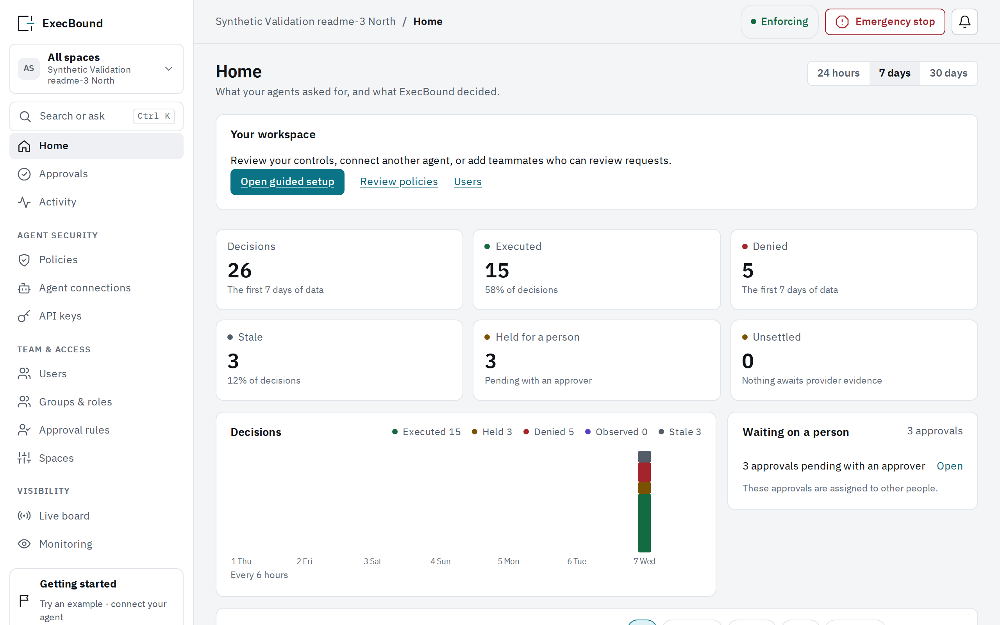

<p align="center">
  <picture>
    <source media="(prefers-color-scheme: dark)" srcset=".github/assets/execbound-mark-dark.svg">
    
  </picture>
</p>

<h1 align="center">ExecBound</h1>

<p align="center">
  <strong>Security for AI agents that act.</strong><br>
  The agent proposes. ExecBound decides.
</p>

<p align="center">
  <a href="https://github.com/ExecBound/execbound/releases/tag/v0.1.0"></a>
  <a href="docs/RELEASE.md#verify-an-image-before-you-run-it"></a>
  <a href="https://github.com/ExecBound/execbound/actions/workflows/ci.yml"></a>
  <a href="#license"></a>
</p>

<p align="center">
  <a href="https://docs.execbound.ai">Documentation</a> ·
  <a href="docs/INSTALL.md">Install</a> ·
  <a href="docs/THREAT_MODEL.md">Threat model</a> ·
  <a href="https://github.com/ExecBound/execbound/discussions">Discussions</a> ·
  <a href="SECURITY.md">Security</a>
</p>

**ExecBound is a deterministic policy layer that sits outside the model.** An AI agent proposes an action (isolate a host, disable an account), and ExecBound allows it, denies it, or holds it for a named approver. It decides from trusted inventory, Cedar policy and impact limits that are shared across agents.

**Status:** v0.1.0 is the first signed release. Out of the box it runs against two mock providers, and it is not production-ready. [What it protects against, and what it does not →](docs/THREAT_MODEL.md)

<!--
  DEMO GIF PLACEHOLDER: replace this comment with the recording once it is approved, or with the fallback terminal GIF:
  <p align="center"></p>
  Keep it under 2 MB and use synthetic names only.
-->

## Try it in five minutes

You need a Linux `x86-64` host with Docker and Compose. To check the signature you also need [cosign](https://docs.sigstore.dev/cosign/system_config/installation/). The image is built for `linux/amd64` only.

```sh
# 1. Verify the signed v0.1.0 image, then pull it by the digest you verified
IMAGE=ghcr.io/execbound/execbound@sha256:1954f9f5edbc25a15deb9f1518f8fdb26b8cdbb191d32be056b61db9ac1c3501
cosign verify "$IMAGE" \
  --certificate-identity https://github.com/ExecBound/execbound/.github/workflows/release.yml@refs/tags/v0.1.0 \
  --certificate-oidc-issuer https://token.actions.githubusercontent.com
docker pull "$IMAGE" && docker tag "$IMAGE" execbound:community

# 2. Install into an empty directory, start it, and govern two requests against the mock providers
mkdir execbound && docker run --rm -u "$(id -u):$(id -g)" -v "$PWD/execbound:/install" execbound:community execbound init /install
cd execbound && docker compose up -d
docker compose run --rm gateway execbound quickstart
```

The last command ends with:

```
  ws01.example     EXECUTED  INC-1001  execution 5f7c…
  ws02.example     DENIED    INC-1002  execution 9a41…
```

Both targets match the allow rule. `ws02.example` is refused anyway, because it has criticality 4 and a deny rule wins over a permit. [Why the second request was refused →](docs/INSTALL.md#why-the-second-request-was-refused)

Then open `http://127.0.0.1:8080/login?setup=1` and sign in with the contents of `state/admin.token`. **Activity** shows both decisions, and **Policies** shows the starter rules as sentences you can edit.

[Install on one host](docs/INSTALL.md) explains each command and how to do the same work one step at a time. The `fresh-machine` check in [CI](.github/workflows/ci.yml) runs these three install commands from an empty directory on every change. Read [Deployment](docs/DEPLOYMENT.md) before anything real depends on it.

<p align="center">
  <picture>
    <source media="(prefers-color-scheme: dark)" srcset=".github/assets/console-home-dark.png">
    
  </picture>
</p>

## Why it exists

AI agents now take actions with real consequences: they isolate a workstation, disable an account, revoke a session. Asking an agent in its prompt to be careful does not narrow what its credential can do. ExecBound sits between the agent and the systems it acts on, and decides outside the model whether each action may run.

The agent asks ExecBound over MCP or HTTP. ExecBound resolves the request to one canonical action and one target, using trusted inventory. It then applies deterministic Cedar policy and shared impact limits, asks a named person when a rule says to, and only then lets the action run. The agent holds an ExecBound credential. The provider credentials and the control stores stay inside the trusted service boundary.

- **Decisions outside the model.** Policy, trusted context and limits decide, not the agent's own account of itself. What the agent claims is recorded as a claim and never satisfies a required fact. An unknown action, a mismatched target or missing context fails closed.
- **A person when it matters.** A rule can hold a request for a named approver. An approval covers that exact request only, expires, and can be used once. An agent can't approve its own request.
- **Shared impact limits.** Limits count the targets affected across agents, runs and both protocols within the scope you configure. Reservations are atomic, so simultaneous requests cannot spend the same remaining capacity.
- **Credentials out of the agent's reach.** On the Execute path ExecBound holds the provider credential and dispatches the action itself.
- **A record you can replay.** Every decision is appended to the workspace's hash-chained audit log with its evidence. An exported history replays offline against a policy change without acting on anything.

## Where it fits

ExecBound has three placements:

- **Execute** holds the connector and dispatches a governed action.
- **Gate** issues a plan-bound grant to an external executor.
- **Monitor** receives activity without granting execution authority.

Every integration is labelled with what it actually enforces: **Native**, **Integrated**, **Advisory** or **Observed**.

- MCP and HTTP agents through the Python client and the official MCP SDK are Native (fixture-tested).
- The Tines and Arcade integrations are **Advisory** today: the caller asks and is trusted to honour the answer.
- Microsoft Defender for Endpoint can feed risk signals into decisions (Integrated, lab trial against a mock endpoint).
- `identity.disable` has a real Microsoft Graph binding. The other actions run on the mock providers.

[Integrations](docs/INTEGRATIONS.md) lists each path, its mode and the evidence behind it. [Scout](docs/SCOUT.md) says what directory evidence can establish.

## What it protects, and what it does not

Version 1 supports one canonical target per action, fixed provider operations, impact shared across runs and adapters, and fail-closed authorization. It does not have:

- generic HTTP passthrough;
- batch mutation;
- automatic resend of an uncertain operation;
- an approval flag the agent can supply.

Two limits apply:

- Gate and Monitor do not stop a caller that uses a separate credential outside ExecBound.
- Tenant row-level security does not contain an attacker who obtains arbitrary SQL access with the runtime credential.

The [threat model](docs/THREAT_MODEL.md) covers:

- who can act on ExecBound, and what each trust boundary must hold;
- the security invariants every path keeps;
- for each threat, its mitigation, the code that enforces it, the test that exercises it, and its status.

[Where credentials live](docs/CREDENTIALS.md) says where every credential is kept and who can read it. [Architecture](docs/ARCHITECTURE.md) describes the components and the trust boundaries between them.

## Tell us where it breaks

- **Try to route around it.** Critique of the trust boundaries is the most useful feedback we can get: open a thread in [Discussions](https://github.com/ExecBound/execbound/discussions).
- **Install problems or questions:** [Discussions → Q&A](https://github.com/ExecBound/execbound/discussions/categories/q-a).
- **Bugs and feature requests:** [issues](https://github.com/ExecBound/execbound/issues/new/choose).
- **Want to contribute?** Start with a [good first issue](https://github.com/ExecBound/execbound/labels/good%20first%20issue).
- **Found a vulnerability?** Report it privately, as [SECURITY.md](SECURITY.md) describes, never in public.

## Documentation

The documents under [docs](docs/) are also published at [docs.execbound.ai](https://docs.execbound.ai). Start with:

| Need | Read |
| --- | --- |
| Install, sign in, and understand the first two decisions | [Install on one host](docs/INSTALL.md) |
| Use the console: setup, agent connections, reviewers, policies and monitoring | [Use the console](docs/CONSOLE_GUIDE.md) |
| Connect an agent host and handle each answer | [Connect an agent host](docs/AGENT_HOSTS.md) |
| Write a policy | [Write a policy](docs/POLICY_GUIDE.md) |
| Run the image and its processes | [Deployment](docs/DEPLOYMENT.md), then [Deploy it in your cloud](docs/CLOUD_DEPLOYMENT.md) |
| Back up, restore and verify history | [Retention, backup and recovery](docs/RECOVERY.md) |
| Verify a release's image before you run it | [Releases](docs/RELEASE.md) |
| Call the HTTP and MCP interfaces, or use the CLI | [Interfaces in depth](docs/API_REFERENCE.md) |
| See what it does not protect against | [Threat model](docs/THREAT_MODEL.md) |

This repository is self-hosted Community: the gateway and its console, the Python client, the examples and the integrations, with the tests that prove them. ExecBound is also offered as a hosted service. [Community and hosting](docs/EDITIONS.md) sets out how the two differ.

## For contributors: run the demo from a clone

The demonstration does four things:

- seeds a synthetic deployment;
- starts the gateway and both mock providers;
- drives a browser through governed requests and approvals;
- writes a sanitized evidence report.

It needs Python 3.13, uv, Docker Compose with a working engine, and the Node and pnpm versions that [console/package.json](console/package.json) pins.

```sh
uv sync --locked
uv run playwright install chromium
corepack enable
cd console
pnpm install --frozen-lockfile
pnpm build
cd ..
uv run python scripts/local_setup.py
uv run alembic upgrade head
uv run execbound seed-validation --seed demo-1 --output local-data/demo-1
uv run python scripts/validation_demo.py run --private local-data/demo-1 --output local-data/demo-1-evidence
```

Notes on running it:

- On Linux, install Chromium with `uv run playwright install --with-deps chromium`.
- `local_setup.py` starts PostgreSQL in Docker Compose on a loopback port. It writes the git-ignored `.env` that holds the database credentials.
- Use a new seed and new output directories for every run.
- Run the demonstration straight after seeding: the fixture's trusted context expires after 300 seconds.
- The evidence directory holds sanitized reports and screenshots. Credentials and provider stores stay in the private fixture directory.

To look around yourself, seed a fresh directory and run `serve` instead of `run`. While it runs, open `http://127.0.0.1:8100/login`. The [integration examples](examples/README.md) call that running demonstration over HTTP and MCP.

## Support

Community is supported by the community, with no guarantee:

- Ask questions in [Discussions](https://github.com/ExecBound/execbound/discussions), and report bugs in issues.
- Report a vulnerability privately, as [SECURITY.md](SECURITY.md) describes, and never in a public issue.
- Security fixes are made in the latest release only.

## Contributing

Pull requests are welcome. [CONTRIBUTING.md](CONTRIBUTING.md) explains:

- how a change is reviewed and reaches this repository;
- what it must pass;
- the sign-off every commit carries.

Everyone taking part follows the [code of conduct](CODE_OF_CONDUCT.md).

## License

Licensing: see [docs/EDITIONS.md](docs/EDITIONS.md) and the LICENSE files for the full terms.

The ExecBound server and console are licensed under AGPL-3.0-only ([LICENSE](LICENSE)). These parts are Apache-2.0:

- the [Python client](clients/python/);
- the [provider protocol](protocol/);
- the [connectors](connectors/);
- the [examples](examples/);
- the [integrations](integrations/);
- the [deployment files](deploy/);
- the server's install bundle, starter policy packs and MCP recipes.

The documentation in [docs](docs/) is CC BY 4.0, and the console's fonts are OFL-1.1. Each directory has its own license file, and each source file has an `SPDX-License-Identifier` line naming its license.

"ExecBound" and its mark are trademarks of ExecBound LLC; [TRADEMARK.md](TRADEMARK.md) says how you may use them. Contributions are made under the [contributor agreement](CONTRIBUTOR_AGREEMENT.md).
