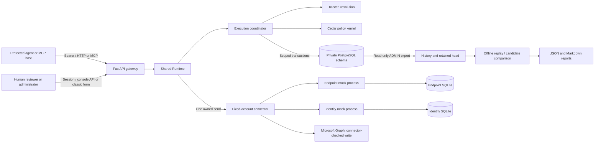
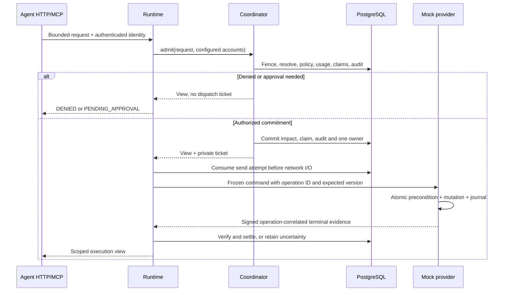
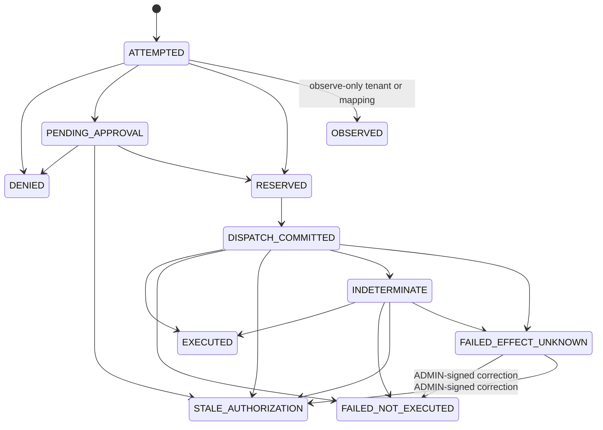

# Architecture

ExecBound is a Python modular application composed into a FastAPI gateway serving a React console, with separately running mock providers, a Microsoft Graph connector and an offline replay CLI. PostgreSQL holds gateway authority, execution state and audit history; each mock provider owns an independent SQLite store. Explicit workers handle monitoring, notifications and recovery. Consequential dispatch remains owned by the shared runtime, and Cedar evaluates locally rather than through an external policy service.

## External monitoring

External monitoring lets customers keep connectors and credentials in their own platform. Tines is implemented; Foundry remains a planned adapter. External monitoring is a separate observation domain with source identity, activity, coverage, detections and alert delivery. The [monitoring implementation](TINES_MONITORING.md) includes story-scoped intake, atomic pending evaluation/findings/outbox, source lifecycle and health, read-only collection, console views and delivery workers. A bounded live Tines intake trial is recorded; audit-log collection remains unqualified without the required account edition. Deployment-specific delivery and collection evidence must be checked separately. Tines is the first integration; [Integrations](INTEGRATIONS.md) records the other candidates researched so far.

Monitor mode observes external execution with explicit coverage gaps. Gate is the implemented [external execution checkpoint](CHECKPOINT.md): an owner-provisioned mapping marks an operation externally executed, and the kernel resolves, decides, reserves the same impact and takes the same canonical target claim, then stops before the connector and answers with a grant describing the one act the caller may perform at its own vendor. Execute retains the protected path described below. The [Arcade logic extension](ARCADE.md) is the second carrier of that Gate placement and the first that is a **platform** rather than a workflow: it answers a control point's Pre- and Post-Execution hooks synchronously, inside the platform's own timeout, with a request shape ExecBound did not design and a response of three enumerated codes. Because that response has nowhere to put a grant, ExecBound holds the correlation instead of the caller. These placements can coexist per workflow and action; a mapping may be `observe_only` or `external_executor` and never both, and a tenant-wide `OBSERVE` mode wins over either. Imported tool results cannot approve an action, consume an execution ticket, settle provider effects or refund enforced impact, and an external executor's report can settle only an execution whose own frozen mapping declared it externally executed. Platform API access can remain in a customer-operated collector; downstream vendor credentials stay with the customer's connectors.

## Components

`app.py` composes health, identity and optional runtime/human surfaces. `runtime.py` is the common agent entry point. `execution/` owns admission and durable state; `resolution/` freezes trusted evidence; `policy/` evaluates immutable bundles; `provider/` is the server's half of the provider path: dispatch and reconciliation (`gateway.py`), the verifiers it settles with (`verifiers.py`, built from the configuration the runtime validated), the executor keys and checkpoint evidence. The provider protocol and the connectors are two Apache-2.0 packages beside the server: `protocol/` (`execbound-protocol`: the action catalog, the frozen `ProviderCommand`, journals, connector records, executor outcomes, the `Connector` interface and the security signal envelope) and `connectors/` (`execbound-connectors`: the mock connector, the Microsoft Graph connector and the mock vendor servers). The dependency runs one way: the server imports both, the connectors import the protocol, and neither imports the server (`tests/test_connector_packages.py`). The server's old module paths re-export what moved, so installed deployments and retained configuration keep working. `surfaces/` adapts protocols and human sessions. `replay/` works from files.

## Trust boundaries

Personal sign-in now authenticates an account independently of any workspace. A membership
maps that account to an existing tenant principal; permissions, Spaces, reviewer assignments
and execution audit remain tenant-scoped. `user_accounts.py` owns account lookup and workspace
entry, while `account_links.py` owns explicit personal-provider linking. Customer directory
and setup/bearer sessions retain their tenant boundary and cannot open unrelated workspaces.

Account and workspace sessions are separate opaque grants. Selecting a workspace verifies
current membership and destination requirements, recomputes authority and rotates the workspace
session and CSRF proof. The console pins its displayed session generation, clears cached data
and closes streams on a switch; stale requests cannot borrow the newly selected workspace's
cookies. Account changes lock the account before all affected tenant fences in sorted order.
Tenant-only mutations recheck current authority within their fence without acquiring an account
lock afterwards. See [account storage](DATA_MODEL.md#accounts-and-workspace-memberships) and
[human entry](SURFACES.md#accounts-and-workspace-selection) for migration and browser details.

The table below names the boundaries an action crosses. The [threat model](THREAT_MODEL.md#trust-boundaries) lists all thirteen, including the security signal producers, monitoring sources, a console's model provider and the public export, each with its threats and evidence.

| Boundary | Authority and limits |
| --- | --- |
| Protected agent → gateway | The agent may propose a bounded action and target using its own credential. Raw text, claims, selectors, run IDs and retry keys are untrusted until checked. |
| Gateway → PostgreSQL | Trusted code sets transaction-local tenant context. Composite keys, forced RLS and restricted grants reinforce scoping. The runtime credential can act across tenants by changing that context; arbitrary SQL access with it is outside the isolation guarantee. |
| Provisioner / administrator → registry | Owner commands provision mappings, inventory, sources and canonical identity. Human administration and context import use explicit store functions with authority checks; selected writes use restricted SECURITY DEFINER functions rather than direct runtime grants. See [Surfaces](SURFACES.md) for the current entry points. |
| Human / agent → Space | Agent space comes from its principal; human visibility comes from current memberships. A session selects a view but grants no membership. Tenant RLS remains the database boundary; space filtering is enforced by store predicates, not another RLS boundary. |
| Gateway → provider | Only a fixed configured account and frozen command can dispatch. Provider secrets, control credentials, evidence keys and stores must be inaccessible to the protected agent. A connector receives the frozen `ProviderCommand` and nothing else of the dispatch, carries no verifier, and its evidence settles only through the verifier the runtime builds from the configuration it validated and rotates; see threat T3.13. |
| Gate caller → gateway | A caller whose bundle mapping is externally executed holds its own vendor credential and is therefore a different trust class from a protected agent, which holds none. Its grant confers no authority to execute, approve, dispatch or reconcile through ExecBound: its only power is to settle the one execution it names, once, at the tier the evidence supports. ExecBound sends nothing and observes nothing at the vendor, so the last mile is cooperative. **Keeping the two classes apart is owner provisioning and not a control**: nothing refuses a principal that serves Gate mappings and ordinary ones, so a stolen Gate credential also dispatches through ExecBound wherever provisioning allowed both. See [External execution checkpoint](CHECKPOINT.md) and residual risk R16. |
| Control point → hook surface | A platform that calls on every tool invocation, authenticating with an ExecBound agent credential held in its own configuration. It supplies no fact that decides anything: the operation, the target, the incident claim and the arguments come from the operator's tool map and the named inputs, reported metadata may only refuse, and `context.user_id` is attribution rather than identity or budget scope. It is the first thing in the system that holds a **usable** report secret at rest, on its correlation row, so a reader of that table can close a row and let the scheduled run free its target — and can never reduce what the tenant is charged. See [Arcade logic extension](ARCADE.md) and residual risk R17. |
| Human → gateway | A current session, exact origin, CSRF token, signed state, assigned scope and current role are checked. An ADMIN is not automatically an assigned approver. |
| Gateway → replay files | Export requires current tenant ADMIN authority. Offline replay verifies files against a retained head and has no live execution capability. Its process capability tests are not an independently administered OS sandbox. |

Mock provider HMACs establish authenticity between trusted components sharing a key, not third-party nonrepudiation. The Graph connector signs ExecBound's own account of its read/check/write exchange, not a receipt issued by Microsoft; its precondition is connector-checked, not atomic at the vendor. The audit chain detects tampering relative to a retained trusted head; replacement of both history and head by a privileged writer remains outside that guarantee. Offline replay retains gateway-recorded provider provenance without importing signing keys.

## Resolution and policy

1. Verify the opaque bearer credential against its digest, expiry, revocation, active principal and active tenant. Refresh current authority at sensitive boundaries.
2. Parse the original bounded JSON strictly. Resolve the tenant's `operation_ref` to an exact account/provider/action/schema/context contract. The mapping must name a provider binding in the [action catalog](ACTION_CATALOG.md), which also supplies the action's argument spec; the request's arguments are normalized against it, before any fact is read.
3. Resolve a canonical selector or unique valid alias to an account resource, then map it to a shared canonical target. A hostname is supported only for endpoints; identity actions accept canonical or provider IDs.
4. Look up the mapping's versioned context contract in the catalog (`src/execbound/contracts.py`). Load the target's inventory facts from their contract storage (existing columns or `resource_facts` rows) and, when the contract requires an incident, the claimed incident as an untrusted selector. Apply the active bundle's context settings for writer allowlists and max age, check each value against its domain, and compute derivations. Caller claims never substitute for trusted facts. See [Context contracts](CONTEXT_CONTRACTS.md).
5. Freeze mapping and resource versions, source facts, provenance, incident relationship, derived facts and expiry. Reattestation cannot extend an already frozen authorization window.
6. Evaluate the active immutable bundle's authorization policies, approval policies and typed limits. The frozen arguments are rechecked against the action spec and reach Cedar as `context.arguments` for actions that declare arguments; they never become resource attributes. Any hard denial, error or missing required evidence denies. Approval obligations are considered only after denials are absent.

Endpoint context includes inventory role/environment/criticality and an open critical incident. Identity context adds `standard`, `privileged` or `tier0` privilege evidence. Demo policies forbid domain controllers and criticality-4 endpoints, and privileged/tier-0 identities. Production actions require review; every identity enable requires review. These are synthetic rules, not universal organization policy. [Policy](POLICY.md) and [Identity provider](IDENTITY_PROVIDER.md) define the details.

## One action through the system

This sequence shows Execute with an atomic mock provider. A Graph binding instead checks immediately before its write and retains the measured gap; Gate follows the separate grant/report path described below.

The frozen command carries the action's normalized arguments, and the provider's signed journal binds the complete command, so evidence for an argument-bearing action commits to the option it executed.

Approval submission records a decision; it does not send the provider command. The agent retries its original request. Admission rechecks identity, assignment, plan/bundle, freshness and capacity, then consumes the approval with the execution commitment. A GET/status call only reads state.

## State and recovery

This diagram is the permitted transition catalog in `execution/models.py`; it does not imply a separate transaction or public response for each intermediate state. Admission can commit several transitions atomically. Approval has its own `PENDING`, `APPROVED`, `DENIED`, `EXPIRED`, `INVALIDATED`, `CONSUMED` lifecycle.

Only one internal owner receives a ticket, and consuming it records the send attempt before network I/O. Tickets have no replacement lease. A crash or lost response can leave `DISPATCH_COMMITTED` or `INDETERMINATE`. Neither state permits automatic retransmission or impact refund.

An externally executed operation runs the same states with no new one. Admission returns no ticket: the grant itself consumes the single attempt, and the row reaches `DISPATCH_COMMITTED` with the same reservation and claim. A report settles it at an evidence tier, an unreported grant is swept to `INDETERMINATE` past its report window with nothing refunded or released, and the claim a settlement on the executor's bare word leaves held is released later by the scheduled recovery run. The state machine gained one settled state and the edges around it: `FAILED_EFFECT_UNKNOWN`, reached from `DISPATCH_COMMITTED` or `INDETERMINATE`, is where an unverifiable statement that a call failed settles, which confirms the impact and refunds nothing, and its one correction carries an ADMIN-signed non-execution to `FAILED_NOT_EXECUTED` or `STALE_AUTHORIZATION`, whichever that evidence names. Both targets of that edge have no outgoing edges, and the only edge into `DISPATCH_COMMITTED` is still the one from `RESERVED`, so no execution is re-granted or re-dispatched. [External execution checkpoint](CHECKPOINT.md) states what each report settles and what no route can do.

An ADMIN reconciles using the exact provider journal. A missing journal alone is inconclusive because a delayed command may arrive. An authenticated atomic cancellation tombstone can prove non-execution and fence that delayed command. Terminal executed evidence confirms impact; terminal no-effect evidence releases reserved impact. Current contained/enabled state, an inverse operation, or a free-text assertion cannot settle the original operation. See [Operations](OPERATIONS.md#recover-an-uncertain-execution).

## Concurrency and impact

All execution writers and policy activation share a per-tenant control fence. Lock order proceeds from that fence to the audit head and execution/approval/impact/claim writes. A coherent authority snapshot is read after waits; network I/O occurs outside SQL transactions. Registry writers are not all excluded until commit, so this is a bounded authority snapshot plus whatever precondition the binding's declared class supports: the provider's atomic expected-version check where the vendor offers a conditional write, and otherwise the connector's own read and comparison immediately before the write, which leaves a measured window this snapshot does not close. See [Execution](EXECUTION.md) before changing transaction boundaries.

One unresolved canonical target claim blocks competing operations even through a different account representation. Retained impact is counted by action and configured principal/tenant scope across adapters, keys and runs. Confirmed impact counts within `(now - window, now]`; unresolved impact does not age out. Approved actions count toward total ceilings and contribute zero autonomous units. Changing policy or later reversing an action never erases earlier impact.

## Audit and replay

Audit appends advance one tenant sequence/hash head atomically with the state change they describe. Immutable events and frozen content support verification; mutable projections serve current queries. ADMIN export reads a coherent read-only snapshot and publishes a complete history prefix, referenced bundles and companion checkpoint exclusively to new files.

Replay first verifies the full prefix and bindings, then reconstructs independent baseline and candidate ledgers chronologically. New hypothetical actions, unknown human approvals, missing historical facts and downstream possible impact remain `UNRESOLVED`. The report can establish a denial despite uncertainty when that denial is independently sufficient. No replay result becomes live authority. See [Replay](REPLAY.md).

## Terms used in code and reviews

| Term | Meaning |
| --- | --- |
| Principal / credential | A tenant actor and one expiring/revocable means of authenticating it |
| Account resource | Inventory representation within tenant, connector account, provider and resource type |
| Canonical target | Shared identity used to guard one physical/logical target across account representations |
| Wire hash | Normalized action/selector/arguments retry fingerprint excluding key, run and claims |
| Intent hash | Resolved semantic intent binding authenticated actor, action, account and target |
| Plan hash | Frozen authorization plan including context and configuration bindings |
| Idempotency key | Principal-scoped retry identifier; it does not reset budgets or change intent |
| Operation ID | Durable identifier correlated to exactly one provider command and terminal journal |
| Bundle | Immutable Cedar schema/policies, mapping references and typed limit configuration |
| Dispatch ticket | Secret internal ownership capability; never a returned API field |
| Continuation | Signed, expiring status/form metadata; never an approval or dispatch ticket |
| Impact | Retained unresolved or confirmed action contribution used to evaluate limits |
| Checkpoint grant | The answer to an externally executed operation: what the caller may do once at its own vendor, returned with a report secret minted once. Neither an execution nor an approval |
| Act grant | The short-lived continuation minted per answer beside a grant, at the `execution.checkpoint_outcome` audience; nothing in ExecBound verifies it today |
| Report secret | The one value that settles a grant, returned once and retained only as a digest, in the same column a dispatch ticket's digest uses |
| Settlement tier | What ExecBound could check about an external executor's report: `ATTESTED` (signature verified against a registered key) or `ASSERTED` (its authenticated word alone). Null for everything ExecBound dispatched |
