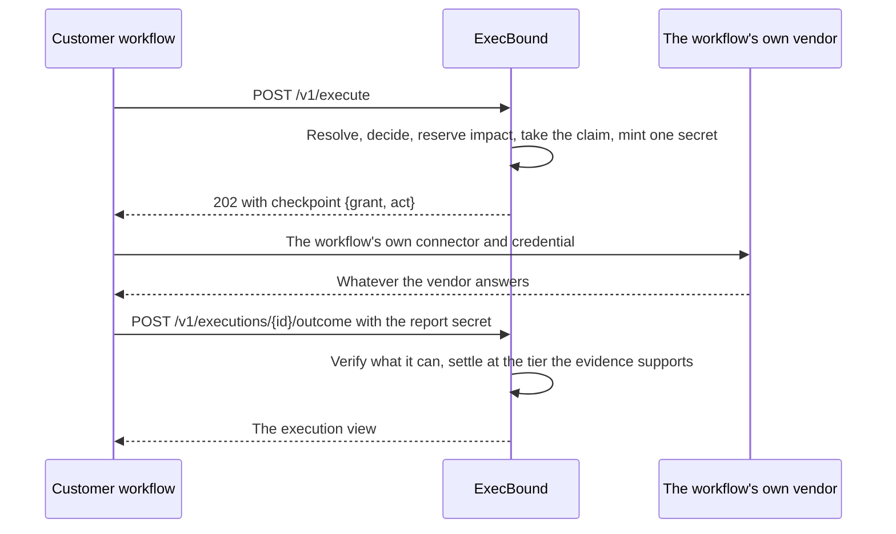

# External execution checkpoint

A checkpoint lets a customer's own workflow ask for a plan-bound decision before that workflow executes, and keeps its vendor connector and its vendor credential where they are. The same kernel resolves, decides, reserves impact and takes the canonical target claim as it does for an action ExecBound dispatches; it then stops before the connector and describes the one act the caller may perform. Acceptance cases GC1 to GC18 are in the [acceptance inventory](ACCEPTANCE_TESTS.md#external-execution-checkpoint).

[Build an external executor](EXECUTOR_GUIDE.md) is the same contract as steps to follow, and chapter 2 of [the executor protocol](protocol/EXECUTOR_PROTOCOL.md#2-the-checkpoint-report-version-1) is its normative text: the grant, the windows, the precondition classes, the report and the signed evidence, field by field. This page keeps the narrative, the reasons and every limit. **A checkpoint is an enforced budget and an enforced approval over a cooperative execution. It is never prevention.** ExecBound sends nothing, sees nothing at the vendor, and cannot stop an executor that never asks, ignores a denial, acts twice or reports falsely. What it holds and what it does not is [§5](#what-is-enforced-and-what-is-cooperative), stated row by row.

## Placement: what makes an operation externally executed

`MappingRef.external_executor` is owner-provisioned bundle content, serialized only when set, so every existing bundle's content hash, `security_versions` and frozen plans are byte-identical. No request field, header, credential attribute or client capability moves an operation into or out of Gate; `precondition_class`, `expected_version` and `external_executor` are all refused on the wire as unknown fields.

Bundle validation refuses the flag beside `observe_only` (the model refuses the pair at construction, and `policy/store.py` refuses it again), refuses a mapping whose provider, action and provider operation are not a released binding of the [action catalog](ACTION_CATALOG.md), and refuses it in a tenant with no unrevoked executor key, since without one an unreported grant would have no exit.

Those checks run at validation and at activation. **Admission does not re-run them**: it reads the active bundle through the execution store, which does not revalidate components, so the key requirement is carried afterwards by two other guards. `executor-key-revoke` refuses to retire a tenant's last live key while its active bundle declares an external executor — an availability guard, so an operator does not take a deployment offline by accident. `_keep_attestable` is its only caller: `executor-key-rotate` is never in that position, because it inserts its replacement in the same transaction, so a live key always remains and no guard is needed. `executor-key-compromise` deliberately bypasses that one, because refusing to cut off a stolen key on the grounds that it is the last one would be a refusal to perform the security action; what makes the resulting state safe is the admission refusal below, which asks the same composition boundary that loads the ring whether a grant issued now could be attested at all.

**A Gate caller and a protected agent are different trust classes, and nothing in the code keeps them apart.** A caller whose mapping is externally executed holds its own vendor credential; a protected agent holds none. A principal should serve Gate mappings or Execute mappings and not both, and that is an owner-provisioning rule with nothing behind it: admission refuses a Gate mapping whose account already has a connector, which keeps one *operation* from being both and says nothing about a principal holding one mapping of each kind. Measured rather than assumed — every reader of `external_executor` in `policy/`, `execution/` and `administration.py` decides per mapping, and none asks anything about the principal. So where provisioning gave one principal a Gate mapping and an ordinary mapping, a stolen Gate credential also dispatches through ExecBound. This is the one **Open** row of the new trust boundary ([threat model](THREAT_MODEL.md) T9.12, residual risk R16), and separate principals are the only control today.

A tenant-wide `OBSERVE` mode is not bundle content and still wins: a checkpoint request in an observing tenant takes the existing observe branch, answers `OBSERVED`, and reserves nothing, claims nothing and grants nothing.

Three conditions are checked at admission and all fail closed; the first two are what a Gate mapping adds, and the third is the ordinary path beside them:

| Condition | Answer |
| --- | --- |
| A Gate mapping whose account is in the runtime's connector inventory | `INVALID_BUNDLE` (409), before the execution row is inserted — the deployment contradicts its own bundle, and the connector paths would treat the grant as a lost dispatch |
| The tenant's executor key ring cannot attest a grant issued now (empty, or holding a row the ring loader refuses) | `INVALID_BUNDLE` (409), after the decision and before anything is reserved, so a denial is still recorded as `DENIED` and a refusal leaves no execution, reservation or claim |
| An ordinary operation whose account has no configured connector | `CONNECTOR_UNAVAILABLE` (503), unchanged |

## The exchange



An eligible checkpoint commits the impact reservation, the canonical target claim, the approval consumption when there was one, and the `DISPATCH_COMMITTED` state in the one fenced transaction admission already uses. It stamps `dispatch_attempted_at` — the single attempt is consumed by the grant itself, and `take_dispatch` refuses both a stamped row and any row carrying a report window. Admission returns no dispatch ticket, so the runtime cannot fall into the dispatch branch, and the runtime's checkpoint branch never indexes the connector table.

The secret is minted **last**, after the closing identity check, the re-attestation and the approval recheck, so nothing is told it may act unless the authority that decided it still holds. Its digest goes into the same `executions.owner_hash` column a dispatch ticket's does, and the secret itself is returned and never stored.

### The checkpoint object

The response body gains one key, `checkpoint`, whose value is exactly `{"grant": …, "act": …}`. The two halves are different things: **`grant` is what admission committed and retained**, and **`act` is a token the presenter mints for this one answer** and re-mints on every later one. Nesting them keeps a presenter-chosen key out of the model's own namespace.

| `grant` field | Meaning |
| --- | --- |
| `operation_id` | The durable operation this grant names; the only execution it can settle |
| `provider`, `provider_operation` | The binding the plan froze; the same tuple the precondition class is keyed by |
| `resource_provider_id` | The target as the vendor names it |
| `action`, `arguments` | The catalog action and its normalized arguments |
| `precondition_class` | `ENFORCED_BY_PROVIDER`, `ASSERTED_BY_EXECUTOR` or `UNAVAILABLE` ([§4](#preconditions)) |
| `expected_version` | The version the plan froze, present exactly when the class is not `UNAVAILABLE` |
| `act_expires_at`, `report_expires_at` | The two deadlines below |
| `regranted` | False on the first answer, true on every later one |
| `report_secret` | Returned once, on the first answer only; `null` on a re-grant |
| `binding` | `{operation_id, account_id, intent_hash, plan_hash}`, the four fields an executor's own record binds; always present. None of it is secret and none of it confers authority; only the report secret settles a grant, so a re-grant carries the same binding |
| `provider_command` | The `ProviderCommand` ExecBound would have sent had it dispatched, built by the same function and with the same serialization and command hash as a dispatch's; present exactly when `expected_version` is |

A provider that speaks ExecBound's own provider protocol, such as the protected mock, accepts `provider_command` verbatim; an executor for a real vendor reads the target, action, arguments and version out of it. It is exactly what ExecBound would have sent had it dispatched, never an approximation of it, and it is added to the wire answer by the runtime's presenter rather than carried on the grant model itself, because `execution` cannot import the provider protocol. Under `UNAVAILABLE` no version exists, so no provider command exists either, and the `binding` alone is what an executor needs to sign a record.

`act` is a continuation of the new `execution.checkpoint_outcome` audience, signed with the existing continuation keys, binding tenant, principal, credential, execution, operation, plan hash, expiry and a nonce. The `operation_id` member is required on this audience and refused on the status, approval and reconcile audiences, so it cannot be attached to another token to make it look like authority over an operation. The key is always present and is `null` when the deployment holds no continuation keys or the act window has already closed — the reservation and the claim are committed either way, and a caller must be told what it is holding.

**Nothing in ExecBound verifies an act grant today.** The outcome route does not accept it, and no other route uses that audience; it is a signed statement the executor holds. A report is authenticated by the report secret and by the caller's own credential, and by nothing else.

A status read never carries a checkpoint object: only the admission that issued a grant describes one.

### Two windows, deliberately separate

| Window | Length | Authenticated by | What it bounds |
| --- | --- | --- | --- |
| Act | `min(grant clock + 15 minutes, the frozen plan's validity, the credential's expiry)` | The act grant (which nothing checks) | When the executor may act |
| Report | `min(the attempt + 24 hours, the credential's expiry)`, on the execution row | The report secret | When ExecBound still accepts a report |

The report window is longer because an executor whose vendor call is queued or retried must still be able to report after the act window closes. Raising the continuation ceiling instead would weaken the status, approval and reconcile audiences together, so it is not raised.

`executions.report_expires_at` is written once, in the row insert, for a Gate mapping in a tenant that is enforcing. That is *before* the decision, so a `DENIED` or `STALE_AUTHORIZATION` row carries an unused window too: **the column marks "this execution would be a checkpoint", never "a grant is live"**, and every reader pairs it with a state. Nothing the runtime holds can update it.

### Retries, and the one mint

An idempotent retry of the same request, while the execution is still `DISPATCH_COMMITTED` and the plan still valid, returns the same grant with `regranted: true`, a freshly signed act, and **no secret at all**. It is described under the precondition class the grant was issued under, which the first answer records on the execution, and not under whatever the deployment declares at the retry, so a redeployment never hands a retry a version or a `provider_command` the grant was not issued with; a grant an ExecBound version issued before the class was recorded is described under the declaration in force, as every retry was. Nothing is reserved, claimed or charged again and neither deadline moves. Only the same principal reaches it. A retry answered for a settled, uncertain, denied or swept execution carries no grant.

The secret is minted exactly once per execution. A caller that lost its first response holds nothing and has no re-mint: the administrator exit of [§7](#uncertainty-the-sweep-and-the-administrator-exit) is its remedy, deliberately.

Outstanding grants are capped at **eight per principal**, counted inside the fence as unsettled executions carrying a report window. A ninth is `TOO_MANY_GRANTS` and the whole attempt rolls back, leaving no execution, no reservation and no claim. The code is not in the status map, so it answers 503; it is checked after the approval branch, so a capped principal can still open a pending approval, which reserves nothing.

### The hook carrier, where the grant does not travel

A second carrier reuses this placement without using this exchange: the [Arcade logic extension](ARCADE.md), which answers a platform's Pre- and Post-Execution hooks. It is worth reading here because it is where the settlement vocabulary above came from, and because it is the shape a future integration is likeliest to meet.

The placement is reused verbatim — `external_executor` on an owner-provisioned mapping, the connector-free account, the key requirement at validation and at admission, the reservation and the canonical claim in one fenced transaction, `DISPATCH_COMMITTED` with no dispatch ticket, the report window, the sweep, the administrator exit and the two tiers. **The exchange does not fit, and no implementation choice routes around it.** The hook response carries an enumerated code, a message string and an override this deployment never sets: there is nowhere in it to put a grant. So the checkpoint object cannot reach the caller, and the party that returns later is the platform on the same channel, with a body ExecBound did not shape and no signature in it.

Two consequences follow, and both belong on this page rather than only on that one:

- **ExecBound holds the correlation instead of the caller.** The grant is still minted, exactly as above; the extension reads the report secret out of the checkpoint object and retains it on its own correlation row for the life of the grant, and discards the act continuation. That makes this the first thing in the system that holds a **usable** report secret at rest — a Gate caller's secret is returned and never stored, and only its SHA-256 digest is kept in `owner_hash`. A reader of that correlation table can therefore close such a row and, once the act window has passed, cause the scheduled run to free its target. What no reader of it can do is reduce what the tenant is charged: both statements the carrier can make confirm the impact.
- **`ATTESTED` is structurally unreachable from the platform, and reachable on the row.** No hook body carries a signature, and mTLS authenticates a channel rather than a statement, so nothing the platform sends can ever be attested. The same execution settled by the administrator exit settles at `ATTESTED` against the tenant's own registered key, and Arcade-carried grants will routinely end that way.

The one-line answer the extension gives is worth keeping: **not the Gate protocol; the Gate placement, carried by ExecBound's own correlation instead of by a grant, because the hook response has no room for one.**

## Reporting the outcome

```http
POST /v1/executions/{execution_id}/outcome
Authorization: Bearer <the same agent credential that asked>
Content-Type: application/json
```

| Body field | Contract |
| --- | --- |
| `report_secret` | Required; the secret the first grant returned. Compared in constant time against the SHA-256 digest the row retains, never against the secret |
| `outcome` | `EXECUTED`, `FAILED_NOT_EXECUTED`, `FAILED_EFFECT_UNKNOWN` or `UNKNOWN` |
| `reason` | `EXECUTED`, `VERSION_MISMATCH`, `CANCELLED_NOT_EXECUTED`, `TARGET_NOT_FOUND` or `REPORTED_FAILURE`, naming the one outcome that may accompany it; absent for `UNKNOWN` |
| `reported_at` | The executor's own clock, carried exactly when none of `record`, `attestation` or `journal` is. It is retained as a reported time and never becomes a confirmation time, which the gateway clock stamps |
| `record` | The executor's Ed25519-signed `SignedOutcome` envelope, and no other: an ES256 statement is sent as `attestation`, and in `record` it is refused, the flattened form a settlement stores it in included |
| `attestation` | A compact ES256 JWS, the form Tines' `JWT_SIGN` produces (see [Executor keys](#executor-keys)) |
| `journal` | The provider's `SignedJournal` for this exact command, verified under a journal key the operator configured for the grant's account (see [What each report settles](#what-each-report-settles)). Refused under a grant issued `UNAVAILABLE`, which carries no `provider_command` for a journal to be of |

A report carries exactly one of `reported_at`, `record`, `attestation` and `journal`. Unknown fields are refused, so an act grant cannot be added to a report as a second authenticator. `UNKNOWN` carries none of the last three and no reason, because nothing signed can express an unknown result: every signed envelope binds a terminal outcome and no terminal reason names one.

The `reported_at` a `record` or an `attestation` signs is compared with the grant instant at one-second precision, because some executors (Tines among them) can sign only whole seconds: it may fall anywhere in the second the grant was issued in but no earlier, so the executor's clock must not trail the gateway's.

**Outcome and reason are paired by a table, not by agreement.** `TERMINAL_PAIRS` maps each of the five reasons to the one outcome that may accompany it, and any other spelling is `INVALID_REQUEST` at the parser, before an execution row is read or a secret is compared. `REPORTED_FAILURE` maps to `FAILED_EFFECT_UNKNOWN` and to nothing else, which is what keeps the reason that names a *statement* away from an outcome that refunds. Two of the five members are outside the **verified** vocabulary: `TerminalEvidence`, `ExecutorRecord` and `JournalRecord` admit neither `FAILED_EFFECT_UNKNOWN` nor `REPORTED_FAILURE`, so no verifier can return that pairing and no signed envelope can carry it. A report presenting a `record` beside `REPORTED_FAILURE` is therefore refused at the parser too, by the clause that lets a signed record state only what a verifier could return.

`FAILED_EFFECT_UNKNOWN` says the executor's call did not succeed and that whether the vendor acted is not established. It is deliberately not `FAILED_NOT_EXECUTED`, which claims the vendor was never reached: a tool that received a 500 may well have mutated the target first, so the unverifiable half is named in the state rather than assumed away.

The route re-reads the **frozen** bundle and refuses any execution whose mapping does not declare an external executor, before the secret is compared, so an operation ExecBound dispatched is unreportable whether or not its owner secret matches. Every refusal that reads the execution row is made twice, once before the record is verified and once inside the fence, and the fenced read is the one that decides. It reads the bundle the grant was frozen under and not the active one: an issued grant cannot be recalled by a bundle edit, which is the same rule the emergency stop follows.

| Refusal | Code | Status |
| --- | --- | --- |
| Malformed body, or a record that is not an Ed25519 `SignedOutcome` (an attestation in its stored form among them), will not verify or contradicts the body it accompanies, or a journal under a grant issued `UNAVAILABLE` | `INVALID_REQUEST`, `INVALID_RECORD` | 400 |
| The secret does not match, or the row carries no digest | `INVALID_REPORT` | 403 |
| Another principal's or another tenant's execution | `NOT_FOUND` | 404 |
| The mapping declares no external executor; or a settled row is sent anything but a restatement of its own settlement | `INVALID_STATE` | 409 |
| The report window has closed | `REPORT_WINDOW_CLOSED` | 409 |
| The tenant's key ring will not load | `INVALID_KEY_RING` | 409 |

A record is verified once outside every transaction, so a caller presenting one that does not verify cannot make a tenant's writers wait for a signature check, and once again inside the fence, which is the read the settlement rests on — a key reported compromised while a record was being verified would otherwise settle the grant on a stolen key's word.

## The workflow contract

This is every branch a calling story has to handle, with the shape ExecBound answers each one with. It is not prose written beside the code: it is the contract asserted in `tests/test_checkpoint_workflow.py`, which drives one story over the real HTTP surface with the protected mocks acting as its vendor and asserts the whole dictionary at the end, so a change to any shape a story branches on fails there rather than in a customer's story.

Five key sets appear below. A **view** is `approval_id`, `approval_state`, `execution_id`, `plan_hash`, `request_ref`, `state`. A **grant** is that plus `checkpoint`. A **pending approval** is that plus `approval_url` and `continuation`. A **denial** is a view plus `denial`, its category, and `notice`, one fixed sentence naming the category and the request's reference and never the reason ([Denials](API_REFERENCE.md#denials)). A **refusal** is `code` and `detail`, and nothing else.

| Branch | Status | Body | State or code | What the story must do |
| --- | --- | --- | --- | --- |
| Grant | 202 | Grant; `checkpoint` is exactly `{grant, act}` | `DISPATCH_COMMITTED` | Act once at its own vendor, then report. The budget is already charged and the target already claimed |
| Report accepted | 200 | View | `EXECUTED` | Nothing further; the grant is spent |
| Approval wait | 202 | Pending approval, **no `checkpoint`** | `PENDING_APPROVAL` | Wait for the human decision at `approval_url` and retry the same request; no grant exists yet |
| Retry after approval | 202 | Grant | `DISPATCH_COMMITTED` | The same execution, now granted, with its own secret and a fresh act |
| Report with the wrong secret | 403 | Refusal | `INVALID_REPORT` | Nothing settled. The grant is untouched and still reportable with the right secret |
| Report whose record will not verify | 400 | Refusal | `INVALID_RECORD` | Nothing settled, no tier written. Re-sign and report again |
| Report retried correctly | 200 | View | `EXECUTED` | The remedy for both refusals above is the same report, sent properly |
| Denial | 200 | Denial, **no `checkpoint`** | `DENIED` | Stop. There is nothing to act on and nothing to report, and the vendor is never called; a person finds the reason by searching the console for its `request_ref` |
| Grant that goes unreported | 202 | Grant | `DISPATCH_COMMITTED` | Nothing different at the time: the dictionary holds this walk's grant under its own key (`expiry-grant`) with the same shape as the first, so the branch a story abandons is pinned too |
| Report after the window closed | 409 | Refusal | `REPORT_WINDOW_CLOSED` | Stop retrying. The administrator exit is the only route left, and the refusal says so rather than inviting a retry that can never succeed |

Two properties of that walk are worth carrying into a real story:

- **A grant is neither an execution nor an approval.** It answers `DISPATCH_COMMITTED` with no provider ever asked, no evidence of anything, `execution.checkpoint_granted` in the chain and no `execution.dispatch_attempt`. Its `approval_id` and `approval_state` are null **unless the same execution went through an approval**: `store.view` fills both from any approval row of the execution, so the "Retry after approval" branch above carries a `CONSUMED` one. A null pair is therefore not how a story tells a grant from an approval; that a grant is not an approval is a fact about what the grant confers, not about those two fields. The MCP `execute` tool description says so too.
- **Size the requesting credential to outlive the report window.** The window is the shorter of a day and that credential's own expiry, and the report route checks the identity before it reads the row, so a story on a short-lived credential is answered about its identity where it expects to be answered about the deadline.

## What each report settles

| Report | State | Tier | Impact | Canonical claim |
| --- | --- | --- | --- | --- |
| Attested `EXECUTED` | `EXECUTED` | `ATTESTED` | Confirmed | Released |
| Attested `VERSION_MISMATCH` | `STALE_AUTHORIZATION` | `ATTESTED` | Released as a non-execution | Released |
| Attested `CANCELLED_NOT_EXECUTED` or `TARGET_NOT_FOUND` | `FAILED_NOT_EXECUTED` | `ATTESTED` | Released as a non-execution | Released |
| Provider-verified `EXECUTED` | `EXECUTED` | `PROVIDER_VERIFIED` | Confirmed | Released |
| Provider-verified `VERSION_MISMATCH` | `STALE_AUTHORIZATION` | `PROVIDER_VERIFIED` | Released as a non-execution | Released |
| Provider-verified `CANCELLED_NOT_EXECUTED` or `TARGET_NOT_FOUND` | `FAILED_NOT_EXECUTED` | `PROVIDER_VERIFIED` | Released as a non-execution | Released |
| Asserted `EXECUTED` | `EXECUTED` | `ASSERTED` | Confirmed | **Still held** |
| Asserted `REPORTED_FAILURE` | `FAILED_EFFECT_UNKNOWN` | `ASSERTED` | Confirmed | **Still held** |
| Asserted non-execution | `INDETERMINATE` | none | Charged | Held |
| `UNKNOWN` | `INDETERMINATE` | none | Charged | Held |

The table is published in bytes too: the checkpoint report vectors in the protocol's [schema directory](../protocol/executor/v1/README.md) hold a grant, a report and its settlement for every row, and the outcome route is tested to settle the report the vectors' executor writes for each one, for a fresh grant the gateway issued, exactly as its row says (`tests/test_checkpoint_report_server.py`). The protocol package's `execbound_protocol.checkpoint_conformance` module checks an executor's own reports against them ([Build an external executor](EXECUTOR_GUIDE.md#7-check-the-reports-against-the-published-vectors)).

An **attested** outcome is one ExecBound verified itself, against a key an administrator registered for that tenant, with the same four-way binding of operation, account, intent hash and plan hash that a provider journal gets. The tier means one thing exactly: **the executor's statement is authenticated and non-repudiable, and the vendor effect is not proven.** A provider journal is made by a different party from the one whose budget is at stake, with a conditional write, a mutation count and a before and after version; an executor's record proves who spoke. An attested settlement is the tenant accepting that executor's signed word and holding a signature it can hold the executor to afterwards; that is accountability, not proof.

A **provider-verified** outcome rests on the provider's own signed journal of the exact command, checked under a journal key the operator configured for that Gate account in `checkpoint_providers` ([Surfaces](SURFACES.md#private-configuration-and-startup)), a party other than the executor, carrying a conditional write, a mutation count and a before and after version. It settles exactly as the attested tier does, state for state, impact for impact and claim for claim, because both are evidence a verifier checked; what differs between them is who spoke. The journal key is HMAC, not a signing key an executor could hold, so an executor cannot manufacture a `PROVIDER_VERIFIED` settlement by presenting anything of its own: the tier follows from what verified, never from the field a caller's evidence arrived in. The exact command is the grant's own `provider_command`, so for a grant issued `UNAVAILABLE`, which carries none, the outcome route takes no journal: it refuses one as `INVALID_RECORD` before checking it, even one of the command ExecBound froze with the plan. What it weighs is the class admission recorded on the execution at the first answer, never the declaration in force when the report arrives, and a later answer to a retry is described under that recorded class too and records nothing, so it never shows a version or a `provider_command` the grant was not issued with. A grant issued by an ExecBound version that did not record the class carries none and is read as before, since an empty class cannot tell an `ENFORCED_BY_PROVIDER` grant from an `UNAVAILABLE` one; every such grant's report window closes within a day of the last grant such a version issued, which a rolling deployment, a rollback or a replica still running that version moves later. The administrator's settlement weighs a journal as it always did, under either class.

An **asserted** outcome is the executor's authenticated word with nothing ExecBound can check, and it settles asymmetrically in both directions. An asserted execution confirms impact, because charging for an action that may have happened is the safe direction, and does **not** release the canonical claim: an executor that could free the target by claiming success would take a grant, report immediately without acting and re-request the same target at once. An asserted `FAILED_NOT_EXECUTED` — the outcome that claims the vendor was never reached, and the one an assertion may not settle — settles nothing at all, because a caller that can free its own budget by reporting failure can exceed every limit. An assertion is retained under its own key and in its own model, with no proof digest and no authenticated record, so replay cannot read it as verification; no assertion releases a claim and no assertion refunds a reservation.

**An asserted `REPORTED_FAILURE` settles, and costs exactly what an asserted success costs.** It is the one state a settlement writes that no verifier's evidence can produce, and it exists because the alternative wedged the row: a reported failure mapped to `UNKNOWN` leaves `INDETERMINATE`, which the adoption query, the grant cap and `usage` all count with no time filter, so one failed call takes that intent out of service until an administrator signs a record for it and eight of them stop the principal. Settling it drains all of that. The charge is the same `CONFIRMED` impact a reported success writes, with `confirmed_at` stamped, and the canonical claim is held to the act window exactly as an asserted success holds it — so there is nothing to be gained by choosing one statement over the other, which is the whole reason the pair is safe to admit. What the settlement decides is what the tenant's history says happened, never what its budget looks like afterwards. The residual is the **overcharge**: a call that genuinely did nothing is charged as though it had, for the length of each rule's own window, unless the correction below is used.

### What a settled row is closed to

On the **report route**, a settled execution accepts only a **restatement** of the tier, outcome and reason it already settled: that is answered with the same view, appending nothing and retaining nothing, so a caller whose acceptance was lost in transit is never told its own settled outcome is invalid. Anything else is `INVALID_STATE`. `INDETERMINATE` stays reportable, so an executor whose vendor call was queued can report `UNKNOWN` honestly and settle later. Because a report is captured exactly when it moves the execution, **one grant appends at most two `execution.outcome_reported` events however many times its secret is presented**; a refused report still appends the ordinary `execution.rejected` record every refused request in the kernel appends, and that volume is bounded by the surfaces' rate limits and by nothing here.

| What arrives at a settled row | Answer |
| --- | --- |
| A report restating its own tier, outcome and reason | The settled view, appending and retaining nothing |
| Any other report, once its secret has matched | `INVALID_STATE` |
| An ADMIN-signed **non-execution** through `reconcile`, against a row at `FAILED_EFFECT_UNKNOWN`, tier `ASSERTED`, retained reason `REPORTED_FAILURE` | **The correction.** It settles again, at the verified evidence's own state, and is the one exception on this page |
| An ADMIN-signed `EXECUTED` against that same row | `INVALID_STATE`, audited, nothing moved: that is promotion under another name |
| Any signed evidence against any other settled grant, and a second correction of a corrected row | `INVALID_STATE`, audited, nothing moved |

**The correction, and why it is not a reopening.** A row settled `FAILED_EFFECT_UNKNOWN` at tier `ASSERTED` with the retained reason `REPORTED_FAILURE` is the one settled grant `reconcile` still admits, and it admits one evidence class in one direction: a `TerminalEvidence` a verifier returned whose outcome is `FAILED_NOT_EXECUTED`. It then settles through the ordinary body — the impact is rewritten to a non-execution with a null `confirmed_at`, the claim is released because the evidence was verified, the correcting evidence and the `ATTESTED` tier replace the asserted ones, and the transition is appended out of the state the assertion settled at. The three row facts are read together and all three are required; the direction is refused by the fenced guard, by `_settle`'s own test and, behind both, by a state machine that holds no edge from that state to `EXECUTED`.

It gives a key holder no authority it did not already hold over the same execution one state earlier: before the statement, the row is `DISPATCH_COMMITTED` or `INDETERMINATE` and the same administrator with the same evidence settles and refunds it. What the statement took away is exactly what this gives back. The targets of that edge have no outgoing edges at all, so a corrected row is final and a second correction is refused; the only edge into `DISPATCH_COMMITTED` is still the one from `RESERVED`, so nothing is re-granted or re-dispatched. Nothing in the chain is erased: it holds the report at tier `ASSERTED`, the transition into `FAILED_EFFECT_UNKNOWN` carrying the whole statement, and the transition out of it carrying the verified evidence, `tier: ATTESTED` and the administrator's own reason. The settled row's `result` column then holds the correcting evidence alone, so the record page reads the statement it replaced from the transition history.

**Where an administrator performs it, and where it does not reach.** The Activity page offers a correctable row the same evidence-submission control an unsettled grant gets: `can_reconcile` is an ADMIN session and either an unsettled grant or a row `_correctable` holds, the form carries the record field and the same state token, and the copy beside it says that the control corrects the charge the platform's unchecked word created rather than reopening the record. What decides what is admissible is still `reconcile` and `_correctable`; the page adds no authority of its own, and the continuation it carries binds the record rather than the state the page read it in, so a grant a report settles between the render and the submission is corrected if the record supplied verifies as a non-execution and refused otherwise. Where it does not reach is the key: a correction needs one usable at the grant instant, so in a tenant whose ring has been revoked as `COMPROMISED` no correction is possible for any grant issued before the revocation, and no later registration makes one possible — while the bare word still settles that tenant's rows. That one is a limitation below.

Two simultaneous reports on one grant serialize on the tenant fence and exactly one settles. Whichever lands first decides, so an asserted report racing an attested one settles `ASSERTED` with the claim held; the same pair sent sequentially in that order gives the same answer.

**A restatement leaves no trace, and that has a cost.** A second, genuinely different attested record — a later reported time, or a signature by a second registered key — that restates the settled tier, outcome and reason is verified, found to move nothing, and answered as the no-op. Nothing is retained and nothing is appended, so **a tenant cannot afterwards see that two of its registered keys attested one settlement**. No budget, claim or execution state moves, and the settlement's retained proof digest is still the first record's: this is a limit on what the tenant's history can answer, never a settlement that went unrecorded. The qualifying signer is any holder of a key the tenant registered, which may be the administrator's settlement key and not only the executor's. One neighbouring record is refused, for a different reason and by a different guard: a record whose `reported_at` predates the grant is `INVALID_RECORD` at the verifier.

## Preconditions

On ExecBound's own dispatch, a binding declared `ENFORCED_BY_PROVIDER` survives a concurrent change because the provider checks the frozen expected version atomically inside its own write; both mock providers do. A binding declared `CHECKED_BY_CONNECTOR`, such as the Microsoft Graph `identity.disable`, gets only ExecBound's own read and comparison immediately before the write, with the window between them measured and retained, which is not atomic ([Provider](PROVIDER.md)). A checkpoint inherits the frozen resource version and hands it to the executor, and whether that means anything depends on the vendor. Each provider binding therefore declares a class, which travels with the grant and appears wherever the checkpoint is shown.

| Class | What the grant carries | What a report under it means |
| --- | --- | --- |
| `ENFORCED_BY_PROVIDER` | The frozen `expected_version` | The vendor offers a conditional write and the executor must use it; a mismatch comes back as `VERSION_MISMATCH`, which settles `STALE_AUTHORIZATION` and, attested, releases the impact and the claim |
| `ASSERTED_BY_EXECUTOR` | The frozen `expected_version` | The vendor exposes a readable version but no conditional write, so the executor can only compare and refuse; the report is an assertion about a race it says it observed, not proof |
| `UNAVAILABLE` | No version at all | The vendor expresses no version, so **a concurrent change is undetectable**. A settled record has no version field to say so; what records it is the class in that grant's own `execution.checkpoint_granted` payload. The outcome route takes no journal for such a grant, because it carries no `provider_command` |
| `CHECKED_BY_CONNECTOR` | Nothing: the grant is refused | The class describes a check ExecBound's own connector makes on its own path. A grant hands the act to somebody else's executor, so carrying it would vouch for a check nobody made; a deployment that declares it for a binding reached through the Gate has every grant for that binding refused |

ExecBound's rule is that a connector lacking the necessary guarantees stays unsupported for protected actions until a narrower contract is explicitly validated. The checkpoint amends that rule **for Gate only**, and says so rather than quietly widening it: the rule still governs every action ExecBound dispatches, and a Gate binding is the narrower contract, with a guarantee stated per class and never described as equivalent. An `UNAVAILABLE` binding is usable because the budget, the approval and the audit are real on their own. Pair it with an approval obligation so a human sees the weaker guarantee before each action.

### Declaring a class

The class is deployment configuration keyed by the provider binding — never by the account, because a checkpoint account has no connection configuration at all, and never by catalog content, so released action specs and bindings stay immutable and no frozen plan or bundle hash moves. It is declared in the private configuration file, as the one block shown below; that block is not a whole file, and the rest of its shape is in [Surfaces](SURFACES.md#private-configuration-and-startup):

```json
{
  "preconditions": [
    {
      "provider": "mock_crowdstrike",
      "provider_operation": "contain",
      "precondition_class": "ENFORCED_BY_PROVIDER"
    }
  ]
}
```

Operator guidance, and both halves matter:

- **An undeclared binding promises nothing.** It answers `UNAVAILABLE`, its grants carry no version, and a deployment that declares nothing at all issues only `UNAVAILABLE` grants. That is the honest default, not an oversight.
- **Declaring a class is a statement about the vendor's API, and ExecBound cannot verify it.** Nothing checks that the vendor really offers a conditional write or really exposes a version. A class claimed for a vendor nobody checked is an overclaim on every page and every report that shows it.
- A declaration naming a binding the running catalog does not bind is refused at load, by the `Runtime`, as the same opaque `Invalid runtime configuration` every invalid file gets. A binding declared twice is refused. A key-ring reload that finds a changed declaration is `CONFIGURATION_CHANGED` and leaves the running keys untouched, because that change needs a restart.

## What is enforced and what is cooperative

Every page, report and document that shows a checkpoint states which of these two tables a claim comes from.

**Enforced for a checkpoint as for a dispatch**, each with its limit in the row:

| Property | What holds, and its limit |
| --- | --- |
| The decision | The same kernel, context freshness, Cedar sets, limit rules and denial precedence; a denial grants nothing and no caller input reaches the decision |
| Budget consumption | The grant writes the same `UNRESOLVED` impact row with the same retained scope attributes, so an externally executed action charges principal, tenant, group, account and selector limits; an approved candidate is exempt from an autonomous rule exactly as on the agent path, and no ceiling can be promised across paths ExecBound never sees |
| Target exclusivity | The grant takes the same canonical claim, so no other agent, account or adapter in the tenant holds a live claim on that target while the grant stands; it bounds ExecBound-mediated changes and never the vendor's own console |
| Approval | Unchanged: scoped, expiring, quorum-aware, server-side, consumed in the same transaction as the reservation and re-verified after every blocking write |
| Single settlement, with one exception | One report secret per execution, compared in constant time against its stored digest, and a state machine with no edge back into `DISPATCH_COMMITTED`, so no execution is ever re-granted or re-dispatched. **One settled row can settle a second time**, in one direction: a grant closed at `FAILED_EFFECT_UNKNOWN` on an unverified statement is moved by an ADMIN-signed non-execution through `reconcile`. No report reaches it, no holder of the report secret reaches it, no connector's verifier reaches it, and a corrected row is final. See [What a settled row is closed to](#what-a-settled-row-is-closed-to) |
| Audit and replay | The checkpoint decision is an ordinary capture in the tenant's hash chain, and replay recomputes it and carries the settlement tier |
| Bounded exposure | Outstanding grants per principal are capped at admission, the act window is short, and an unreported grant becomes retained uncertainty rather than lapsing silently |

**Cannot be prevented.** None of this is an implementation defect; each follows from the last mile running on the customer's credential.

| Cannot be prevented | What happens instead |
| --- | --- |
| An executor that never asks | ExecBound has no record at all. Only monitoring coverage of that path can notice the action, classified as an observation with no matching checkpoint, which is missing evidence and never a proven bypass |
| An executor that asks and ignores a denial | The denial is recorded and nothing is charged, so the history shows a denied checkpoint and, where monitored, an action that followed it |
| An executor that acts twice on one grant | The second action is invisible. The budget is charged once and the claim held once |
| An executor that reports falsely, without a key | An assertion is recorded as an assertion and never promoted. A false execution charges the budget and does not release the target; a false `FAILED_EFFECT_UNKNOWN` closes the row and charges it the same, which is why there is nothing to gain by choosing between those two; a false non-execution releases nothing at all. What the tenant has against the middle one is the correction, which is an administrator signing a non-execution on one row |
| An executor that reports falsely, with its key | A signed non-execution releases the budget and the target on the executor's own word. The signature makes the lie non-repudiable afterwards, which is the tenant's recourse; nothing prevents it at the time. A tenant that does not want that should register no key beyond the one its administrator settles with |
| An executor whose vendor call outcome is genuinely unknown | Neither tier can express it as a terminal outcome, so the report says so and settles nothing: impact charged, claim held, the same treatment a lost provider response gets |
| An executor that takes grants and never reports | Each grant charges its scopes until an administrator settles it from the executor's own record. **The sweep is not a second bound on that**: `sweep_grant` calls `store.transition` and nothing else, so the row moves to `INDETERMINATE` and the impact stays `UNRESOLVED` and the claim stays held, and the grant goes on charging afterwards exactly as before. An executor can therefore exhaust its own and any shared ceiling; the cap of eight bounds how fast, and the uncertain queue shows it |
| A vendor change between grant and action | The frozen precondition is the only defence and is only as strong as the vendor's conditional write; under `UNAVAILABLE` there is none |
| Recalling an issued grant | The emergency stop refuses new grants and cannot recall issued ones, and neither can a bundle edit, a key-ring change or an administrator's settlement. The act window bounds the exposure and the stop period is visible in replay |

## Uncertainty, the sweep and the administrator exit

A grant whose report window closes unreported is swept to `INDETERMINATE` with reason `UNREPORTED_GRANT`. **The sweep settles nothing, refunds nothing and releases nothing**: the impact stays `UNRESOLVED` and the canonical claim stays held, so the grant keeps charging every scope and keeps its target unavailable. The scheduled run takes the checkpoint branch on the row's report window before any connector is looked up, because a grant has no connector by construction, and re-reads every condition under the fence so a report that landed in between decides instead of the run.

`reconcile_operation`, the connector path that `execbound reconcile` and the recovery run's cancellation mode both use, **refuses a checkpoint outright in every mode**. The three things a connector path could do to a grant are all wrong: settle it `FAILED_NOT_EXECUTED` on cancellation evidence and release its claim, which is the refund on absent evidence the contract forbids; ask a provider about an operation ExecBound never dispatched; or record an inconclusive journal against it.

### The exit is the console, not the CLI

The administrator exit is the Activity page's settlement control for a current ADMIN: paste the executor's own signed record with a reason, and the row settles through the connector-free `reconcile` with the verifier that checks the tenant's registered keys. `execbound reconcile` is **not** that exit — it looks the account up in the live connector inventory and answers `CONNECTOR_UNAVAILABLE`, or `INVALID_STATE` from `reconcile_operation` if a connector was configured for that account afterwards.

The control is offered for the rows `reconcile` would take a settlement for: an **unsettled** grant, which is `DISPATCH_COMMITTED` or `INDETERMINATE`, and the settled correctable row of [what a settled row is closed to](#what-a-settled-row-is-closed-to), where the same form corrects the charge instead of ending the uncertainty. Another settled row is offered none, and an attempt against one is refused `INVALID_STATE` and audited; the rejection event names no execution, so what it leaves is a trace that an attempt happened and not a way to find the row from it.

**A live grant is admitted deliberately**, because the evidence decides and not the actor: an executor-signed record presented by an administrator is the same record the outcome route would accept. Two forms the console takes are refused on the route. One is an ES256 attestation in the flattened form a settlement stores, which an administrator may paste back from a retained record; on the route the field names the envelope, so the same statement is accepted there only as the `attestation` it is. The other is a provider's journal for a grant issued `UNAVAILABLE`, which carries no `provider_command`; the outcome route takes no journal for such a grant, while the administrator's settlement still weighs one under the journal key the operator configured. Two consequences are stated where the administrator is about to act, and belong beside the row for recalling an issued grant in [what is enforced and what is cooperative](#what-is-enforced-and-what-is-cooperative):

- **Settling a live grant closes ExecBound's route on its executor.** The executor's later report is then refused unless it restates the settled outcome.
- **It does not stop the executor acting.** The act grant is still live, nothing revokes it, ExecBound dispatched nothing, and it cannot undo what the executor does at the vendor.

### The claim an assertion left held

Three exits could free that claim — the recovery sweep after the act window, attested evidence, or an administrator. **Which of them exist depends on what the assertion said**, because the two settled assertions are not alike.

**An asserted `EXECUTED` row has one exit, and it is the recovery run.** Attested evidence against it is refused by the outcome route as a contradiction, and an administrator's signed settlement of it is refused `INVALID_STATE` by `reconcile` in the first of its two transactions, before any signature is verified. Promotion from `ASSERTED` to `ATTESTED` would release the canonical claim before the act window on evidence that says nothing new, which is the single thing the settlement asymmetry exists to deny, and it would buy a privilege for no new fact. It stays refused, and refused deliberately rather than by omission.

**An asserted `REPORTED_FAILURE` row has a second exit: the correction.** An ADMIN-signed **non-execution** through `reconcile` settles that row again at the verified evidence's own state, rewrites the impact to a non-execution and releases the claim in the same transaction, because the evidence was verified. The direction is what makes it admissible where promotion is not: it moves the row against the interest of the party that spoke — a confirmed charge becomes a refund — and it restores exactly the power the same administrator, with the same key and the same evidence, held over the same execution one state earlier. Silence always kept that power, a statement took it away, and this gives back that and nothing else. If the recovery run has already released the claim at the act window, the correction leaves that release where it is: the claim update is conditioned on `released_at IS NULL`, so a correction never rewrites when a target was freed or the `execution.claim_released` event that named the instant.

**An administrator's settlement of a settled checkpoint is refused `INVALID_STATE` by `reconcile` in both of its transactions, except on the correctable row.** Against a correctable row a verified non-execution is refused by **neither** transaction, and a verified `EXECUTED` is refused by the **fenced** transaction alone — the unfenced call can no longer decide on the row by itself, so such a request now spends a signature verification before the refusal it was always going to get. That verification is the caller's own cost, it runs outside the fence where an unfenced verification has always run, and the refusal it precedes is unchanged.

**For every other settled assertion the scheduled recovery run is the exit.** It selects settled checkpoints at tier `ASSERTED` whose claim is unreleased and whose act window has passed, re-reads all of it under the fence, releases the claim and appends `execution.claim_released` with the reason `ACT_WINDOW_CLOSED`. The execution is not touched: it stays in the state its assertion settled at, at tier `ASSERTED` with its impact confirmed, because what the act window's closing ends is the executor's authority to act, not the charge for what it says it did. The boundary is measured from `dispatch_attempted_at`, and the run's own grace period (300 seconds by default, 60 seconds to a day) sits on top, so the instant a page shows is the earliest a release can happen rather than when it will.

### Recovery counters

`execbound recover` prints these per run. **`unresolved` is the alerting signal** — it means a row was due and would not move.

| Counter | Meaning |
| --- | --- |
| `swept` | Unreported grants past their report window moved to `INDETERMINATE` |
| `open_grants` | Grants inside their report window: healthy, simply not due, **not** an alert |
| `uncertain_grants` | Grants already in retained uncertainty; this run has no exit to take, and the executor's late report and the administrator's settlement are the two that exist. **Not** an alert |
| `settled_grants` | Grants something settled between the run's selection and its sweep — an administrator, or the executor's own report arriving inside its window |
| `released` | Claims an assertion left held, released now that the act window has passed |

Both grant counters exist because both used to land in `unresolved`, which alerted an operator five minutes after every grant was issued and, for a swept one, forever.

## Executor keys

An executor registers a public key per tenant in `executor_keys`, of one of two schemes named by the row's own `algorithm` column: **Ed25519**, the original scheme, or **ES256**, for a workflow platform that cannot produce an Ed25519 signature (Tines' `JWT_SIGN` among them). ExecBound never holds a private key of either scheme, so read access to that table cannot forge the attested tier and no command has a private half to echo; `executor-key-list` does print each registered **public** key and its algorithm, which is what it is for. Five commands run over the owner connection: the four writers (`executor-key-register`, `executor-key-rotate`, `executor-key-revoke` and `executor-key-compromise`) take an ADMIN `--actor` and are audited in the tenant chain, and `executor-key-list` takes no actor because it writes and audits nothing. See [Operations](OPERATIONS.md#register-and-cut-off-executor-keys).

**A key verifies only its own scheme, and the scheme comes from the registered row, never from anything the message says about itself.** An Ed25519 key never verifies a JWS and an ES256 key never verifies the Ed25519 envelope; a report presenting either envelope against a key of the other scheme is `INVALID_RECORD`. `executor-key-register` and `executor-key-rotate` take `--algorithm ED25519` (the default) or `--algorithm ES256`, and `--public-key` or `--public-key-file` (an unreadable file is `INVALID_KEY`, cleanly). An Ed25519 key is 64 lowercase hex characters, as before. An ES256 key is read as an SPKI PEM, a P-256 JWK, or 33 bytes of compressed SEC1 hex, and is normalized to that compressed hex before storage whichever form arrived, so the live-material check can compare keys registered in different spellings. Registration refuses a point not on the P-256 curve or any other curve, private key material in any spelling, a JWK carrying anything beyond its public fields, a key id already taken, material already live for the tenant and material the tenant has already recorded as compromised. Rotation, retirement, compromise and the grant-instant window below apply to an ES256 key exactly as to an Ed25519 one; the small-order blocklist and the field-prime check are an Ed25519-only concern, because they answer a fact about that curve's arithmetic and ES256's own point-on-curve check is what a compressed SEC1 encoding needs instead.

Registration refuses a duplicate key id, material already live for the tenant, material the tenant has already recorded as compromised, and any encoding nobody holds the private half of. `cryptography` loads every one of them as a valid public key. The blocklist is ten encodings of the eight points whose order divides eight, and the identity is the worst of them — the fixed signature `01` and sixty-three zero bytes verifies *any* message against it — while a forgery against the other seven need only guess which of eight values `[k]A` takes. The field-prime check beside it is not a second class of forgeable key: it refuses a `y` at or above the field prime, which is a second spelling of a point that already has a canonical one (`edff…ff7f` is another way to write `0000…0000`, the order-four point) and would otherwise walk straight past a blocklist written in canonical bytes. Neither fact is about the shape of the string, so the column pattern cannot express it and the Python guard is the control.

Registration and rotation also refuse the executor protocol's published test keys, `INVALID_KEY` like every refusal here: the Ed25519 and ES256 keys whose private halves the checkpoint report vectors publish, in any spelling, since an ES256 key is normalized before it is compared. A ring that already holds one, from before that refusal, loads, and the verifier treats the key as it treats one reported compromised: it attests nothing whatever the grant instant, so a report signed with it is `INVALID_RECORD`, an administrator's settlement or correction from its record is refused, and neither admission, bundle validation nor the revocation guard counts it as a live key. The ring's other keys are untouched, and `executor-key-list` marks the row `"published": true`. A deployment refuses the published journal keys too ([Operations](OPERATIONS.md#configure-a-providers-journal-key-for-the-gate)).

Rotation adds a key and retires the old one in one transaction and never rewrites a registered key. A key attests a grant **only** when it was created at or before the grant and its revocation, if any, is strictly after it — and that window is necessary, not sufficient: a key cut off as compromised attests nothing whatever the instants, which the next subsection is about. Within the window, a scheduled rotation never invalidates an outstanding proof and a replacement registered after a grant attests nothing about it.

### Retirement and compromise are different acts

| | `executor-key-revoke` / `executor-key-rotate` | `executor-key-compromise` |
| --- | --- | --- |
| Recorded reason | `RETIRED` | `COMPROMISED` |
| Direction | Backward-permissive: a proof for a grant issued while the key was current still verifies | **Retroactive**: the verifier refuses the key whatever the grant instant |
| Over an already-revoked row | Refused | Accepted, and `revoked_at` keeps the instant the key actually left the ring |
| Rows reached | The named id | **Every id of the tenant carrying that public key**, because a second id spelling the same key would otherwise go on attesting with the stolen private half |
| May empty the ring | No — a revocation is refused while an active bundle declares an external executor, and a rotation cannot, because it inserts its replacement in the same transaction | **Yes**, deliberately |
| Audit kind | `executor_key.revoked` / `executor_key.rotated` | `executor_key.compromised`, so an incident is one grep of the chain |

A rotation is always a retirement, however an operator is using it: ExecBound cannot tell why a key is being swapped, and reading a rotation as a cut-off would silently invalidate every outstanding proof of every tenant that rotates on a schedule. Standard incident response rotates or revokes on suspicion and confirms the theft afterwards, which is why a compromise can be recorded over a row already stamped `RETIRED`.

### What a compromise costs, stated rather than discovered

Reporting a key compromised is the right action and it is not free. An operator responding to an incident should be told this before, not after:

- **The ring may be left empty**, because refusing to cut off a stolen key on the grounds that it is the last one would be a refusal to perform the security action. Admission then refuses new grants for that tenant with `INVALID_BUNDLE` (409) until a replacement is registered.
- **The replacement attests none of the cut-off key's grants.** A key speaks only for grants it covered.
- **A grant only the cut-off key could have attested has no *attested* settlement at all**, and that is narrower than it used to be. Every report carrying a record, the administrator's settlement and a replacement key are refused at the same verifier, because the exit is driven by it; the verifier is loaded only for a report that presents a record, so an **unsigned** report never reaches it. An executor still holding its report secret can therefore settle such a grant on its bare word — `EXECUTED`, or `FAILED_EFFECT_UNKNOWN` with reason `REPORTED_FAILURE` — which confirms the impact and puts the row in front of the recovery run, so the target is freed once the act window has passed. What that tenant cannot do is answer the statement: the correction needs a key usable at the grant instant, and no key registered after the revocation can ever be one. The result is a charged, closed, **uncorrectable** row where the cut-off used to leave an open one.
- **A grant nobody reports at all is still frozen.** The recovery sweep reaches it at its report window and leaves it `INDETERMINATE` with its impact charged and its canonical claim held, where the uncertain queue shows it, and nothing releases either afterwards. The reservation goes on charging every scope it took and the target goes on being unavailable to that tenant, indefinitely. That is the direction the contract requires — retained uncertainty over a refund on evidence nobody trusts — and it is a cost of the cut-off rather than a defect in it. The write-off that would close it, releasing such a claim without settling the execution and audited as its own administrator act, is a mechanism ExecBound does not have.
- **Outstanding grants are not swept.** Sweeping closes nothing (`INDETERMINATE` is as reportable as `DISPATCH_COMMITTED`), the set is not well defined (a grant issued while a second, uncompromised key was also current is still perfectly attestable by that key), and the execution state machine is not the owner connection's to drive. The residual is that a grant nothing can settle waits until its report window before it appears in the uncertain queue.

### Key-ring availability

The tenant's ring is read whole and constructed whole. One malformed or forgeable row anywhere in it makes the whole ring fail to load, rather than being skipped: a key nobody could have signed with is not evidence that the rest of the ring is what an administrator registered, and answering the permissive way would settle grants against a ring the process could not read.

It fails closed, and both registration and the key model refuse such a row, so only a row predating those guards or written over the owner connection can reach it. The answer is **`INVALID_KEY_RING` (409)**, on both the outcome route and the console's settlement control — not the generic 503 a caller is invited to retry, because nothing about that answer changes until an administrator lists the tenant's keys and replaces the row. An operator seeing it should run `executor-key-list` rather than retry.

## Records, pages and replay

The record and approval pages label an externally executed operation, and every label is paired with a state or with a read; the class and the tier are inert text and no control on either page dispatches anything.

- **The precondition class is shown only for a record no grant has been issued for** — a pending approval or a refusal — and is worded as what this deployment declares for the binding, which is what a page reads. A grant carries the class in force when admission issued it; a redeployment moves the declaration; so a record that has a grant is shown no class and is pointed at its own `execution.checkpoint_granted` audit events instead, which retain the class the grant actually carried. The execution also records that class at the first answer, for the outcome route and the grant's retries, and no page reads it. Describing a live grant with a class it was not issued under is what this arrangement exists to prevent.
- **The evidence tier is shown once the row is settled**, with what it rests on rather than as a bare word.
- **A settled assertion says what it is holding and what releases it**: that an assertion never releases a canonical claim, and that the scheduled run releases it once the act window has passed, named as the run's earliest boundary rather than as a promise about when.
- **A settled `FAILED_EFFECT_UNKNOWN` row says what was and was not established**: that the executor stated its call failed, that ExecBound could check nothing about that statement, and that the impact is charged exactly as a reported success is charged. The state is also in `ACTIVITY_STATES`, so the activity filter can be asked for it like any other settled state; `activity_filters` is a strict allowlist that answers 400 for a state it does not hold, and a settled state a reader could see but not filter to would sit against the state's own name being its disclosure.
- **A corrected row shows the statement it replaced, read from the transition history.** `_settle` replaces the `result` column with the correcting evidence, so the record is the only place the earlier statement survives, and the page says so rather than leaving a reader to look for it in the retained result.
- The uncertain queue lists unreported grants and offers the connector-free settlement control to an ADMIN; the sentence beside it says that settling from the executor's record closes ExecBound's route for this grant and cannot undo what the executor does at the vendor.

Replay reads the tier from beside the evidence on the transition payload and uses it to choose the envelope **before** either is parsed: an attested settlement's authenticated record is parsed as the executor's `SignedOutcome`, and a settlement naming no tier as a provider's `SignedJournal`. Neither stands in for the other, so a mislabelled settlement is a refused export rather than evidence read as the wrong kind. An assertion is parsed from its own key, bound to the operation, the account and both hashes, and refused if it claims a refund or a state no settlement writes. New refusal codes are `INVALID_SETTLEMENT_TIER`, `INVALID_ASSERTED_OUTCOME` and `INVALID_ASSERTED_SETTLEMENT`; an attested checkpoint's provenance is `RECORDED_EXECUTOR_EVIDENCE`, kept apart from the gateway-evidence provenance a provider journal gets, and a report that names a tier carries a fourth limitation line saying that no executor public keys are loaded offline and that an asserted outcome was never verified. See [Replay](REPLAY.md).

## Storage

Migration `0025_checkpoint` adds `executor_keys` (tenant, key id, public key, created and revoked times, forced row-level security, runtime `SELECT` only, no INSERT or UPDATE grant at all) and two columns on `executions`: `settlement_tier`, constrained to the two tiers and null until settled, with `UPDATE (settlement_tier)` as the only grant the runtime gains, and `report_expires_at`, which nothing can update. Migration `0026_key_compromise` adds `executor_keys.revocation_reason`, backfilled `RETIRED` and constrained to be present exactly when the row is revoked, so no statement can retire a key without saying which kind of revocation it is. Both downgrades refuse while the retained rows exist. Migration `0033_reported_failure` redefines the state check constraint on `executions.state`, `execution_events.from_state` and `execution_events.to_state` so that all three admit `FAILED_EFFECT_UNKNOWN`, and its downgrade refuses while **any** of the three holds it anywhere in the database — the corrected row is why all three are read, because its own state is `FAILED_NOT_EXECUTED` or `STALE_AUTHORIZATION` and only its retained events name the new one. See [Data model](DATA_MODEL.md). Migration `0056_gate_evidence` widens both: `executor_keys` gains `algorithm`, `ED25519` or `ES256` with each key's shape checked against it, and `settlement_tier` admits a third tier, `PROVIDER_VERIFIED`; its downgrade refuses while an ES256 key or a provider-verified settlement exists. The first answer to a grant also writes the class it was issued under to `executions.precondition_class`, the column migration `0032_connector_precondition` added for the dispatch path's own class, which the runtime already holds `UPDATE` on, so no migration is needed. No page reads that column for a grant, and replay reads classes from the audit chain alone.

## Limitations

Read these as part of the guide, not as a footnote.

1. **Provider-specific proof rests on the protected mocks.** Everything here is developed and tested against the protected mocks acting as an external executor and, for `PROVIDER_VERIFIED`, as the provider that signs the journal too; the mock's conditional write stands in for a vendor's and the mock's journal stands in for one. Every capability up to that boundary is fixture-verified. The live trial against a real workflow platform (Tines, reached through a temporary tunnel) is recorded at `docs/trials/<trial date>-tines-gate.md`; that record, not this page, is where a claim about a real vendor's conditional write, version semantics or journal behaviour is established or is named as still missing.
2. **An `UNAVAILABLE` precondition class means a concurrent change is undetectable.** The grant carries no version, the executor has nothing to compare, and the settled record cannot say whether the target moved between the decision and the action. The class the grant carried is the only record that the question was unanswerable.
3. **An executor that never asks is invisible.** ExecBound holds no record of it at all. Noticing it needs monitoring coverage of that path, and a monitoring rule that sees an observed action with no matching checkpoint reports missing evidence — never a proven bypass. That rule belongs to monitoring and is not built yet.
4. **The per-principal cap bounds unsettled grants, not held claims.** An asserted `EXECUTED` leaves the unsettled set and frees a cap slot while its claim is still held, so between a settlement and the next recovery run past the act window one principal can hold more live claims than the cap admits. Closing it means counting held claims at admission, which is a change to the cap.
5. **A grant only a cut-off key could have attested has no attested exit, and an unreported one has no exit at all.** Its executor's bare word still settles it and the recovery run still frees its target; what is lost is the tenant's ability to answer that word, because the correction needs a key usable at the grant instant. A grant nobody reports keeps its reservation and its claim indefinitely. Stated in full above.
6. **A restatement of a settled outcome leaves no trace**, so the history cannot answer whether two registered keys attested one settlement.
7. **An administrator settling a live grant does not stop its executor acting.**
8. **A tier says who spoke.** `ATTESTED` is a verified signature, not proof that the vendor did anything; `ASSERTED` is the executor's word, checked by nobody.
9. **A principal serving both Gate and Execute mappings is not refused**, so the trust-class separation is owner provisioning and not a control. Stated in full under [placement](#placement-what-makes-an-operation-externally-executed).
10. **A settled `FAILED_EFFECT_UNKNOWN` overcharges a call that did nothing.** The state says the effect was never established, and the impact is charged as though it had been, for the length of each limit rule's own window. That is deliberate — the alternative is a refund on nobody's evidence — but it is a cost the tenant carries, and the only way back is an administrator signing a non-execution for that one row.
11. **The checkpoint journal key is HMAC and sits in the gateway's own private configuration.** That places it in the same trust boundary as a connector's evidence keys: a reader of that configuration could forge a journal. The executor never holds it, which is what keeps a `PROVIDER_VERIFIED` settlement from ever resting on the executor's own word, but the key's custody is an operator responsibility rather than a cryptographic guarantee ExecBound makes. See [Surfaces](SURFACES.md#private-configuration-and-startup).
12. **A Tines signing credential cannot be host-restricted.** Tines refuses a credential in a cryptographic function while domain restriction is enabled, so the ES256 private key's credential has no host restriction and any story in the team with access to it can sign a valid attestation. The report secret is in the same position, readable in the story's own event data for the life of the grant. Both are why the recipe recommends a dedicated Tines team and short event retention rather than relying on Tines-side access control.
