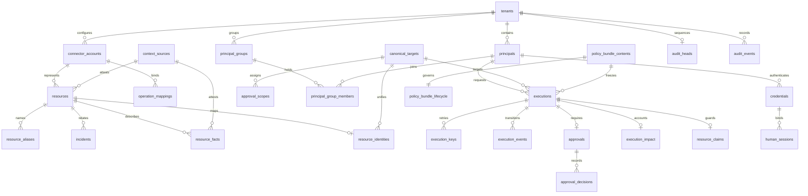

# Data model

The gateway uses SQLAlchemy Core and parameterized SQL against the private `execbound` PostgreSQL schema. There is no ORM entity layer. [Alembic migrations](../migrations/versions/) are the DDL source of truth; `SCHEMA_REVISION`, the table/function catalog and privilege checks are in [db.py](../src/execbound/db.py). Read those values from the checkout being deployed. The migration history below describes the schema changes; repository state does not establish a live database's schema.

## Relationships

This is a conceptual relationship map; the inventory below covers every table. Tenant ID participates in scoped primary and foreign keys. An execution is scoped to a principal, while its canonical target can unify multiple account-specific resource rows. A pending execution need not yet have an impact reservation or target claim.

## Accounts and workspace memberships

Migration `0054_account_memberships` adds eleven forced-RLS tables; the ten below are core's, and the eleventh, `community_allocations`, is a dormant table only the hosted service uses. Runtime reads use an
account context separately from tenant context; email and provider-subject lookups have narrow
pre-authentication policies. Writes use the reviewed definer transitions rather than direct
runtime table grants. Account context is established by trusted server code, never accepted
as authority from a supplied account/workspace selector.

| Records | Purpose |
| --- | --- |
| `user_accounts`, `user_passwords`, `user_identities` | Unique normalized email, verification and account epoch; preserved password parameters/hash; bound Google, GitHub and Microsoft subjects (a Microsoft subject is the account's tenant and object identifiers, `<tid>:<oid>`). Matching email alone cannot add a provider binding. |
| `workspace_memberships` | One account/principal mapping per tenant, local active/version state and retained original-workspace access for unverified legacy addresses. `last_entered_at` (`0082_workspace_entry`) is when the account last entered the workspace, set only by the definer functions `account_session_open` and `account_switch`; the runtime reads it to choose the workspace a sign-in opens and to order the workspace menu, and writes nothing. |
| `user_factors`, `user_passkeys` | Global factor authority with retained legacy encryption bindings, replay/lockout/recovery state and passkey handles/counters. Newly enrolled material binds to the account; historical metadata does not grant authority through the original tenant. |
| `account_login_proofs`, `account_sessions` | Proven personal authentication and separately scoped opaque account sessions, with a fifteen-minute idle and eight-hour absolute limit. Tenant-only authentication cannot mint these grants. |
| `account_provider_links` | Five-minute, single-use state/provider/session-bound linking capabilities, requiring verified email, recent account authentication and enrolled MFA. |
| `user_security_events` | Account-owner security history spanning workspaces; local administrators retain only their local view. A row of kind `assurance_carried` (`0089_assurance_carry`) also names, in `source_tenant_id`, `source_session_id`, `destination_tenant_id` and `destination_session_id`, the workspace and session whose second-factor verification a switch carried and the workspace and session it opened; a check keeps the four null on every other kind. Row-level security admits a row under the account's own setting alone, never a workspace's, so neither workspace's administrators read the other's identifiers. The destination's audit event `account_security.assurance_carried` carries the same `session_id` as `destination_session_id`, which joins the two. |

`human_sessions` gains account/session, account-version and membership-version bindings.
`identity_providers.require_sign_in` is an owner-only requirement flag, default false; merely
enabling an existing provider does not change access policy. Required-directory workspaces reject
personal entry without current matching directory evidence. Combined switch-and-SSO and the
administrator requirement/recovery controls remain separate identity work.

Backfill preserves tenant/principal IDs, passwords, existing personal-provider bindings and
tenant history. Only enrolled humans are adopted; agents, jobs, token-only principals and
pending invitations are not mailbox-verified accounts. Legacy `principals.email` remains a
bootstrap field with its existing unique index; shared-account email authority is
`user_accounts.email`, and invited memberships must use distinct tenant principals.
Linked principals' old administrator email/reset and factor/provider write paths refuse global
account changes. Pending pre-migration challenges are invalidated for a safe retry. Empty
downgrade is supported; a populated downgrade refuses and requires a reviewed database restore.
Repository migration availability does not establish any deployment's schema.

## Table inventory

All tables below have enabled **and forced** tenant RLS. Runtime access always includes SELECT. “Append” means INSERT without UPDATE/DELETE/TRUNCATE; listed mutable columns are the only allowed updates. Registry provisioning uses a separate trusted owner, not the protected agent or normal runtime.

| Table | Key / important bindings | Purpose and runtime writes |
| --- | --- | --- |
| `tenants` | `tenant_id` | Tenant name/active status; read only. `plan` (`sandbox`, `free` or `team`, default `team`) since `0044_hosted_free`, which no core code reads and which is never a security control. `slug` and `provisioned_at` since `0055_community_signup`, written only by the dormant `community_provision`; the same migration dropped the unique index on `lower(name)`, so two tenants may share a display name. `max_agents` since `0066_max_agents`: the workspace's agent limit, null for uncapped, `CHECK (max_agents IS NULL OR max_agents >= 0)`; the runtime reads it through the table-wide `SELECT` `0001_foundation` granted, `tenants` carries no column-level grant, and the runtime holds no privilege that writes it: it can write the column only through dormant definer functions a loaded plugin claims, and the owner connection sets it otherwise (see [Agent limit](#agent-limit) below) |
| `principals` | tenant + `principal_id`; space FK | `space_id` with `CHECK ((kind = 'AGENT') = (space_id IS NOT NULL))`: an agent is **owned** by one space and a person is a **member** of spaces. AGENT, HUMAN_APPROVER or ADMIN, or, since `0064_scheduled_jobs`, SYSTEM for a workspace's one scheduler principal, which never authenticates or holds authority (see the scheduled jobs paragraph below); active status; `label` (1 to 80 characters), `created_at` (null for rows that predate 0036) and `deactivated_at`; read only, written through the definer functions; `email` (retained legacy bootstrap address, lower case and globally unique across tenants; `admin_set_email` refuses changes after account adoption; personal sign-in uses `user_accounts`); `dormant_at` since `0044_hosted_free`, a sleeping agent's marker (see [Agent limit](#agent-limit) below); `replaced_by` since `0061_replaced_principals`, the principal of the same tenant that took this one's place when the person rejoined through an invitation, with a check that a replaced principal is never active and never names itself (see the replaced principals paragraph below); `number`, the principal's counting number in its workspace, a display handle the console reads as "Agent 3" (agents, since `0058_api_key_numbers`) or "User 3" (administrators and approvers, since `0062_people_numbers`). Each class counts upward from one in creation order on a counter of its own, so a workspace has both a User 1 and an Agent 1; the partial unique indexes `principals_agent_number` and `principals_person_number` hold the two counts, the BEFORE INSERT OR UPDATE OF kind trigger `principals_number` (function `number_principal`) assigns the next number of the row's class under a per-tenant, per-class advisory lock, and the column is `NOT NULL` since 0062. A change between the two person kinds keeps the number, a change between a person and an agent takes the next number of the new class, and a replaced principal keeps its number. Every reference, authorization and audit record keeps `principal_id` |
| `credentials` | tenant + `credential_id`; principal FK | Token digest, issuance, expiry, revocation; `last_used_at` (stamped by `credential_used`, display only) and `replaces_credential_id` (written by `admin_credential_replaces`, a rotation's link, no foreign key) since 0079; read only |
| `spaces` | tenant + `space_id`; unique `(tenant, lower(name))` | A division of ownership and view **inside** one tenant: name (1 to 80), detail (1 to 160), creator and `archived_at`. Never deleted, only archived; read only, written through the six space definer functions |
| `space_members` | tenant + space + principal; space and principal FKs | A person's role in one space, `ADMIN` or `HUMAN_APPROVER`. The role **narrows and never raises**: a person's authority is `min(principals.kind, space role)`. An active `ADMIN` principal with **no** row here is a *tenant administrator*; read only, written through `space_assign` and `space_unassign` |
| `space_policy_selection` | tenant + space; space and bundle FKs | The bundle one space has selected, with when and by whom. The primary key is what gives "at most one bundle per space"; the runtime holds `INSERT` and `UPDATE (bundle_id, changed_at, changed_by)`, because activation is already a fenced store function with an audited ADMIN check |
| `audit_heads` | tenant | Current sequence and hash; INSERT/UPDATE for serialized append |
| `audit_events` | tenant + sequence; unique tenant/event ID; actor FK | Immutable canonical payload/hash chain; append |
| `connector_accounts` | tenant + account; provider binding | Active configured provider account identity, no raw credentials; `sample` marks the one account `samples_install` writes for sample targets, whose connection the gateway derives from the deployment's sample key; read only |
| `context_sources` | tenant + account + source | Inventory/incident source kind, allowed writers, active status; read only for the runtime, created and deactivated by the owner `context-source-*` commands |
| `operation_mappings` | tenant + operation reference | Exact account/provider/action/schema/context versions; read only |
| `resources` | tenant + account + provider + resource type + resource ID | Provider ID/version, source, facts/observation time, active status; read only for the runtime; the owner `context-import` command updates the inventory columns, source, observation time and active flag, and `version` (the provider's expected version) only when a manifest states it |
| `resource_aliases` | tenant + alias ID; full resource FK | Normalized hostname/provider ID with validity interval; read only |
| `incidents` | tenant + account + incident ID; full resource/source FKs | Independently linked incident status/severity/version/time; read only for the runtime, created and updated by `context-import` |
| `resource_facts` | tenant + account + provider + resource type + resource ID + fact name; resource and source FKs | Generic scalar facts for contracts that use row storage, with source, version and observation time; read only for the runtime, written and retracted by `context-import` |
| `signal_sources` | tenant + `source_id`; unique `token_hash`; space, principal group and creating, rotating and revoking principal FKs | One registered security signal producer ([Security signals](SIGNALS.md)): label, producer name and version range, capabilities and subject kinds, a principal scope of 1 to 64 agent ids or one principal group (never both), placement (`out_of_process`), input path (`independent` or `agent_forwarded`), whether it attests liveness, registration version, the token's SHA-256 digest and a rotated-out digest with the end of its grace, lifetime, rotation and revocation, and health: the current minute's rate count, records held (at most 500,000), last acceptance, last refusal and its code, conflicts and rate refusals. Written by the owner `signal-source-*` commands, and its rate and health columns by `signal_admit`; the runtime's `SELECT` names every column but `token_hash` and `previous_token_hash`, and it writes nothing |
| `security_signals` | tenant + source + `source_event_id`; source FK; subject account FK to `connector_accounts` | One admitted envelope: its record digest, the registration version it was admitted under, producer name and version, capability, verdict, confidence, severity, the resource subject (account, provider, resource type, provider id), optional action and request reference (the intake refuses a request reference today and resolution never reads a record that carries one), observation, receipt on the gateway's clock, optional producer expiry after the observation, attributes, and evidence reference and digest. Written only by `signal_admit`; runtime `SELECT` only; never updated or deleted. One index serves resolution's read of the newest record per source |
| `agent_runs` | tenant + run ID; principal FK | Server-issued run scope and expiry; append |
| `policy_bundle_contents` | tenant + bundle ID; unique content hash binding | Immutable full bundle JSON, hash and creator; append |
| `policy_bundle_lifecycle` | tenant + bundle ID; exact content FK | DRAFT/VALIDATED/ACTIVE/RETIRED; INSERT, update `state`, `changed_at` |
| `tenant_policy_control` | tenant; `stopped_by` principal FK | Shared tenant fence, emergency stop (`stop_id`, `stopped_at`, `stopped_by`, `stop_reason`: all set or all null), enforcement mode (`ENFORCE` or `OBSERVE`), approval deadline (`approval_deadline_seconds`: 120 by default, 120 to 3600, or null for off), and assistant switch (`assistant_enabled`, false by default). Runtime INSERT and column-limited UPDATE; active bundle selection moved to `space_policy_selection` in 0041 |
| `canonical_targets` | tenant + canonical target ID | Shared target identity; read only |
| `resource_identities` | full account resource key; canonical target FK | Account representation → shared canonical target; read only |
| `approval_scopes` | tenant + approver + canonical target + action | Explicit active reviewer assignment; read only |
| `principal_groups` | tenant + `group_id`; unique tenant/name | Owner-provisioned agent group (name of 1 to 80 characters) that a `group`-scoped limit rule names; read only |
| `principal_group_members` | tenant + group + principal; group and principal FKs | Current membership of active AGENT principals, at most 64 groups each, changed only by the owner `group-assign` and `group-unassign` commands under the tenant fence; read only |
| `executions` | tenant + execution ID; unique tenant/operation ID | Frozen plan, identity, hashes, bundle, state and proof (a terminal `OBSERVED` execution keeps its would-be decision in `result`); since `0025_checkpoint`, `settlement_tier` (`ATTESTED` or `ASSERTED`, and `PROVIDER_VERIFIED` since `0056_gate_evidence`, null until a report settles an externally executed operation and null forever for one ExecBound dispatched) and `report_expires_at` (written once in the insert for a mapping that declares an external executor in a tenant that is enforcing, so it marks "this execution would be a checkpoint" and never "a grant is live"; a `DENIED` or stale row carries one too, and every reader pairs it with a state); INSERT, update `state`, `changed_at`, `owner_hash`, `dispatch_attempted_at`, `result`, `settlement_tier`. The report window has no update path at all |
| `execution_keys` | tenant + principal + idempotency key | Immutable retry binding to execution and wire/intent hashes; append |
| `execution_events` | tenant + event ID; execution/actor FKs | Immutable transitions and payloads; append |
| `approvals` | tenant + approval ID; unique tenant/execution | Frozen plan/bundle/obligations, expiry, required approver count, completing decision identity, and (since 0084) `reviewers_at_hold`, how many people could decide it when it was held, a presentation hint no decision reads; INSERT, update `state`, `decided_by`, `decided_credential_id`, `decided_at` |
| `approval_decisions` | tenant + approval + principal ID; approval, principal and credential FKs | One recorded decision per distinct human per approval: credential, `APPROVE` or `DENY`, time; INSERT only |
| `execution_impact` | tenant + execution ID; principal FK | Exact action, approved flag, unresolved/confirmed/nonexecution contribution, or an `OBSERVED` projection row that only observe-mode evaluations count; `account_id`, `group_ids` (JSON array) and `facts` (JSON object) retain the frozen intent's account, the principal's memberships at reservation and the frozen plan's scalar facts, written once at insert so limit scopes count over the row and never over current state (null where a row predates `0022_limit_scopes` and the backfill could not derive them; `group_ids` is always null on such rows); INSERT, update `state`, `confirmed_at` |
| `resource_claims` | tenant + execution ID; canonical target FK | One unreleased owner per target; INSERT, update `released_at` |
| `human_sessions` | tenant + session ID; principal/credential FKs | Session/CSRF digests, credential binding, role and expiry (at most eight hours after creation and never past the credential); INSERT, update `revoked_at`; the expiry is extended only through the `renew_human_session` definer function; `label`, one of a fixed set of device names chosen from the User-Agent at sign-in and written with the row (0035) |
| `approval_notifications` | tenant + notification ID; unique approval/destination/kind (`approval_notifications_one_per_kind`, since 0080); approval FK | Outbox row per approval, operator destination and message `kind` (`approval.pending`, `approval.reminder` or `approval.closed`, default `approval.pending`): the announcement is queued in the approval's transaction, a reminder by the drain once half a pending approval's window has passed, a close-out by the drain once the approval ends, with its `outcome` (`APPROVED`, `REFUSED`, `LAPSED`, `WITHDRAWN`) and `closed_at`, set on a close-out alone (`approval_notifications_closed_fields`); INSERT, update the delivery columns (`state`, `attempts`, `next_attempt_at`, `lease_until`, `lease_token`, `delivered_at`, `last_error`), never `kind`, `outcome` or `closed_at` |
| `export_cursors` | tenant + destination ID | One security-event export cursor per operator destination: last exported sequence and hash, last failure window, attempts, lease and state; INSERT, update the cursor and delivery columns |
| `authentication_failures` | failure ID; unique surface/reason/minute window/tenant/subject (nulls not distinct); nullable tenant FK | Bounded failed-authentication counters per surface (`http`, `mcp`, `human`, `monitor`, `token` since `0063_personal_access_tokens`, `signal` since `0068_security_signals`) and reason (`MALFORMED`, `UNKNOWN`, `MISMATCH`, `EXPIRED`, `REVOKED`, `INACTIVE`); tenant and subject set only when authentication verified the named credential, monitoring source or signal source exists, otherwise all three null; INSERT, update `count`, `last_at` |
| `executor_keys` | tenant + `key_id`; tenant FK | Owner-provisioned **public** keys an external executor's report is verified against ([External execution checkpoint](CHECKPOINT.md)): key id, since `0056_gate_evidence` an `algorithm` of `ED25519` or `ES256`, the public key (an Ed25519 key's raw 32 bytes as 64 lowercase hex characters, or an ES256 key's compressed point as 66), `created_at`, `revoked_at` (at or after creation) and, since `0026_key_compromise`, `revocation_reason`, `NOT NULL` exactly when the row is revoked and one of `RETIRED` or `COMPROMISED`. No private key or shared secret exists here, so read access cannot forge the attested tier; **runtime SELECT only**, with no INSERT allowlist entry and no update grant, written by the four `executor-key-*` owner commands |
| `arcade_hooks` | tenant + principal + `arcade_execution_id`; principal and execution FKs | One control point hook exchange ([Arcade logic extension](ARCADE.md)): the platform's own execution id, the derived idempotency key, the tool identity, the reported metadata and user id as retained inert text, the extension's decision (`OK`, `CHECK_FAILED` or `RATE_LIMIT_EXCEEDED`), the ExecBound execution and operation, the grant's report secret until settlement, the reported success flag and platform codes, the two contradiction stamps and the creation and settlement times. Keyed on the **principal** as well as the tenant, because an Arcade execution id carries no ExecBound scope and two projects of one tenant minting the same id needs no misbehaviour from either. The one place in the system that holds a usable report secret at rest: it is nulled at settlement and cleared opportunistically once a report window has closed. INSERT, SELECT, a bounded UPDATE over the decision, execution, operation, secret, reported and contradiction columns and the settlement time, and **no DELETE or TRUNCATE**; the tenant, principal, Arcade id, derived key, tool identity, reported metadata and user id and creation time are written once |
| `assistant_turns` | tenant + `turn_id`; `principal_id` FK | A person's assistant turns: context kind and id, the question (up to 1,000 characters), state (`RUNNING`, `COMPLETED`, `FAILED` with one reason from a closed list), steps, the answer as structured text, cited ids, model and token counts; runtime `SELECT` only, written through `assistant_turn_create`, `assistant_turn_step`, `assistant_turn_complete` and `assistant_turn_retire`, which nulls the text thirty days after completion and keeps the counts, and, since `0064_scheduled_jobs`, `assistant_turn_retire_due`, the same retirement for the scheduled pass with no actor |
| `principal_passwords` | tenant + `principal_id`; principal FK | One salted scrypt hash with its own `algorithm`, `n`, `r`, `p` and `dklen` beside it, so a row written under older parameters keeps verifying; runtime `SELECT` only, written by `password_redeem` and `password_replace` |
| `password_resets` | tenant + `reset_id`; principal FK | One-time set-password codes as their SHA-256, with `expires_at`, `redeemed_at`, `revoked_at` and a failure counter bounded at five; at most one live row per person by partial unique index; runtime `SELECT` only |
| `principal_identities` | tenant + `principal_id` + `provider` + `subject` | A provider account bound to a person: `google` or `github`, the provider's stable subject, and the address and display name as hints. One account is one person anywhere (a global partial unique index on provider and subject) and one person holds one account per provider; runtime `SELECT` only |
| `identity_providers` | tenant + `provider_id`; at most one row per tenant that is not `disabled` (partial unique index) | The one OpenID Connect provider a tenant's administrator registered: name, issuer, client id, subject claim (`sub` or `oid`), the Entra directory the issuer names, the three endpoints discovery answered with and when it was fetched, and the client secret as AES-256-GCM ciphertext with its key id beside it. `state` is `draft`, `verified`, `enabled` or `disabled`; `verified` is written only by the sign-in that proved it. Runtime `SELECT` only, plus one single-row policy permitting the row whose own id equals `execbound.directory_provider` while it is not disabled. |
| `identity_links` | tenant + `link_id`; principal and provider FKs; one live link per `(provider_id, subject)` and one per person (partial unique indexes) | A directory account bound to a person: the subject, `via` (`invitation`, `self` or `admin`), the invitation that bound it, the display name and username the directory reported as hints, and the last sign-in. The subject index is keyed on the provider row rather than a provider name, because two customers' directories are two namespaces. Runtime `SELECT` only, plus one single-row policy on `execbound.directory_subject`. |
| `identity_invitations` | tenant + `invitation_id`; principal and provider FKs; at most one pending row per person (partial unique index) | One-time invitation codes as their SHA-256, with `expires_at`, `redeemed_at`, the subject that redeemed them, `revoked_at` and a failure counter bounded at five. Runtime `SELECT` only. |
| `federated_sign_ins` | tenant + `credential_id`; credential, principal, provider and link FKs | What a directory session stands on: the subject, the refresh token as ciphertext with its key id, `verified_at` and the reason it was revoked (`PROVIDER_REFUSED`, `LINK_REVOKED`, `PROVIDER_DISABLED`). The credential it names is an ordinary row whose digest is of bytes nobody kept. Runtime `SELECT` only. |

The dormant tables only the hosted service uses (`onboarding_slots`, `onboarding_invitations`, `signup_requests`, `signup_messages`, `community_allocations`, `product_counts`, `account_preferences`, `account_recoveries`, `account_messages`, `dormancy_warnings`, `approval_email_subscriptions` and `approval_emails`, these two since `0096_approval_email`) are documented with the hosted service; [Roles and connection behavior](#roles-and-connection-behavior) says how core treats them.

**Teammate invitations** (`0059_workspace_invitations`) adds two tables in the *inviting* tenant, because a teammate invitation lives in the workspace that sent it: `workspace_invitations` (one normalized address, the inviter, the frozen grants as `jsonb`, `created_at`/`expires_at` seven days apart, the token digest and its `generation`, `failures` (0 to 5) and `sends` (1 to 5), `state` `PENDING`/`ACCEPTED`/`REVOKED`, the acceptance/revocation columns each paired with their own `CHECK`, and, since `0083_invitation_reviewer_group`, the optional `reviewer_group_id` the invited Approver joins on acceptance; a partial unique index holds one `PENDING` row per tenant and address) and `workspace_invitation_messages` (the outbox: one row per invitation, `state` `PENDING`/`IN_FLIGHT`/`DELIVERED`/`FAILED`, `attempts` (0 to 5), the lease pair and `last_error`). Both are forced-RLS; the runtime holds `SELECT` on each and **`UPDATE`** on the messages table's seven delivery columns alone (`state`, `attempts`, `next_attempt_at`, `lease_until`, `lease_token`, `delivered_at`, `last_error`), and no `INSERT` or `DELETE` on either table: every row is written by the seven `SECURITY DEFINER` functions below.

Delivery must reach a workspace no jobs token names, so `workspace_invitation_due(p_now, p_limit) RETURNS TABLE(tenant_id, message_id)` is tenant-agnostic by construction: its own `SELECT` carries no tenant predicate at all, and what confines it is a second policy on `workspace_invitation_messages`, `owner_drain`, granted `FOR SELECT TO CURRENT_USER`: the exact role that owns every function in this migration and runs this migration, and *only* that role, never `execbound_app`. This was a new pattern for the codebase: every earlier cross-tenant pass instead held its own operator credential and walked a configured tenant list, as the security-event export drain still does and the approval-notification drain once did, while this one needs no identity and no configuration at all, because the policy itself is the boundary. The directory of tenants `0064_scheduled_jobs` adds, `job_tenants`, is the second owner-only cross-tenant read (see the scheduled jobs paragraph below). `deliver_invitations` calls `_due` once, unfenced, to get `(tenant, message)` pairs, then leases, rekeys and sends each pair inside that one message's own tenant fence, in its own transaction, so nothing about another tenant is ever read or held past that first list.

The other six functions run under the ordinary tenant fence. `workspace_invitation_create(p_actor, p_invitation, p_email, p_grants, p_message, p_now) RETURNS timestamptz` re-implements `access_change`'s own grant-shape rules inline (`GRANT_CHECK`, because a `SECURITY DEFINER` function cannot call back into a normal one) and canonicalizes every grant's `space_id` to lowercase 8-4-4-4-12 before storing it, so a shouted-case or absent id never reaches a raw cast error. It raises `INVITATION_PENDING` for a second row at an unexpired pending address; `create_invitation` in `invitations.py` catches that one code, and only when the existing row has actually expired, revokes it as the same actor (its own `invitation.revoked` event, reason `EXPIRED`) and retries the create in the same transaction: the function's own `EXCEPTION WHEN unique_violation` block needs a `begin_nested()` savepoint around each attempt from Python, because the `RAISE EXCEPTION` that follows a caught unique violation is otherwise fatal to the whole transaction at the Postgres level. `workspace_invitation_revoke` and `workspace_invitation_resend` both take the actor/tenant/clock check every administrator path shares (`ACTOR_CHECK`: an active ADMIN or equivalent holding `access.manage` now, and a caller clock within five minutes of the database's); resend never extends `expires_at`, so an expired invitation is a new invitation rather than a longer-lived one. `workspace_invitation_rekey(p_invitation, p_token_hash, p_now) RETURNS timestamptz` only ever moves a still-`PENDING`, unexpired row, bumping `generation` and zeroing `failures`, so an invitation moving out from under an in-flight send is `INVALID_STATE` rather than a link minted for nothing. `workspace_invitation_check` is the read `inspect_invitation` makes on every open: a wrong digest still counts toward the five-miss lockout and the count commits, because the function returns normally rather than raising.

`workspace_invitation_accept(p_invitation, p_token_hash, p_principal, p_account, p_password, p_now) RETURNS jsonb` is the one function two different callers reach with different proof, and its own **lock order is the account, then the tenant fence, then this function**: `accept_invitation` in `invitations.py` calls `lock_account` before `store.fence` for a signed-in acceptance (a new address has no account yet and takes the fence first), so two acceptances of the same account, or an acceptance racing a revoke, serialize. Inside the function, the invitation row is locked (`FOR UPDATE`) before anything else is read, exactly once, which is what makes accept-vs-revoke and accept-vs-accept race to a single winner (T4.39). The inviter's `access.manage` and every Space named in the frozen grants are re-checked **at this moment**, not cached from when the invitation was created (T4.37): a demoted or deactivated inviter, or a Space archived since, refuses the acceptance and creates nothing. The new principal's `email` is the invited address unless another principal anywhere already holds it (`principals_email` stays one global unique index), in which case a caught `unique_violation` on that insert falls back to a `label` of the address instead. Grants are applied by calling `access_change` as the inviter inside this same transaction, so promotion handling, revoked credentials and the `access.set_user_roles` audit event are the one real implementation of the grant rules rather than a second copy of it. The membership write is what lets a removed member be invited back at all: a membership's primary key is `(account, tenant)`, so a former member, one whose membership row still exists but whose principal was deactivated by removal, cannot get a second row; instead the existing row is **re-pointed** at the new principal (`principal_id = new, active = true, version = version + 1`), leaving the old principal deactivated with its own grant history untouched (the cost: a readmitted member's old principal history does not merge with the new one). A membership whose principal is still active is `ALREADY_MEMBER` on both the create side (checked against `principals.email` and, cross-tenant, against `user_accounts.email` joined through an active membership and an active principal) and the accept side.

Downgrade refuses while `workspace_invitations` holds any row, checked by the same `NO FORCE` / recount / `FORCE` bracket `0055` uses so the count itself is not RLS-filtered, proven under a non-bypassing owner too (T4.38), and otherwise drops the functions, the `owner_drain` policy and both tables, matching every other populated-downgrade refusal in this file.

**Replaced principals** (`0061_replaced_principals`, T4.41) close the one gap the re-point left: the old principal stayed deactivated with its old grants, and nothing stopped an administrator from reactivating it, which would make a live approver or administrator that no membership points at, counted by `access_has_permission` and by the `LAST_ADMINISTRATOR` check, beside the new principal for the same address. `principals.replaced_by uuid` names the principal that took the old one's place, through a foreign key `principals_replaced_by` on `(tenant_id, replaced_by)` to the same table's `(tenant_id, principal_id)` with its covering index `principals_replacement`, and the check `principals_replaced_retired` (`replaced_by IS NULL OR (NOT active AND replaced_by <> principal_id)`) is the backstop: no code path, the owner's included, can make a replaced principal active. The new principal stays deliberately fresh, so an invitation never brings back approval eligibility or grants the old one held. Two functions are patched in place, the way `0057_api_key_never` patches its own, reading the live definition, replacing one exact fragment that must occur exactly once, and re-creating it so the owner, `SECURITY DEFINER` and the grants stay. `workspace_invitation_accept` sets `replaced_by` on the old principal when it re-points a membership, and before it decides whether that principal is still active it now takes the tenant fence (the `tenant_policy_control` row) and then the old principal's row (`FOR NO KEY UPDATE OF p`). That is the order `admin_reactivate_principal` takes the same two locks in: 0047 put the fence at the top of every administration function, and 0044 takes the target's row lock. With the fence first on both sides, a reactivation and an acceptance of the re-invitation serialize whoever calls them: whichever commits first wins, and the other reads the committed outcome and refuses cleanly, `ALREADY_MEMBER` for the acceptance or `PRINCIPAL_REPLACED` for the reactivation, never a check violation. Taking the row lock alone, before the fence `access_change` takes later, deadlocks against a reactivation that already holds the fence (TI42 proves both orders). `admin_reactivate_principal` refuses a replaced principal with `PRINCIPAL_REPLACED` immediately after its own row lock and before any other effect; it is patched rather than restated from `0044_hosted_free`, because `0047_access_control` rewrote it after 0044 (the fence and the role-aware actor check), and restating 0044's text would quietly undo both. Nothing is backfilled: when 0061 was written no deployment had applied 0059, and a membership re-pointed locally before 0061 simply names no replacement. Downgrade refuses while any principal names its replacement, counting under the same `NO FORCE` / count / `FORCE` bracket, and otherwise restores both function bodies byte for byte and drops the index, the two constraints and the column.

**Scheduled jobs for every workspace** (`0064_scheduled_jobs`) lets the scheduled `recover` and `notify` reach every workspace, however it was created, with no workspace credential. `job_tenants` (`tenant_id` as its primary key, a foreign key to `tenants` with `ON DELETE CASCADE`, and `added_at`) lists every tenant once. The migration backfills it from `tenants` under one lock on that table, with `FORCE` lifted and restored so an owner without `BYPASSRLS` reads every tenant, and the invoker trigger `tenants_enroll` (function `job_tenants_enroll`) adds each tenant created after, which passes the table's `tenant_isolation` policy because every path that creates a tenant has already set the fence to it. The table is forced-RLS and the runtime role holds no privilege on it. Its one cross-tenant read is a second policy, `owner_list`, `FOR SELECT TO CURRENT_USER USING (true)`, whose role is the one that runs the migration and owns the definer function `job_tenants_page(p_after, p_limit)`. The runtime calls that function, which returns the next 1 to 500 tenant ids after `p_after` in id order. Before a pass lists anything, `jobs.check_directory_policy` refuses it with `UNSAFE_JOB_POLICY` unless the table has exactly those two policies, as made (T4.46).

The same migration adds the principal kind `SYSTEM` for a workspace's scheduler principal, the actor of the events the scheduled pass writes there and never an identity (T4.47). Its id is derived from its tenant, `md5('execbound.scheduler:' || tenant_id)::uuid`; the check `principals_system_id` ties the kind to that id in both directions, and the partial unique index `principals_system` holds one per tenant. `scheduler_actor()`, a fenced definer function with no argument, makes it with `ON CONFLICT DO NOTHING` (label "ExecBound scheduler", number 1, no space) and answers its id and whether it was made; it refuses an unfenced or inactive tenant with `INVALID_TENANT`. `principals_system_frozen`, a `BEFORE UPDATE` trigger on `principals`, refuses any change to a `SYSTEM` row and any change of kind to or from `SYSTEM`. `principal_guard`, one invoker trigger function attached as `system_guard_<column>` `BEFORE INSERT OR UPDATE OF` each of the 29 columns `execbound.principal_columns.GUARDED` names, refuses the derived id there with `SYSTEM_PRINCIPAL` and reads no table, so it holds in the tables fenced by account too. `access_effective_kind` answers `SYSTEM` for the principal and `access_has_permission` false, both patched in place, and the dormant `agents_sleep` is patched the same way to leave the scheduler's events out of the activity it measures. `assistant_turn_retire_due()`, a fenced definer function with no argument and no actor, takes the tenant control lock, requires an active tenant and retires the turns completed thirty days before the database's own clock. Downgrade refuses while any `SYSTEM` principal exists, counted with `FORCE` lifted on `principals`, because the audit chain names them; otherwise it restores the three patched functions and drops everything above.

Monitoring adds seven tenant tables: `monitor_profiles` (immutable, versioned detection profiles set by a current ADMIN; one active per tenant, retired never edited or deleted; findings name the version that produced them), `monitor_sources` (story/token digest/lifecycle and receipt counters, plus, after a rotation, the current token digest beside the immutable registration digest, the previous digest with its grace deadline, the rotating and revoking administrators, since `0090_monitor_source_creator` the minting one, and the persisted receipt-time health state with its change and check times), `monitor_observations` (immutable tool result plus mutable evaluation state; heartbeats now update only their source's receipt-time freshness, while older stored heartbeat rows remain), `monitor_findings` (stable rule binding plus acknowledgement, which since `0081_finding_acknowledgement` carries an optional note of at most 500 characters and is final: a trigger refuses any change to `acknowledged_at`, `acknowledged_by` or `acknowledgement_note` once `acknowledged_at` is set, for every role; a source-health finding binds to its source with no observation, a clock-skew finding to the observation whose reported time is implausible), `monitor_deliveries` (one intent per finding, written with it, and since `0097_findings_destinations` one delivery per finding and destination, routed at drain time, with bounded retry and lease state), `monitor_connections` (one active read-only collection connection per tenant: pinned origin, optional team scope, the API key's SHA-256 fingerprint and never the key, probed capabilities, health with its episode start, the durable audit cursor, the platform tenant pinned by the first collected record, and the last run's outcome, error code and retry hint) and `monitor_inventory` (allowlisted story, action and credential metadata per connection, with the outbound classification left null for an action type the collector does not recognize, and on story rows the coverage class and gap episode the last reconciliation decided). Scout adds four more: `monitor_agents` (one row per directory principal a connection enumerated, with the class the directory's own object type states, the sponsors as object identifiers only, a sponsor state that keeps `absent`, `unreadable` and `not_read` apart, the blueprint and the credential kinds it holds, and the ExecBound principal an ADMIN has linked), `monitor_agent_grants` (each grant the agent holds, with the object it actually sits on, so an inherited permission names the blueprint where it has to be removed), `monitor_agent_reach` (one row per action **per path**, with the certainty that path can establish, the enforcement mode it can support, the catalog version that produced it and the moment its proof lapses) and `monitor_reach_exceptions` (an ADMIN's recorded decision to live with one ungoverned path, written since `0099_scout_agents_page` only by `admin_accept_reach` and `admin_withdraw_reach`, which keep every change in `monitor_reach_acceptances`). Nothing in any of the four is deleted: a grant or a path that is gone is marked `gone_at` and kept, and the runtime role holds no DELETE on them at all. `monitor_connections` gains a `kind` whose origin check is per platform, so one tenant runs one connection per platform rather than one in total. Since `0086_monitor_collect_schedule` a connection also records its `credential_mode` (`key_file`: an operator's key file on the collecting host), its collect and activity intervals (null for the kind's default), a waiting collection request with the administrator who made it, and the lease a collection run holds (`collecting_until`, `collecting_lease`), and `last_outcome` admits `INTERRUPTED`. The runtime inserts only the columns that existed before and updates none of these: `admin_request_collection`, `admin_set_collection_schedule`, `collector_claim` and `collector_release` write them, a trigger clears the lease in the statement that revokes a connection, and `check_runtime` holds the insertable columns to `INSERT_COLUMNS`. Since `0087_monitor_sealed_keys` a `sealed` connection, a Tines key an administrator pasted in the console, keeps that key only as `sealed_ct`, a sealed box of an envelope binding it to its tenant, connection and kind that only the collector's private key opens, beside `sealed_key_id`, the collector key it was sealed to, and its fingerprint; the runtime inserts and updates neither, and `admin_create_sealed_connection`, `admin_replace_sealed_key` and `collector_reseal` write them. Since `0088_monitor_entra_consent` a `platform_app` connection is a Microsoft Entra directory whose administrator consented to the deployment's own app: it holds no key fingerprint and records `consented_at` and `consented_by`; `monitor_connect_attempts` records every attempt to connect a directory or update a consent (its principal, Space, label or connection, digests of its `state`, binding cookie and nonce, the directory a verified sign-in named, a ten-minute life and how it ended), which the runtime only reads; `monitor_directory_claims` holds one digest per active Microsoft Entra connection's directory with no tenant column and no runtime privilege; and one active Microsoft Entra connection per directory holds across every tenant. Four definer functions write the attempts and a definer trigger the claims. Since `0093_scout_delta` an Entra connection keeps the delta link its next delta pass reads, when that link last advanced and its baseline, the end of its first complete collection that read both principal collections, and `collecting_delta` marks a lease a delta pass holds, which `collector_claim_delta` alone sets; each agent keeps the AI publisher catalog's key for its application and one episode marker for each of `new-actor.v1`, `first-consequential-action.v1` and `new-ai-consent.v1`, and a connection's one `initial-inventory.v1` finding names the connection alone ([SCOUT.md](SCOUT.md#between-full-collections-delta-the-baseline-and-the-new-actor-rules)). Since `0094_scout_audit` an Entra connection's `audit_cursor` is where its next read of the directory's audit log starts, `audit_baseline_at` the moment its first read that caught up with the log stored what it found, `audit_behind_since` since when its reads have not caught up, and, since `0095_scout_audit_retention`, `audit_bound_since` since when they have met the connection's observation bound; each audit entry an application initiated that the activity map covers is one `entra_audit` observation naming the actor's service principal and its target by object id alone, kept while it is current or a rule still reads it and then removed by the scheduled `process` pass through `monitor_audit_purge` ([SCOUT.md](SCOUT.md#what-the-directorys-own-audit-log-shows)). `monitor_observations` carries either a `source_id` or a `connection_id` and never both, with `evidence` distinguishing a customer-instrumented report from a platform-collected record, and `monitor_findings` follows the same origin rule. All force RLS, use composite tenant/source foreign keys and deny runtime DELETE/TRUNCATE; the one removal the runtime may ask for is that purge, a definer function bounded to evaluated, uncited directory audit observations a month old. Source identity and event content cannot be updated by the runtime. The [monitoring guide](TINES_MONITORING.md) documents atomicity, grants and limits. Monitoring history (sources, observations, findings and collection runs) is separate from the protected execution audit chain. A change to a monitoring connection is the exception: creating one, replacing its sealed key, recording a directory's consent, asking for a collection, changing its schedule and revoking it each append an informational event (`monitor.connection_created` and the rest in [AUDIT_EVENTS.md](AUDIT_EVENTS.md)), because a connection holds or reaches a credential; the event decides nothing replay reconstructs and takes no tenant control row.

`resources.privilege_class` is nullable to preserve endpoint rows and constrained to `standard`, `privileged`, `tier0` when present. Identity resolution requires appropriate trusted values even though the shared database column is nullable. Application validation is stricter than some generic registry SQL columns.

Important unique indexes and keys enforce one selected bundle per space (the `space_policy_selection` primary key, which replaced the per-tenant active-bundle index in `0041_spaces`), one unresolved execution per tenant/principal/intent hash, and one unreleased claim per tenant/canonical target. `execution_keys` retains key ownership across completion. The explicit action checks on approval scopes and impact admit only the six catalog actions. Read the migration for exact column lengths, timestamp constraints and covering indexes before changing a model.

**The weekly summary** (`0078_weekly_summary`) adds two tables in each subscriber's own tenant: `weekly_summary_subscriptions` (one row per person who ever turned the summary on, keyed by tenant and principal: `subscribed_at`, and `ended_at` with `ended_via` `SETTINGS` or `LINK`, the two set together; never deleted) and `weekly_summary_messages` (the outbox: one row per subscriber per Monday `week_ending`, `state` `PENDING`/`IN_FLIGHT`/`DELIVERED`/`FAILED`/`SKIPPED`, `attempts` (0 to 5), the lease pair, a code-shaped `last_error`, and `unsubscribe_hash`, the SHA-256 of the 256-bit secret minted for the latest attempt's one-click link). Both are forced-RLS with the tenant policy. The runtime holds `SELECT` on both, `INSERT` and `UPDATE` of `subscribed_at`, `ended_at` and `ended_via` on the subscriptions, and `UPDATE` of the eight delivery columns alone on the messages; it never inserts a message and deletes neither. A second, owner-only `owner_drain` `SELECT` policy on each lets three `SECURITY DEFINER` functions read across tenants and return identifiers or a count only: `weekly_summary_tenants` (workspaces with an active subscriber), `weekly_summary_due` (due messages) and `weekly_summary_sent` (deliveries since an instant, for the deployment's daily cap). `weekly_summary_enqueue` and `weekly_summary_unsubscribe` read their tenant from `execbound.tenant_id`, refuse `TENANT_REQUIRED` without one and touch only that tenant's rows, so on an owner without row-security bypass every write happens inside one tenant's fence. The value report reads no new table; `0077_rejection_index` adds the partial index `audit_events_rejected` its count of refusals before a decision reads.

## Agent limit

`tenants.max_agents` (`0066_max_agents`) is a workspace's agent limit, which core enforces without knowing any plan and which is null, uncapped, unless an operator sets it. `admin_create_principal` and `admin_reactivate_principal` read it under a `FOR NO KEY UPDATE` lock on the tenant row and refuse `PLAN_LIMIT` at the limit, so a creation and a reactivation contending for the last allowance serialize and exactly one wins.

`principals.dormant_at` is a sleeping agent's marker, distinct from the `deactivated_at` migration `0036` added for a person switching an agent off by hand, and a `CHECK` forbids the two ever being set together. Only the dormant `agents_sleep` sets it, so no agent sleeps on a deployment that loads no plugin. A sleeping agent **still counts** toward the limit, and waking it (`admin_reactivate_principal`, which clears `dormant_at`) is never refused; a person's own deactivation **frees** the allowance, so reactivating a hand-deactivated agent takes one back, counts as a creation and is refused `PLAN_LIMIT` at the limit. The hosted service's plans, and how it sets this column, are documented with the hosted service.

## Audit versus projections

`audit_events`, `execution_events`, retry keys and bundle contents are append-only to the runtime. Current heads, execution state, approval decisions, impact settlement, claims and sessions are mutable projections with column grants. Mutating a projection directly bypasses the coordinator's atomic invariants even if SQL permissions technically allow it; use the domain functions.

Every audit append locks/creates the tenant head and records one deterministic canonical event with its previous hash. Durable execution intent, approval consumption and reserved impact commit together. A later proof produces new outcome/reconciliation events. There is no automatic purge or supported “reset budget” operation. Runtime DELETE/TRUNCATE is denied on every tenant table.

The replay export captures audit history and referenced bundle content rather than copying mutable tables as historical truth. Legacy gaps remain unresolved. Independently retaining a checkpoint is necessary for stronger tamper detection than a self-contained export/head pair. See [Replay](REPLAY.md).

## Roles and connection behavior

Every `tenant_isolation` policy compares `tenant_id` against `(SELECT current_setting('execbound.tenant_id', true))`. The subquery is uncorrelated, so PostgreSQL evaluates it once per statement as an InitPlan instead of once per row; the isolation it enforces is identical to the direct call. `tests/test_database.py` asserts that no policy in the schema uses the per-row form, so a new table cannot reintroduce it.

`authentication_failures` deliberately keeps **two** permissive policies rather than one merged `OR`: `tenant_isolation` for a tenant's own rows and `unattributed_counters` for rows with no tenant, which a pre-authentication failure cannot have. Supabase's advisor reports the pair as `multiple_permissive_policies`. Merging them would save one policy evaluation on a table written only on failed authentication and read only by the administration surface, and would cost the separation that makes each grant readable and separately auditable — a single expression is easier to widen by accident when editing the other half. The pair stays until the table is measured to be hot.

`execbound_app` must not own application objects, create schema objects, bypass RLS, create roles/databases, replicate or inherit another role's authority. `check_runtime()` verifies the role, exact table catalog, forced RLS, allowed writes, the exact function catalog and Alembic revision, then the dormant objects' grants below; `/health/ready` invokes it.

Migration `0021_admin_functions` adds five `SECURITY DEFINER` functions owned by the schema owner with a pinned `search_path`: `admin_create_principal`, `admin_issue_credential`, `admin_revoke_credential`, `admin_assign_approver` and `admin_unassign_approver`. `execbound_app` holds EXECUTE on them and nothing else new: `principals`, `credentials` and `approval_scopes` stay SELECT-only for the runtime. Each function reads the tenant from `execbound.tenant_id` (the setting forced row-level security uses, which also fences the owner), verifies that the actor is an active ADMIN of an active tenant, refuses an ADMIN kind, principal or credential, bounds a credential lifetime to 1 minute to 90 days and the caller's clock to 5 minutes from the database's, and writes the row shape the owner tooling writes; a refusal raises its code (`INVALID_ACTOR`, `INVALID_KIND`, `INVALID_PRINCIPAL`, `INVALID_LIFETIME`, `INVALID_CLOCK`, `INVALID_DIGEST`, `INVALID_CREDENTIAL`, `INVALID_TARGET`, `INVALID_ACTION`, `INVALID_SCOPE`, `INVALID_TENANT`) and rolls the caller's transaction back. `check_runtime()` asserts that exactly these functions run as definer, are not owned by the runtime role and are executable by it, and that no other function the runtime could call exists in the schema (trigger functions, which cannot be called, are the one exception). Migration `0027_approval_deadline` adds `renew_human_session`, the only way a live console session's expiry moves. Migrations use a separate owner connection.

**Dormant objects** (`0065_dormant_grants`). Every migration ships in the one chain, so the tables and functions only a plugin uses exist on every install. `src/execbound/db.py` marks them inside `TABLES` and `FUNCTIONS`: `DORMANT_TABLES` holds `community_allocations`, `product_counts`, `onboarding_slots`, `onboarding_invitations`, `signup_requests`, `signup_messages`, `account_preferences`, `account_recoveries` and `account_messages` (these two since `0085_account_recovery`), `dormancy_warnings` (since `0092_dormancy_warning`), and `approval_email_subscriptions` and `approval_emails` (these two since `0096_approval_email`), and `DORMANT_FUNCTIONS` holds `product_count`, `onboarding_claim`, `sandbox_reattest`, `onboarding_invite`, `onboarding_invitation_rekey`, `onboarding_invitation_revoke`, `sandbox_expire`, `sandbox_notice`, `sandbox_fallback`, `agents_sleep`, `signup_request`, `signup_allocate`, `signup_mark`, `signup_verify_queue`, `signup_verify_rekey`, `signup_verify_check`, `community_provision`, `signup_provider_attach` and `community_provision_provider` (these two since `0069_provider_signup`), and `account_recovery_request`, `account_recovery_rekey`, `account_recovery_check`, `account_password_recover` and `account_recovery_lapse` (since `0085_account_recovery`), and `dormancy_warn`, `dormancy_warnings_due` and `dormancy_warnings_sent` (since `0092_dormancy_warning`), and `approval_email_change`, `approval_email_queue`, `approval_email_tenants`, `approval_email_due`, `approval_email_sent` and `approval_email_unsubscribe` (since `0096_approval_email`), all `SECURITY DEFINER`. `0065_dormant_grants` revoked every grant the owner had made to PUBLIC, `execbound_app` and Supabase's `anon`, `authenticated` and `service_role` on them, PUBLIC's `EXECUTE` on `onboarding_invitation_revoke` included, which `0042_console_invitations` had never taken off. `check_runtime` then requires, after the revision check, that the runtime role hold on each exactly what the process's loaded plugins claim and nothing where none claims it, reading the table grants as extra rows of its existing functions query and each function's `EXECUTE` from its own function row; `DELETE` and `TRUNCATE` stay refused on every table. A dormant function the runtime cannot execute is therefore allowed, where every other definer function must be executable. The grants the migration rows here describe for these objects are what a plugin that uses them claims and its own upgrade grants back; on a database whose processes load no plugin the runtime holds none of them, and one that holds any is refused. The revoke convention, from `0063_personal_access_tokens`, is `REVOKE ALL ... FROM PUBLIC, execbound_app`, then the same from each Supabase role that exists. **A new table or function only a plugin uses** goes into the shared chain with no grant but the owner's, by that convention, which also takes a new function's default `EXECUTE` off PUBLIC; into `TABLES` or `FUNCTIONS` and `DORMANT_TABLES` or `_DORMANT_FUNCTION_NAMES` (from which `DORMANT_FUNCTIONS` is derived); and into the plugin's claims. A claim on an object outside the catalog refuses the plugin (`INVALID_CLAIM`), a definer function missing from the catalog or not executable while not dormant fails `check_runtime`. No source under `src` outside `db.py` and a plugin's own package names a dormant object as `execbound.<name>` (DC19).

`Database.transaction(tenant_id)` sets `execbound.tenant_id` transaction-locally with `set_config(..., true)`. Normal transactions use READ COMMITTED; coherent snapshot reads can request REPEATABLE READ. Pool reuse cannot retain the prior transaction's tenant. Both `USING` and `WITH CHECK` apply to the tenant predicate. A missing setting sees no tenant rows.

The private schema has no grants to Supabase API roles or PUBLIC. RLS protects scoped application use, not compromise of the trusted runtime credential. Do not replace the explicit tenant predicate with a Supabase Auth/JWT policy without designing a new authentication boundary.

## Migration history

| Revision | Change | Forced-RLS tables after upgrade |
| --- | --- | --- |
| [0001_foundation](../migrations/versions/0001_foundation.py) | Identity, credentials and audit; private grants and forced RLS | 5 |
| [0002_identity_context](../migrations/versions/0002_identity_context.py) | Account/mapping registry, trusted sources/resources/aliases/incidents, runs | 12 |
| [0003_database_tuning](../migrations/versions/0003_database_tuning.py) | Covering indexes and once-per-statement tenant setting lookup | 12 |
| [0004_policy_bundles](../migrations/versions/0004_policy_bundles.py) | Immutable content, lifecycle and tenant policy fence | 15 |
| [0005_execution_state](../migrations/versions/0005_execution_state.py) | Canonical identity, scoped approval, execution, impact and claims | 24 |
| [0006_human_sessions](../migrations/versions/0006_human_sessions.py) | Bounded revocable human sessions | 25 |
| [0007_identity_context](../migrations/versions/0007_identity_context.py) | Read-only privilege evidence and explicit identity action checks | 25 |
| [0008_monitoring](../migrations/versions/0008_monitoring.py) | Separate sources, observations, findings and delivery state; downgrade refuses retained history | 29 |
| [0009_context_contracts](../migrations/versions/0009_context_contracts.py) | Read-only generic resource facts for versioned context contracts | 30 |
| [0010_authentication_failures](../migrations/versions/0010_authentication_failures.py) | Bounded, attributed authentication failure counters; a second policy admits unattributed rows to every tenant context; downgrade refuses retained rows | 31 |
| [0011_tenant_stop](../migrations/versions/0011_tenant_stop.py) | Emergency stop columns on the tenant control row; downgrade refuses while a stop is active | 31 |
| [0012_source_rotation](../migrations/versions/0012_source_rotation.py) | Monitoring source token rotation with a bounded grace window and revocation attribution; the registration digest stays immutable and the runtime updates only the current digest, expiry and lifecycle columns | 31 |
| [0013_source_health](../migrations/versions/0013_source_health.py) | Persisted source health state and source-health and clock-skew finding rules; findings without an observation; downgrade refuses retained health findings | 31 |
| [0014_detection_profiles](../migrations/versions/0014_detection_profiles.py) | Versioned per-tenant detection profiles, profile-stamped findings and the `sensitive-action.v2`, `restricted-target.v1` and `observed-rate.v1` rules; downgrade refuses retained profiles and findings | 32 |
| [0015_approval_notifications](../migrations/versions/0015_approval_notifications.py) | Transactional outbox for approval notifications to operator destinations; downgrade refuses retained rows | 33 |
| [0016_export_cursors](../migrations/versions/0016_export_cursors.py) | Per-destination cursors for the security event export; downgrade refuses while a cursor has advanced | 34 |
| [0017_approval_quorum](../migrations/versions/0017_approval_quorum.py) | Frozen required approver count on approvals and one decision row per distinct human; downgrade refuses while decision rows remain | 35 |
| [0018_soc_actions](../migrations/versions/0018_soc_actions.py) | Widened action checks to the six catalog actions; downgrade refuses retained new-action rows | 35 |
| [0019_observe_mode](../migrations/versions/0019_observe_mode.py) | Per-tenant enforcement mode on the control row and the terminal `OBSERVED` execution and impact state; downgrade refuses while a tenant observes or observed rows remain | 35 |
| [0020_resource_facts_long](../migrations/versions/0020_resource_facts_long.py) | `resource_facts` integer values cover the full signed 64-bit `Long` range instead of 18 digits; downgrade refuses while a wider value is retained | 35 |
| [0021_admin_functions](../migrations/versions/0021_admin_functions.py) | Five `SECURITY DEFINER` administration functions executable by the runtime role, so the credential and approver pages write without any table privilege; downgrade drops them | 35 |
| [0022_limit_scopes](../migrations/versions/0022_limit_scopes.py) | Owner-provisioned `principal_groups` and `principal_group_members` (forced RLS, runtime SELECT only) and the `account_id`, `group_ids` and `facts` impact attributes with an account covering index and a GIN index; existing rows backfilled from `executions.frozen` with `group_ids` left null; downgrade refuses while any group, membership or bundle content with a scoped rule or `actions` list exists | 37 |
| [0023_monitor_collection](../migrations/versions/0023_monitor_collection.py) | `monitor_connections` and `monitor_inventory` for read-only platform collection, and observations and findings that carry either a reporting source or a collection connection with an `evidence` label; downgrade refuses while collected evidence is retained | 39 |
| [0024_monitor_rls_initplan](../migrations/versions/0024_monitor_rls_initplan.py) | The six monitoring tables' `tenant_isolation` policies read the tenant setting through an uncorrelated subquery, so PostgreSQL evaluates it once per statement as 0003 already does elsewhere; isolation is unchanged and no grant or table changes | 39 |
| [0025_checkpoint](../migrations/versions/0025_checkpoint.py) | `executor_keys` (forced RLS, runtime SELECT only) and the `settlement_tier` and `report_expires_at` columns on `executions`, with `UPDATE (settlement_tier)` as the runtime's only new grant; downgrade refuses while any executor key, settlement tier or report window is retained | 40 |
| [0026_key_compromise](../migrations/versions/0026_key_compromise.py) | `executor_keys.revocation_reason`, backfilled `RETIRED` and constrained to be present exactly when the row is revoked, so nothing can retire a key without saying whether it was an ordinary retirement or a compromise the verifier reads backwards; downgrade refuses while any key is recorded `COMPROMISED` | 40 |
| [0027_approval_deadline](../migrations/versions/0027_approval_deadline.py) | `tenant_policy_control.approval_deadline_seconds` (default 120, null for off, checked to 120..3600) with UPDATE for the runtime role; the `human_sessions` lifetime ceiling raised from 15 minutes to 8 hours and the `renew_human_session` SECURITY DEFINER function that extends a live, unrevoked session forwards only, within that ceiling and the credential's expiry; downgrade cuts extended sessions back to 15 minutes | 40 |
| [0028_onboarding](../migrations/versions/0028_onboarding.py) | `onboarding_slots` and `onboarding_invitations` (forced RLS; runtime SELECT on slots only), a case-insensitive unique index on `tenants.name` (the upgrade refuses while two tenant names collide), and the `onboarding_claim` and `sandbox_reattest` definer functions; downgrade drops all of it and leaves claimed sandboxes as ordinary tenants | 42 |
| [0029_claim_clock](../migrations/versions/0029_claim_clock.py) | `onboarding_claim` stamps `redeemed_at` and `claimed_at` from the database clock instead of the caller's issue time, so a gateway clock behind the operator's or the seeder's cannot fail an honest claim's check constraints; signature, ownership and grants unchanged | 42 |
| [0030_scout_agents](../migrations/versions/0030_scout_agents.py) | `monitor_agents`, `monitor_agent_grants`, `monitor_agent_reach` and `monitor_reach_exceptions`, and the connection `kind` with a per-platform origin check; downgrade refuses while agent evidence is retained | 46 |
| [0031_scout_rules](../migrations/versions/0031_scout_rules.py) | The two agent episode markers and the agent a finding names, with the three Scout rules admitted to the finding check; downgrade refuses while agent findings are retained | 46 |
| [0032_connector_precondition](../migrations/versions/0032_connector_precondition.py) | `executions` records the precondition class each dispatch rested on and, for `CHECKED_BY_CONNECTOR` alone, the window the connector measured; the same column also holds the class an externally executed grant was issued under, written at its first answer, which the outcome route reads to refuse a provider journal under `UNAVAILABLE` and a retry is described under (a grant issued before that was recorded holds none); two check constraints bound the class to its four values and the window to that one class, written with `IS NOT DISTINCT FROM` so a NULL class cannot carry a window past a CHECK that rejects only an explicit FALSE | 46 |
| [0033_reported_failure](../migrations/versions/0033_reported_failure.py) | One table, `arcade_hooks`, and one vocabulary move. The correlation table is owner-shaped like the rest — forced RLS, a `tenant_isolation` policy, revocation from the five roles, runtime INSERT and SELECT and a bounded UPDATE, no DELETE or TRUNCATE. The state check constraint on `executions.state`, `execution_events.from_state` and `execution_events.to_state` is redefined on **all three** columns to admit `FAILED_EFFECT_UNKNOWN`, exactly as `0019_observe_mode` did for `OBSERVED`; the impact states are untouched. Downgrade refuses while any correlation row is retained, and again while any of the three columns holds the new state anywhere in the database — all three, because a corrected row's own state is `FAILED_NOT_EXECUTED` or `STALE_AUTHORIZATION` and only its retained events name the new one | 47 |
| [0034_agent_owner_org](../migrations/versions/0034_agent_owner_org.py) | `monitor_agents.owner_org_ref`, a GUID with runtime `UPDATE` on that column alone: the organization that owns an external agent's application, so sponsorship can be scoped | 47 |
| [0035_session_label](../migrations/versions/0035_session_label.py) | `human_sessions.label` (nullable text, 1 to 80 characters), the device label written at session issue and never updated; no grant change, because the runtime's table-level INSERT covers it | 47 |
| [0036_people](../migrations/versions/0036_people.py) | `principals.label`, `created_at` and `deactivated_at`, and the `admin_label_principal`, `admin_deactivate_principal` and `admin_reactivate_principal` SECURITY DEFINER functions; deactivation revokes the person's credentials and sessions in the same function; no grant change | 47 |
| [0037_agent_bindings](../migrations/versions/0037_agent_bindings.py) | `agent_bindings` (one to one while active, forced RLS, runtime `SELECT` only) and the `admin_bind_agent` and `admin_unbind_agent` SECURITY DEFINER functions, which keep `monitor_agents.linked_principal_id` in step; the runtime role loses its `UPDATE` on that column; existing links to active agent principals become bindings and any other link is cleared; downgrade refuses while bindings exist | 48 |
| [0038_assistant_turns](../migrations/versions/0038_assistant_turns.py) | `assistant_turns` (forced RLS, runtime `SELECT` only) with its four SECURITY DEFINER functions, and `tenant_policy_control.assistant_enabled` (false by default, runtime `UPDATE` on that column) | 49 |
| [0039_signups](../migrations/versions/0039_signups.py) | `signup_requests` and `signup_messages` (forced RLS; runtime SELECT on both, UPDATE on the outbox's seven delivery columns and no INSERT or DELETE), the `onboarding_slots` lifecycle columns with the trigger that keeps `expires_at`, and the seven definer functions `onboarding_invite`, `onboarding_invitation_rekey`, `sandbox_expire`, `sandbox_notice`, `signup_request`, `signup_allocate` and `signup_mark`. The upgrade stamps every sandbox already claimed as converted, so nothing running acquires a fourteen-day fuse because a migration ran; downgrade drops the tables, the columns and the functions and leaves every claim and invitation as it was | 51 |
| [0040_sign_in](../migrations/versions/0040_sign_in.py) | `principals.email` with a global unique index, `principal_passwords`, `password_resets` and `principal_identities` (all forced RLS, runtime `SELECT` only) and seven SECURITY DEFINER functions; `authentication_failures.subject_kind` widens to admit `principal`. Two extra **single-row** SELECT policies do the one read that happens before a tenant is known: a `principals` row whose own email equals `execbound.sign_in_email`, and a `principal_identities` row whose own provider and subject equal `execbound.sign_in_subject`. The runtime gains no table write. Downgrade refuses while any failure row is attributed to a person | 54 |
| [0041_spaces](../migrations/versions/0041_spaces.py) | `spaces`, `space_members` and `space_policy_selection` (all forced RLS with the tenant policy in its once-per-statement form; runtime `SELECT` on the first two and `INSERT` plus three update columns on the third), `space_id` on `principals`, `connector_accounts`, `policy_bundle_contents`, `approval_scopes`, `executions`, `approvals`, `execution_impact`, `monitor_sources`, `monitor_connections`, `monitor_observations`, `monitor_findings` and (nullable, a reader's filter only) `audit_events`, `offered_tenant_wide` on the two offerable tables, and `human_sessions.current_space_id`. Every tenant is given one `Default` space and every column is backfilled with it; every `HUMAN_APPROVER` principal is seated in it and **no** `ADMIN` is, so every existing administrator stays a tenant administrator. The selection moves off `tenant_policy_control` (the column, the runtime's grant on it and the "one ACTIVE per tenant" index all go), `admin_create_principal` and `admin_assign_approver` are recreated with a space, and the six space functions and `session_set_space` are added. Downgrade **refuses while any tenant holds more than one space** and otherwise restores the column, the grant, the index and the two old signatures | 57 |
| [0042_console_invitations](../migrations/versions/0042_console_invitations.py) | `onboarding_invitation_revoke`, a fenced `SECURITY DEFINER` function with no actor that ends an invitation which is neither redeemed nor already revoked, and a **column-level** runtime `SELECT` on `onboarding_invitations` naming every column except `token_hash`. The console needs a revoke rather than a rekey to a dead digest, because the partial unique index of `0028` counts a live row and not a usable code; it needs the columns to list the pool, and it needs the digest for nothing, so the grant stops short of it. No table gains a write, and downgrade drops the function and the grant | 57 |
| [0043_directory_sign_in](../migrations/versions/0043_directory_sign_in.py) | `identity_providers`, `identity_links`, `identity_invitations` and `federated_sign_ins` (all forced RLS, runtime `SELECT` only) with eleven SECURITY DEFINER functions, and two extra **single-row** SELECT policies keyed on `execbound.directory_provider` and `execbound.directory_subject`, because one redirect URI serves every tenant and the public halves of a flow hold a provider id and no tenant. The runtime gains no table write. Downgrade refuses while any directory sign-in is still live, because going back would leave a session standing on a provider that no longer exists. | 61 |
| [0044_hosted_free](../migrations/versions/0044_hosted_free.py) | `tenants.plan` (`sandbox`, `free`, `team`, default `team`, no backfill so no existing tenant acquires a cap by existing), `onboarding_slots.fell_back_at` with a check that it is never set alongside `converted_at`, and `principals.dormant_at` with a check that it is never set alongside `deactivated_at` and never while the principal is active; a partial index on `principals (tenant_id) WHERE kind = 'AGENT' AND (active OR dormant_at IS NOT NULL)` for the cap's own count. `admin_create_principal` is dropped and recreated in the three-argument form `0041_spaces` left it (spaces' body unchanged) with one addition: for an `AGENT`, it locks the tenant row `FOR NO KEY UPDATE`, counts held agents (live or dormant) and refuses a `free` tenant's fourth with `PLAN_LIMIT`, hard-coding the limit the plan mapping held in Python, now the hosted service's plugin's catalogue of plans (see [Agent limit](#agent-limit) above; `0066_max_agents` replaced the `CASE` with `tenants.max_agents`). Two new fenced, no-actor functions: `sandbox_fallback(p_now)`, day fourteen's default outcome, which sets `plan = 'free'` and stamps `fell_back_at` while leaving the tenant active, sharing `sandbox_expire`'s guards; and `agents_sleep(p_now)`, which puts a `free` tenant's live agent principals to sleep (`active = false`, `dormant_at = p_now`) after ninety days with no `execution.*` event, measured from the later of that and the slot's own `claimed_at`. `sandbox_expire` and `sandbox_notice` are recreated to refuse a fallen-back slot (`fell_back_at IS NOT NULL`), so the two endings are mutually exclusive in both orders. `onboarding_claim` is recreated to stamp `plan = 'sandbox'` on a claim, and `admin_reactivate_principal` to clear `dormant_at` on waking and to refuse, with `PLAN_LIMIT` under the same tenant-row lock and count as creation, reactivating a hand-deactivated agent on a tenant at its cap (waking a sleeping agent is never refused). Five functions are recreated in all (`admin_create_principal`, `admin_reactivate_principal`, `onboarding_claim`, `sandbox_expire` and `sandbox_notice`) and three named check constraints are added (`onboarding_slots_one_ending`, `principals_one_off_switch` and `principals_dormant_requires_inactive`), beside the `plan` column's own inline check. Downgrade drops the two new functions, restores the five recreated ones to their prior bodies verbatim and drops the three columns (the `plan` check goes with its column), the index and the three named check constraints | 61 |
| [0045_review_permissions](../migrations/versions/0045_review_permissions.py) | Allows target/action/space review assignments on existing ADMIN or HUMAN_APPROVER accounts. Replaces only the assignment function body, preserves owner and grants, and creates no automatic assignments. No new tables or columns. Downgrade restores the previous assignment predicate; earlier runtime versions cannot consume administrator approvals. | 61 |
| [0046_request_references](../migrations/versions/0046_request_references.py) | `executions.request_number`, a stable human request number unique within the tenant, backfilled, `NOT NULL` and positive; execution identity is unchanged | 61 |
| [0047_access_control](../migrations/versions/0047_access_control.py) | `access_principals`, `access_groups`, `access_group_members` and `access_role_grants`, with the `access_change`, `access_effective_kind`, `access_has_permission` and `access_protect_last_admin` functions: live human roles and groups, separate from agent policy and review scopes; `session_set_space` is replaced | 65 |
| [0048_approval_rules](../migrations/versions/0048_approval_rules.py) | `approval_rules`, `approval_rule_actions` and `approval_rule_targets`, with `approval_rule_change`: group-based approval routing resolved against current membership and roles | 68 |
| [0049_unused_groups](../migrations/versions/0049_unused_groups.py) | `access_change` can delete a group nobody uses, under the same serialized access-management boundary; no new table | 68 |
| [0050_account_security](../migrations/versions/0050_account_security.py) | `account_factors`, `account_security_policy` and `session_assurance`, with `account_security_change`: human factors and session assurance under the tenant boundary | 71 |
| [0051_passkeys](../migrations/versions/0051_passkeys.py) | `account_passkeys` and `passkey_challenges`: bound passkey challenges and credentials for human MFA | 73 |
| [0052_account_experience](../migrations/versions/0052_account_experience.py) | `account_preferences`, `account_requests` and `product_counts`, with `account_change` and `product_count`: personal preferences, actionable privacy requests and aggregate product counts; `account_preferences` and `product_counts` are dormant ([Roles and connection behavior](#roles-and-connection-behavior)) | 76 |
| [0053_persistent_community](../migrations/versions/0053_persistent_community.py) | `demo_fixture` on `resources`, `resource_facts` and `incidents`, `onboarding_slots.community_at`, and `onboarding_slot_expiry` replaced: persistent Community claims, with the legacy lifecycle timestamps kept as historical evidence ([Synthetic fixture markers](#synthetic-fixture-markers)) | 76 |
| [0054_account_memberships](../migrations/versions/0054_account_memberships.py) | Independent personal accounts and global authentication records, tenant memberships, account-bound sessions and owner-only security transitions; preserved legacy factors and Community claimant evidence. See [accounts and workspace memberships](#accounts-and-workspace-memberships). | 87 |
| [0055_community_signup](../migrations/versions/0055_community_signup.py) | Verification cycle columns on `signup_requests`, the `verification` outbox class, `tenants.slug`/`provisioned_at` in place of the dropped `tenants_name_lower`, and the four definer functions `signup_verify_queue`, `signup_verify_rekey`, `signup_verify_check` and `community_provision`; patches `signup_request`, `signup_mark` and `agents_sleep` in place. No new table; its tables and functions are dormant ([Roles and connection behavior](#roles-and-connection-behavior)). Downgrade refuses while any request is verifying or provisioned, any tenant carries a slug, or a restored unique display-name index would collide. | 87 |
| [0056_gate_evidence](../migrations/versions/0056_gate_evidence.py) | `executor_keys.algorithm` (`ED25519`, backfilled for every existing row, or `ES256`), with the public-key CHECK widened to tie its shape to the algorithm, and `executions.settlement_tier` admitting `PROVIDER_VERIFIED` beside `ATTESTED` and `ASSERTED`; no new table. Downgrade lifts forced RLS on both inspected tables under an ACCESS EXCLUSIVE lock, refuses while any key is `ES256` or any execution is settled `PROVIDER_VERIFIED`, and restores it | 87 |
| [0057_api_key_never](../migrations/versions/0057_api_key_never.py) | `admin_issue_credential` lets exactly one expiry past its 90-day cap: `9999-12-31 00:00:00+00` (`identity.NEVER`), and only for an `AGENT` principal, which is how an agent's API key is issued to never expire. The function is replaced from its live definition with the one lifetime clause changed, so its owner, `SECURITY DEFINER` and grants stay; no table changes. Downgrade restores the cap; a key already issued with no expiry keeps it until revoked, since authentication only compares the expiry | 87 |
| [0058_api_key_numbers](../migrations/versions/0058_api_key_numbers.py) | `principals.number` and `credentials.number`: each workspace counts its agents and its agents' keys upward from one, in creation order, so the console reads "Agent 3" and "Key 12"; a person's principal and credential have none (`principals_number_kind`), and two partial unique indexes on `(tenant_id, number)` hold the count. The existing rows are numbered under lifted row-level security; new rows take the next number from BEFORE INSERT triggers (`number_agent`, `number_agent_key`) under a per-tenant advisory lock, and `number_agent` also fires on a change of kind, so a principal that stops being an agent loses its number and one that becomes an agent takes the next. `credentials.deleted_at` and the definer function `admin_delete_credential` take a revoked or expired agent key out of every list; the row stays, so executions and audit events that name it still resolve. Numbers are display handles only: every reference and authorization keeps the UUID. Downgrade drops the triggers, the function and the three columns | 87 |
| [0059_workspace_invitations](../migrations/versions/0059_workspace_invitations.py) | `workspace_invitations` and `workspace_invitation_messages` (forced RLS; runtime `SELECT` on both, `UPDATE` on the messages table's seven delivery columns and no `INSERT`/`DELETE` on either), a second, owner-only `owner_drain` policy on the messages table for the tenant-agnostic drain, and seven `SECURITY DEFINER` functions: `workspace_invitation_create`, `_revoke`, `_resend`, `_due`, `_rekey`, `_check` and `_accept`. See the teammate invitations paragraph in [Table inventory](#table-inventory) above. Downgrade refuses while any invitation is retained. | 89 |
| [0060_sample_targets](../migrations/versions/0060_sample_targets.py) | `connector_accounts.sample` (boolean, default false) and two fenced `SECURITY DEFINER` functions executable by the runtime role. `samples_install(actor, account, space, targets, now)` refuses anyone but a live administrator of the tenant, checked once the fence is held as `samples_remove` checks it, a workspace with a selected policy or an active connection, and an `endpoint.isolate` mapping another account holds; it writes one sample account with its sources and mapping and three targets with their resources, identities, aliases, open critical incidents and the installer's review scope, and is the only writer of the flag. `samples_remove(actor, account, bundle, now)` refuses while a request on the account is unresolved, deactivates those rows, deletes nothing, and deselects and retires the starter bundle only while a space still selects it. The runtime gains no table write. Downgrade refuses while any sample account exists | 89 |
| [0061_replaced_principals](../migrations/versions/0061_replaced_principals.py) | `principals.replaced_by`, a foreign key within the tenant (`principals_replaced_by`) with its covering index (`principals_replacement`), and the check `principals_replaced_retired` that a replaced principal is never active and never names itself. `workspace_invitation_accept` and `admin_reactivate_principal` are patched in place, one exact fragment each (two for the acceptance), keeping owner, `SECURITY DEFINER` and grants: the acceptance takes the tenant fence and then the old principal's row before deciding, and marks the old principal replaced when it re-points a membership; reactivation refuses a replaced principal with `PRINCIPAL_REPLACED` right after its row lock. No backfill. Downgrade refuses while any principal names its replacement, and otherwise restores both bodies byte for byte and drops the index, the constraints and the column. See the replaced principals paragraph in [Table inventory](#table-inventory) above. | 89 |
| [0062_people_numbers](../migrations/versions/0062_people_numbers.py) | People get counting numbers of their own, so the console reads "User 3" where it printed a UUID prefix or "unlabelled". Administrators and approvers count upward from one per workspace in creation order, on a counter separate from agents'. 0058's single index `principals_number` becomes two partial unique indexes on `(tenant_id, number)`, `principals_agent_number` (`kind = 'AGENT'`) and `principals_person_number` (`kind IN ('ADMIN', 'HUMAN_APPROVER')`); its check `principals_number_kind`, that only an agent has a number, becomes `NOT NULL` on `principals.number`, and `principals_number_check` stays. `number_agent` is replaced by `number_principal`, which fires on insert and on a change of kind and numbers both classes under a transaction advisory lock keyed on the tenant and the class (the agents' key is 0058's, so an insert under either revision waits on the same lock); a change between the two person kinds keeps the number, a change between a person and an agent clears it and takes the next number of the new class, and an insert that names a number keeps it, as under 0058. Existing people are numbered by `created_at` (a row without one first), then by principal id, inside 0058's bracket of an exclusive lock, `NO FORCE ROW LEVEL SECURITY` and `row_security = off`, so the hosted owner, which does not bypass row security, numbers every tenant, and `NOT NULL` refuses a backfill that touched nothing. A replaced principal (0061) keeps its number, and a person's credential still has none. Numbers are display handles only: every reference, authorization and audit record keeps the UUID. Downgrade clears people's numbers under the same bracket and restores 0058's check, index, trigger and function, the function from 0058's own text so it comes back byte for byte | 89 |
| [0063_personal_access_tokens](../migrations/versions/0063_personal_access_tokens.py) | `personal_access_tokens` (forced RLS; runtime `SELECT` only, no `INSERT`/`UPDATE`/`DELETE`: every row is written by the four `SECURITY DEFINER` functions below), one row per token holding its name, digest, lifetime and revocation/deletion columns, with `revoked_at`/`last_used_at`/`deleted_at` each checked against `created_at` and no foreign key on `revoked_by`. An administrator's token is minted alongside its own backing credential in `credentials` with a discarded secret, the same shape `sign_in_credential` (0040) mints for a sign-in; the identity it acts as is therefore an ordinary credential-backed ADMIN identity, checked by every existing identity gate unchanged. `admin_issue_personal_token(actor, token, credential, name, token_hash, credential_hash, issued_at, expires_at)` refuses anyone but a live administrator, a clock more than five minutes off, a lifetime under an hour or over ninety days unless it is `identity.NEVER`, a blank or overlong name, a malformed digest, and an eleventh live token once the owner already holds ten (`TOO_MANY_TOKENS`, an advisory-locked count that joins `credentials` and ignores a token whose backing credential a deactivation, a password reset or a promotion (0036, 0040, 0047) already revoked without touching this table). `personal_token_used(token, used_at)` stamps `last_used_at` on a live, unexpired token whose credential is still unrevoked, throttled to once a minute, and raises `INVALID_TENANT` rather than `INVALID_CLOCK` when the tenant fence is missing. `admin_revoke_personal_token(actor, token, revoked_at)` and `admin_delete_personal_token(actor, token, deleted_at)` do the same to the backing credential as to the token row, and delete refuses a token that is neither revoked, by its own row or through its backing credential, nor already expired (`INVALID_TOKEN`), so it accepts exactly the tokens the console lists as revoked or expired. The migration also widens 0010's `authentication_failures_surface_check` to admit `'token'` beside `http`/`mcp`/`human`/`monitor`. Downgrade refuses, the same lift-count-restore-FORCE shape 0010's own downgrade and 0061's both use, while any token row or any `token`-surface failure counter is retained, and otherwise drops the four functions and the table and restores the narrower surface check | 90 |
| [0064_scheduled_jobs](../migrations/versions/0064_scheduled_jobs.py) | `job_tenants` (forced RLS and no runtime privilege; read across tenants only by its owner, through the definer function `job_tenants_page`, under the `owner_list` policy), backfilled and kept by the trigger `tenants_enroll`; the principal kind `SYSTEM` for each workspace's scheduler principal, with the check `principals_system_id`, the unique index `principals_system`, the `principals_system_frozen` trigger and `principal_guard` on every guarded principal column; `access_effective_kind`, `access_has_permission` and `agents_sleep` patched in place; and the definer functions `scheduler_actor` and `assistant_turn_retire_due`. See the scheduled jobs paragraph in [Table inventory](#table-inventory) above. Downgrade refuses while any `SYSTEM` principal exists | 91 |
| [0065_dormant_grants](../migrations/versions/0065_dormant_grants.py) | Revokes every grant the owner had made to PUBLIC, `execbound_app` and each Supabase role that exists (`anon`, `authenticated`, `service_role`) on the seven dormant tables and seventeen dormant functions, naming them literally rather than reading `execbound.db`; no table or function changes. The runtime role keeps nothing on them until a loaded plugin claims them and its own upgrade grants them (see Dormant objects in [Roles and connection behavior](#roles-and-connection-behavior)). Downgrade gives back exactly what the runtime role held before it, table, column and function grants, and not PUBLIC's `EXECUTE` on `onboarding_invitation_revoke` | 91 |
| [0066_max_agents](../migrations/versions/0066_max_agents.py) | `tenants.max_agents integer`, null for uncapped, with the check `tenants_max_agents` (`max_agents IS NULL OR max_agents >= 0`), filled with 3 for every `free` tenant and left null for every other, under the tenants table's `ACCESS EXCLUSIVE` lock with `FORCE` lifted only around the backfill. Five functions are patched in place from their live definitions, one exact fragment each, keeping owner, `SECURITY DEFINER` and grants: `admin_create_principal` and `admin_reactivate_principal` read `t.max_agents` where they read `CASE t.plan WHEN 'free' THEN 3 ELSE NULL END`, under the same lock, count and `PLAN_LIMIT`; `community_provision`, `onboarding_claim` and `sandbox_fallback` set `max_agents = 3` in the statement that sets `plan = 'free'`. `agents_sleep` still reads the plan. Downgrade refuses while any tenant's limit differs from what its plan gave under 0044 ("An agent limit differs from its plan's; downgrade refused"), and otherwise restores the five bodies byte for byte and drops the column | 91 |
| [0067_step_up_window](../migrations/versions/0067_step_up_window.py) | `account_security_change` and `user_security_change` patched in place from their live definitions, one exact fragment each, keeping owner, `SECURITY DEFINER` and grants: `fresh`, the one test of how recently the session's factor was verified, reads `interval '30 minutes'` where it read `interval '5 minutes'`, matching `mfa.STEP_UP_WINDOW`. The other five-minute intervals in both functions are different windows and keep their values: the sign-in's own age for staging a first authenticator or linking a provider, and how long a staged authenticator, a passkey challenge and a provider link last. Downgrade restores the five minutes | 91 |
| [0068_security_signals](../migrations/versions/0068_security_signals.py) | `signal_sources` and `security_signals` (forced RLS; the runtime's `SELECT` on `signal_sources` names every column but `token_hash` and `previous_token_hash`, as 0042's on `onboarding_invitations` does, because a digest is the credential `signal_admit` takes, and `check_runtime` refuses a runtime that can read either (`UNREADABLE_COLUMNS` in `db.py`); table `SELECT` on `security_signals`; no `INSERT`/`UPDATE`/`DELETE` on either) and one `SECURITY DEFINER` writer the runtime may execute, `signal_admit(source, token_hash, now, …)`. It refuses a gateway clock more than 300 seconds from the database's (`INVALID_CLOCK`), authenticates the token's digest inside the tenant fence on an unlocked read and again once the source row is locked, so a caller without the token never waits behind an admission and a rotation committed in between refuses the old token, and returns a `{"refused": code}` document rather than raising, so the rate count, the conflict count and the health columns commit with the refusal. It counts 600 envelopes per source per minute, answers a retry of an accepted event with its first receipt before any time check, and checks the capability, the subject kind, the producer name and version range (compared as integers), the observation (at most 60 seconds ahead of receipt, under 3,600 seconds old), the expiry order, the subject's connector account and the 500,000-record cap; a value the table's own checks refuse is `INVALID_SIGNAL`. The migration also widens `authentication_failures_surface_check` to admit `'signal'`. Downgrade refuses, with FORCE lifted and restored around the counts as 0063's does, while any source, record or `signal`-surface failure counter is retained, while any operation mapping names `endpoint-isolation.v2`, or while any bundle of any status holds content 0067 cannot parse or serve (a `signal_mappings` key, a mapping naming v2 or carrying `action`, or a context setting, top-level or in the ruleset, naming v2 or a `signal` source). It does not scan `executions`, `execution_events` or `audit_events`: a frozen v2 plan cannot exist without a `security_signals` row, nor a v2 audit record without an `operation_mappings` row, and nothing deletes either. Retention pruning must extend the guard to those tables before it deletes either | 93 |
| [0069_provider_signup](../migrations/versions/0069_provider_signup.py) | `signup_requests.completion_provider` (`CHECK (completion_provider IN ('google', 'github'))`) and `completion_subject` (`CHECK (length(completion_subject) BETWEEN 1 AND 255)`), both null or both set (`signup_requests_completion`), holding a live provider completion on the link's own `verify_token_hash`/`verify_expires_at`/`verify_failures`/`verify_generation` columns — attaching one replaces whichever proof was live, exactly as a resend replaces an unopened link. Two new `SECURITY DEFINER` functions, dormant like 0055's own: `signup_provider_attach(request, provider, subject, token_hash, admit, capacity, now)` is `admit`'s advisory count plus `signup_verify_queue`'s `QUEUED`-to-`VERIFYING` transition, reached from a provider's own callback instead of a mailed link, minting no message and superseding a still-`PENDING` verification message the way `workspace_invitation_accept` (0059) supersedes an invitation's; `community_provision_provider(request, token_hash, tenant, principal, account, name, slug, capacity, now)` creates the account with no password and its `user_identities` binding, then hands the workspace entirely to `community_provision`'s own signed-in branch, so the two signup paths cannot drift apart. Five existing functions are patched in seven fragments total, as 0066 and 0067 patch theirs: `community_provision` now refuses a request holding a live completion (never both a password and a provider binding); `signup_verify_check` answers null for one, so `/signup/verify` never renders a password form for a provider token; `signup_verify_rekey` refuses `INVALID_STATE` while a completion is live, and otherwise nulls an expired one and proceeds; `signup_verify_queue`'s resend branch ends a live completion outright, its token included, leaving no digest or expiry until the send mints the new link; and `signup_mark`'s `EXPIRED`/`REFUSED`/purge transitions null both columns, as they already null the link's. Both functions follow `0063`'s and `0065`'s revoke convention: owner grant only, nothing for PUBLIC, `execbound_app` or a Supabase role; the runtime role holds nothing on them until a loaded plugin claims them and its own upgrade grants them (see Dormant objects in [Roles and connection behavior](#roles-and-connection-behavior) above). Downgrade refuses, FORCE lifted and restored around the read as 0055's own downgrade does, while any request holds a live provider completion ("lossy downgrade refused"), and otherwise restores the five patched bodies byte for byte, drops both functions, the table check and both columns | 93 |
| [0070_first_password](../migrations/versions/0070_first_password.py) | `user_security_change` patched in place from its live definition, two exact fragments, keeping owner, `SECURITY DEFINER` and grants. A new operation, `password_set`, inserts an account's first `user_passwords` row, `ON CONFLICT (account_id) DO NOTHING` and then `PASSWORD_EXISTS`, so it never replaces one; it asks `link_begin`'s bar first (a factor verified within `fresh` when one is enabled, the account session signed in within five minutes, a verified address) and refuses `RECENT_AUTH_REQUIRED`. It joins the operations that move the account's version and end its other sessions, and `user_security_events` records it as `password_set`. The downgrade removes both fragments; a first password already set stays, an ordinary row | 93 |
| [0071_space_credential_scope](../migrations/versions/0071_space_credential_scope.py) | `admin_issue_credential`, `admin_revoke_credential` and `admin_delete_credential` patched in place from their live definitions, one exact fragment each, keeping signature, owner, `SECURITY DEFINER`, `search_path` and grants. Each asks the space question `admin_create_principal` and `admin_assign_approver` already ask: an actor without workspace-wide `access.manage` who holds a membership acts on an agent only where that membership is `ADMIN`, read from the agent's own `principals.space_id`. Issuing refuses `INVALID_PRINCIPAL`; revoking and deleting find no row and refuse `INVALID_CREDENTIAL`. A person's credential (`space_id` null) is outside the check. The downgrade removes the three fragments | 93 |
| [0072_space_principal_scope](../migrations/versions/0072_space_principal_scope.py) | Eighteen definer functions patched in place from their live definitions, each fragment required exactly once, keeping signature, owner, `SECURITY DEFINER`, `search_path` and grants. An actor without workspace-wide `access.manage` who holds a membership now administers a person only when the person holds at least one membership, every space they are seated in is one where the actor's membership is `ADMIN`, and the person is neither managed by the access model (`access_principals`) nor a member of an access group (`access_group_members`), all read in the statement that acts; an agent stays 0071's rule, its own `principals.space_id`. The three credential functions replace 0071's "a person passes" with that rule. `admin_label_principal`, `admin_deactivate_principal`, `admin_reactivate_principal`, `admin_set_email`, `admin_reset_password`, `directory_invite`, `directory_link` and `directory_unlink` refuse `INVALID_PRINCIPAL`; `directory_invitation_revoke` finds no invitation (`INVALID_INVITATION`); `admin_revoke_personal_token` and `admin_delete_personal_token` find no token (`INVALID_TOKEN`) unless the actor owns it; `admin_bind_agent` refuses the principal (`INVALID_PRINCIPAL`) and a discovered agent whose connection's space is not one of the actor's `ADMIN` spaces (`INVALID_AGENT`), and `admin_unbind_agent` finds no binding unless both sides are (`INVALID_STATE`); `admin_unassign_approver` withdraws only a scope of such a space (`INVALID_SCOPE`), and `admin_assign_approver` refuses to move another space's live scope of the same approver, target and action into the actor's (`INVALID_SPACE`). A workspace administrator is unchanged. The downgrade restores each body byte for byte | 93 |
| [0073_directory_workspace_admin](../migrations/versions/0073_directory_workspace_admin.py) | `directory_register`, `directory_set_state` and `directory_link_self` patched in place from their live definitions, each fragment required exactly once, keeping signature, owner, `SECURITY DEFINER`, `search_path` and grants. A provider signs people in to the whole tenant, so only a workspace administrator configures it: `directory_register` and `directory_set_state` refuse an actor without workspace-wide `access.manage` who holds any membership with `INVALID_ACTOR`, the code an actor who is not an administrator gets, in the words `space_create` uses, before the provider is read. `directory_link_self` links through a draft or a verified provider, the test sign-in that verifies a registration, for a workspace administrator alone and answers anybody else, approver or narrowed administrator, `INVALID_PROVIDER`; through an enabled provider it links anybody's own account as before. A workspace administrator is unchanged. The downgrade restores each body byte for byte | 93 |
| [0074_workspace_settings_admin](../migrations/versions/0074_workspace_settings_admin.py) | `account_security_change` and `user_security_change` patched in place from their live definitions, one exact fragment each, keeping signature, owner, `SECURITY DEFINER`, `search_path` and grants. The organization's MFA requirement is one value for every person of the tenant, so only a workspace administrator sets it: after the `policy` operation's own check (an `ADMIN` session with a factor verified in the step-up window), each function refuses an actor without workspace-wide `access.manage` who holds any membership, in the words `space_create` uses with the session's principal as the actor, with `RECENT_AUTH_REQUIRED`, the code an approver gets. The other workspace-wide settings of the same decision (the mode, the approval deadline, the emergency stop and the assistant switch) are Python store functions and change no schema. A workspace administrator is unchanged. The downgrade restores each body byte for byte | 93 |
| [0075_workspace_requests_admin](../migrations/versions/0075_workspace_requests_admin.py) | `account_change` patched in place from its live definition, one exact fragment, keeping signature, owner, `SECURITY DEFINER`, `search_path` and grants. The data and closure requests queue holds every person's requests, from every space, so only a workspace administrator records a response: after the `resolve` operation's own check (an `ADMIN` session and a `completed` or `declined` state), the function refuses an actor without workspace-wide `access.manage` who holds any membership, in the words `space_create` uses with the session's principal as the actor, with `FORBIDDEN`, the code an approver gets. Reading the queue, `observe-report` and `rotation-readiness` are Python reads of the same decision and change no schema. The `request` operation, a person's own request, is unchanged, and so is a workspace administrator. The downgrade restores the body byte for byte | 93 |
| [0076_policy_activation_index](../migrations/versions/0076_policy_activation_index.py) | A partial index on `audit_events`, `audit_events_policy_activation (tenant_id, (payload ->> 'bundle_id'), sequence DESC) WHERE kind = 'policy.bundle_activated'`, so the console's policy list and detail read each version's latest activation note as one short index range rather than a walk of the tenant's events. No table, grant, row-level security policy or `check_runtime` entry changes. Downgrade drops the index | 93 |
| [0077_rejection_index](../migrations/versions/0077_rejection_index.py) | A partial index, `audit_events_rejected` on `(tenant_id, occurred_at)` where `kind` is `execution.rejected`, for the value report's count of requests refused before a decision over up to 31 days. No table, column, grant or policy changes; the downgrade drops the index | 93 |
| [0078_weekly_summary](../migrations/versions/0078_weekly_summary.py) | The weekly summary: `weekly_summary_subscriptions` (a person's opt-in, `subscribed_at`, `ended_at` and `ended_via` `SETTINGS` or `LINK`, never deleted) and `weekly_summary_messages` (one per subscriber per Monday `week_ending`, with the invitation outbox's lease, attempts, backoff and code-shaped `last_error`, and the SHA-256 of the per-attempt unsubscribe secret), both under forced row-level security with the tenant policy. The runtime role reads both, inserts and updates the opt-in's three columns, and updates the outbox's delivery columns only; it never inserts a message or deletes either. `owner_drain`, a SELECT policy for the migration's role alone, lets three definer functions read across tenants and return identifiers or a count: `weekly_summary_tenants`, `weekly_summary_due` and `weekly_summary_sent`. `weekly_summary_enqueue` and `weekly_summary_unsubscribe` read their tenant from `execbound.tenant_id`, refuse `TENANT_REQUIRED` without one and touch only its rows; a link ends only an active subscription that started no later than its message was queued. The downgrade refuses while any subscription exists | 95 |
| [0079_key_last_used](../migrations/versions/0079_key_last_used.py) | Agent keys' last use and recorded rotation, and who has a second factor: `credentials` gains `last_used_at` and `replaces_credential_id`, both nullable, display and notice state only, with no check constraint and no foreign key, and the partial index `credentials_replaces_idx` on `(tenant_id, replaces_credential_id)`. Three definer functions, executable by the runtime role alone: `credential_used` (the once-a-minute stamp authentication makes on an agent's key after every check, skipping a locked row and stamping nothing on clock skew), `admin_credential_replaces` (an administrator records that a newly issued key replaces a live key of the same agent, refusing `INVALID_REPLACEMENT` otherwise) and `admin_member_factors` (an active administrator reads one boolean per listed person, read as step-up enforcement reads it, setting `execbound.account_id` per account and restoring the caller's). The runtime keeps no `UPDATE` on `credentials`. The downgrade drops the functions, the index and both columns | 95 |
| [0080_notification_kinds](../migrations/versions/0080_notification_kinds.py) | `approval_notifications.kind text NOT NULL DEFAULT 'approval.pending'` (`approval.pending`, `approval.reminder` or `approval.closed`), `outcome` (`APPROVED`, `REFUSED`, `LAPSED` or `WITHDRAWN`) and `closed_at`, a close-out's alone (`approval_notifications_closed_fields`); every existing row reads `approval.pending` and keeps its id. The unique key `(tenant_id, approval_id, destination_id)` becomes `approval_notifications_one_per_kind (tenant_id, approval_id, destination_id, kind)`, so a destination gets at most one message of each kind per approval. Three partial indexes: `approval_notifications_followup (tenant_id, delivered_at) WHERE state = 'DELIVERED' AND kind <> 'approval.closed'` for the drain's close-out scan, `approvals_pending_expiry (tenant_id, expires_at) WHERE state = 'PENDING'` for a reminder scan, and `approval_notifications_pending_created (tenant_id, created_at) WHERE kind = 'approval.pending'` for the workspace settings' seven-day delivery read. Nothing is granted: the runtime's `UPDATE` stays the seven delivery columns, so `check_runtime` refuses an update grant on the new three. Downgrade refuses, FORCE lifted and restored around the read as 0015's does, while any reminder or close-out is retained, and otherwise drops the indexes, the check and the columns and restores the three-column key under its old name | 95 |
| [0081_finding_acknowledgement](../migrations/versions/0081_finding_acknowledgement.py) | `monitor_findings.acknowledgement_note`, an optional note of 1 to 500 characters that only an acknowledged finding may carry (two checks), with the runtime's `UPDATE` grant on it beside the `acknowledged_at, acknowledged_by` grant; the partial index `monitor_findings_open` on `(tenant_id, created_at DESC)` where `acknowledged_at` is null, for the open queue and its count; and the trigger `monitor_findings_acknowledged_once`, whose non-definer function (fixed search path, executable by its owner alone) refuses with `check_violation` any change to `acknowledged_at`, `acknowledged_by` or `acknowledgement_note` once `acknowledged_at` is set, so an acknowledgement is final for every role. The downgrade refuses while any note is retained and otherwise drops the trigger, its function, the index, both checks and the column | 95 |
| [0082_workspace_entry](../migrations/versions/0082_workspace_entry.py) | `workspace_memberships.last_entered_at`, a nullable `timestamptz` the runtime reads and never writes, and one statement patched into each of `account_session_open` (the account's active membership in the session's tenant, when an account session opens) and `account_switch` (the destination membership) that sets it to the call's time, each function patched in place so its owner, `SECURITY DEFINER`, search path and grants stay. A sign-in opens the eligible workspace entered most recently and the workspace menu orders by it. The downgrade restores both definitions and drops the column | 95 |
| [0083_invitation_reviewer_group](../migrations/versions/0083_invitation_reviewer_group.py) | An invitation may name the reviewer group its Approver joins on acceptance: `workspace_invitations.reviewer_group_id` (nullable, no foreign key, so a group may be deleted while an invitation waits). `workspace_invitation_set_group`, a definer executable by the runtime role alone, sets it once on a pending, unexpired invitation in the creating transaction, under the administrator check every invitation path runs, and refuses `INVALID_GROUP` for another tenant's group, a group with an Administrator or Policy manager grant, a group with any other grant the invitation's grants do not cover, and an invitation that grants no Approver. `workspace_invitation_accept` is patched in place with three exact fragments: a step 8b, after step 8's `access_change`, that checks the group again and adds the new principal to it, or skips it with `GROUP_GONE`, `GROUP_ROLES`, `GROUP_SCOPE` or `GROUP_FULL`, and a `reviewer_group` outcome in its result. The downgrade refuses while a pending invitation names a group, and otherwise restores the acceptance byte for byte and drops the function and the column | 95 |
| [0084_reviewers_at_hold](../migrations/versions/0084_reviewers_at_hold.py) | `approvals.reviewers_at_hold`, a nullable non-negative integer admission writes once, in the statement that inserts a `PENDING` approval: how many distinct people could decide it at that instant. The runtime's table-level `INSERT` covers it and its column-level `UPDATE` does not, so `check_runtime` refuses a database that lets the runtime rewrite it; no decision, resume, consume, journal, export or replay reads it, and `approval_binding` names its own keys, so the frozen binding is unchanged. Rows held earlier keep `NULL`. The index `executions_created` on `(tenant_id, created_at)` serves the decision coverage read's 30-day window. The downgrade drops the index and the column, which carry no authority and no retained uncertainty | 95 |
| [0085_account_recovery](../migrations/versions/0085_account_recovery.py) | Two dormant tables under forced row level security, `account_recoveries` and `account_messages`, and five dormant `SECURITY DEFINER` functions, `account_recovery_request`, `account_recovery_rekey`, `account_recovery_check`, `account_password_recover` and `account_recovery_lapse`, created with no grant but the owner's by the revoke convention of `0063_personal_access_tokens`. They hold a hosted password reset by email and are documented with the hosted service; a database whose processes load no plugin holds no grant on them, and `check_runtime` refuses one that does. The downgrade drops them; the account's `password_reset` security events stay. | 97 |
| [0086_monitor_collect_schedule](../migrations/versions/0086_monitor_collect_schedule.py) | `monitor_connections` gains `credential_mode` (every row `key_file`, the only mode admitted), `collect_interval_seconds` (Entra 3,600 to 86,400; Tines exactly 86,400) and `activity_interval_seconds` (Tines only, 300 to 3,600), null meaning the kind's default; a collection request, `collect_requested_at` and `collect_requested_by`, set or clear together; and a run's lease, `collecting_until` and `collecting_lease`, set or clear together. `last_outcome` admits `INTERRUPTED`. Four `SECURITY DEFINER` functions are the only writers of the new columns: `admin_request_collection` and `admin_set_collection_schedule` for an active administrator of the connection's space, and `collector_claim` (at most fifteen minutes, measured from the database's clock) and `collector_release` for a collection run, and the trigger `monitor_connections_revoked_unleased` clears the lease in the statement that revokes a connection. The runtime's table-level `INSERT` becomes column-level `INSERT` on the columns that existed before, and `check_runtime` holds it to exactly those (`INSERT_COLUMNS`); it updates none of the new columns. The downgrade refuses while a connection records `INTERRUPTED` and otherwise drops what it added, the trigger included, and restores the table-level grant and the previous outcome check | 97 |
| [0087_monitor_sealed_keys](../migrations/versions/0087_monitor_sealed_keys.py) | `credential_mode` admits `sealed`: a Tines connection whose API key is kept as `sealed_ct`, a sealed box (X25519 with XSalsa20-Poly1305) of an envelope binding the key to its tenant, connection and kind, and `sealed_key_id`, the collector key it was sealed to (`ck1-` and sixteen hex digits). A sealed connection holds both and every other neither, and only a Tines connection is sealed; every connection keeps its key's fingerprint. Three `SECURITY DEFINER` functions are the only writers of the two columns: `admin_create_sealed_connection` for an active administrator of an active space they administer, under the connection registry lock, the capacity of 20 and one active connection per platform per space, with a collection request; `admin_replace_sealed_key` for an active sealed connection; and `collector_reseal`, which re-seals one row from the collector key and the ciphertext it names, so a key replaced meanwhile is never overwritten, and leaves the fingerprint alone. The runtime inserts and updates neither column. The downgrade refuses while a connection is sealed and otherwise drops the functions, checks and columns and restores the previous mode check | 97 |
| [0088_monitor_entra_consent](../migrations/versions/0088_monitor_entra_consent.py) | `credential_mode` admits `platform_app`: an Entra connection a directory administrator consented to, read with the deployment's own app registration. It alone holds no key, so `key_fingerprint` becomes nullable and is null exactly for it, and it alone records `consented_at` and `consented_by`. `monitor_connect_attempts` records every attempt to connect a directory or update a consent: its principal, space, label or connection, the SHA-256 digests of its `state`, binding cookie and nonce, the directory a verified sign-in named, a ten-minute life, and how it ended (`consented`, `refused` with a code and the callback that refused it, or `expired`); forced RLS, runtime `SELECT` only, never deleted. `monitor_directory_claims` holds one SHA-256 digest per active Entra connection's directory with no tenant column; the runtime holds no privilege on it (`PRIVILEGELESS_TABLES`), and the definer trigger `monitor_directory_claim_sync` (`TRIGGER_DEFINERS`) keeps it equal to the active Entra connections. The unique index `monitor_connections_directory_once` keeps one active Entra connection per lowercased directory across every tenant; the upgrade refuses, naming a count, while two share one, and backfills the claims with FORCE lifted. Four `SECURITY DEFINER` functions write the attempts: `admin_start_connect` (an active administrator of an active space they administer; the capacity of 20 and one active Entra connection per space for a new connection, an active consented connection for an update; at most five live attempts and twenty a day per tenant), `admin_record_signin` (the attempt live, its digests matching, its principal still an administrator, the directory claimed nowhere for a new connection and its own for an update), `admin_complete_consent` (every rule again, then the `platform_app` connection with a collection request, or the update's new consent) and `admin_refuse_connect`. `monitor_connect_attempts.principal_id` and `monitor_connections.consented_by` carry 0064's guard against the scheduler principal (`GUARDED_ADDED`). The downgrade refuses while a connection is `platform_app` or any attempt exists, and otherwise drops what it added and requires the fingerprint again | 99 |
| [0089_assurance_carry](../migrations/versions/0089_assurance_carry.py) | `user_security_events` gains four nullable `uuid` columns, `source_tenant_id`, `source_session_id`, `destination_tenant_id` and `destination_session_id`, with the check `user_security_events_carry` (all four null, or all four set on a row of kind `assurance_carried`); the runtime reads them and writes none. `account_switch` is patched in place with four exact fragments, keeping its owner, `SECURITY DEFINER`, search path and grants: before it moves the tenant setting it reads the source session's `session_assurance` row joined to the account's `user_factors`, kept only for an enabled factor at the row's version verified within the last thirty minutes (`mfa.STEP_UP_WINDOW`); under the destination's setting it inserts that row for the new session with the source's own version, `verified_at` and method, and the account's `assurance_carried` record naming both workspaces and sessions; and its result gains `assurance_carried`, `carried_method` and `carried_verified_at`. The downgrade restores the function byte for byte and drops the check and the columns; carried rows and the account's records stay | 99 |
| [0090_monitor_source_creator](../migrations/versions/0090_monitor_source_creator.py) | `monitor_sources.created_by`, the administrator who minted a source, now that one can be minted from the console as well as from the command line; null on every source created before it. A composite foreign key holds it to a principal of the source's own tenant. The runtime writes it with the row and cannot update it. The downgrade drops it and keeps every source | 99 |
| [0091_microsoft_sign_in](../migrations/versions/0091_microsoft_sign_in.py) | `microsoft` joins the provider and method checks on `user_identities.provider`, `account_login_proofs.method`, `account_sessions.method`, `account_provider_links.provider` and `signup_requests.completion_provider`, each recreated under its own name, and the lists in `sign_in_credential` and `signup_provider_attach`, patched in place with their owner, `SECURITY DEFINER` and grants kept. `principal_identities` and `identity_sign_in` keep `google` and `github`, because they hold only bindings made before accounts existed. No table, function or grant is added. The downgrade refuses `MICROSOFT_ROWS_PRESENT` while any of the five columns holds `microsoft`, then removes the one entry from each live definition | 99 |
| [0092_dormancy_warning](../migrations/versions/0092_dormancy_warning.py) | One dormant table under forced row level security, `dormancy_warnings`, in the warned workspace's own tenant and unique on `(tenant_id, principal_id, silent_since)`, with a tenant fence and an `owner_drain` SELECT policy for the owner of its functions alone, and three dormant `SECURITY DEFINER` functions, `dormancy_warn`, `dormancy_warnings_due` and `dormancy_warnings_sent`, created with no grant but the owner's by the revoke convention of `0063_personal_access_tokens`. They hold a hosted warning to a free workspace's administrators before its agents go to sleep and are documented with the hosted service; a database whose processes load no plugin holds no grant on them, and `check_runtime` refuses one that does. The downgrade drops them | 100 |
| [0093_scout_delta](../migrations/versions/0093_scout_delta.py) | Scout's delta collection and new-actor rules. `monitor_connections` gains, for an Entra connection only, `delta_link` (the `servicePrincipals/delta` link a delta pass reads next: the pinned Graph origin and delta path as a prefix, at most 4,096 characters, and only with a baseline), `delta_at` and `baseline_at` (the end of the connection's first complete collection that read both principal collections); the upgrade sets `baseline_at` to its own moment on every Entra connection that has synchronized (`last_sync_at` set) and holds a classic service principal, gone or not, so has read the service principals, whatever its latest run's outcome or probe, with FORCE lifted on `monitor_connections` and `monitor_agents` for that statement alone, and leaves any other to its first collection that reads both. `monitor_agents` gains `ai_publisher` (the AI publisher catalog's key, never an identifier it matched on) and the episode markers `new_actor_opened_at`, `first_action_opened_at` and `ai_consent_opened_at`. `monitor_findings` admits `new-actor.v1`, `first-consequential-action.v1` and `new-ai-consent.v1`, which name an agent, and `initial-inventory.v1`, which names a connection alone; all but `first-consequential-action.v1` carry no observation. `new-agent.v1` stays admitted. `monitor_connections.collecting_delta` marks a lease a delta pass holds (only with a lease): `collector_claim_delta`, a new `SECURITY DEFINER` function, is the only claim that sets it, and refuses a connection that is not an Entra one with a link and a baseline or that has a collection request waiting, leaving the request; `collector_claim` now records `INTERRUPTED` only for a full run's expired lease, `collector_claim_delta` records it for one too, returns that lease and takes nothing, and `collector_release` and the revoke trigger clear the mark with the lease. The runtime gains column `UPDATE` on the seven columns, no `INSERT` on the three connection columns or the mark, and `EXECUTE` on the new function. The downgrade refuses `SCOUT_DELTA_FINDINGS_RETAINED` while a finding of the four rules is retained and otherwise drops the columns and the function, restores `collector_claim`, `collector_release` and the revoke trigger as 0086 wrote them, and restores the earlier checks | 100 |
| [0094_scout_audit](../migrations/versions/0094_scout_audit.py) | Scout's directory audit-log observations. `monitor_observations` admits the collected kind `entra_audit`, one entry of a Microsoft Entra directory's audit log that an application initiated and the reviewed activity map covers: it needs an action, an outcome and a GUID-shaped `target_ref`, the target's object id, and is the one collected kind that names a target, every other still naming none; `external_ref` is the entry's own id, whose underscores the reference check has admitted since 0023, so that check is unchanged. `monitor_connections` gains, for an Entra connection only, `audit_baseline_at`, the moment its first audit read that caught up with the log stored what it found, and no audit-log observation received at or before it raises `first-consequential-action.v1`, and `audit_behind_since`, the moment from which its audit reads have not caught up, cleared by one that does or by a run that skips the read its probe found refused, which dates the episode a `collection-health.v1` finding is raised for; the runtime gains column `UPDATE` on both and no `INSERT`. No table, policy or index is added. The downgrade refuses `SCOUT_AUDIT_OBSERVATIONS_RETAINED` while an `entra_audit` observation is retained, looking with row security off for the look alone, and otherwise drops the two columns and restores the earlier checks | 100 |
| [0095_scout_audit_retention](../migrations/versions/0095_scout_audit_retention.py) | The retention of Scout's directory audit observations. `monitor_audit_purge(p_connection, p_observations)`, a `SECURITY DEFINER` function on the search path `pg_catalog, pg_temp`, is the one way the runtime removes an observation, and the runtime still holds no `DELETE`: inside the caller's own tenant fence, for an active workspace and a Microsoft Entra connection of it, which it locks, it deletes those of at most 1,000 listed observations that are `entra_audit`, evaluated, stamped at least thirty days (720 hours, whatever the session's time zone) before the statement's moment by the database's own clock and cited by no finding, returns how many, and refuses `INVALID_TENANT`, `INVALID_LIMIT` or `INVALID_STATE` otherwise; `PUBLIC` and the Supabase platform roles hold nothing on it and the runtime holds `EXECUTE`. Which old observations the rules still read or may yet read (a baseline actor's earliest baseline observation of each action that no unsettled execution could account for, any an execution could account for beside one that stays, and any an execution not yet settled, or one whose window reaches into the thirty days, could account for) the scheduled `process` pass chooses not to list. A partial index, `monitor_observations_entra_actor` on `(tenant_id, connection_id, actor_ref, action, occurred_at) WHERE kind = 'entra_audit'`, serves that choice and the observation bound's test of an actor's first action and of a principal's newest one. `monitor_connections` gains, for an Entra connection only, `audit_bound_since`, the moment its audit reads began meeting the connection's observation bound, cleared by the first read that ends a tenth of the bound under it, which dates the episode a `collection-health.v1` finding is raised for; the runtime gains column `UPDATE` on it and no `INSERT`. No table or policy is added. The downgrade drops the function, the index and the column; what the purge removed cannot be restored, so nothing refuses | 100 |
| [0096_approval_email](../migrations/versions/0096_approval_email.py) | Two dormant tables under forced row level security, each with a tenant fence and an `owner_drain` SELECT policy for the owner of its functions alone: `approval_email_subscriptions` (a person's opt-in in a workspace, keyed by tenant and principal, with when it began and how it ended, `SETTINGS` or `LINK`) and `approval_emails` (one message per approval per person in the approval's own workspace, with its deadline, the outbox's lease and outcome columns and the digest of its one-click unsubscribe secret, and no address or name), and six dormant `SECURITY DEFINER` functions, `approval_email_change`, `approval_email_queue`, `approval_email_tenants`, `approval_email_due`, `approval_email_sent` and `approval_email_unsubscribe`, created with no grant but the owner's by the revoke convention of `0063_personal_access_tokens`. They hold an opt-in approval email for a hosted workspace's reviewers and are documented with the hosted service; a database whose processes load no plugin holds no grant on them, and `check_runtime` refuses one that does. The downgrade refuses while a subscription is retained and otherwise drops the functions and the tables | 102 |
| [0097_findings_destinations](../migrations/versions/0097_findings_destinations.py) | Findings delivery. `monitor_deliveries` gains `destination_id`, with the identifier check `approval_notifications` carries, set only on insert: an intent, the row the store writes beside each finding, has none, and a delivery is one row per finding and destination that the router writes at drain time. `ROUTED` is an intent's state once it has been routed, and a check holds it to rows with no destination. `UNIQUE (tenant_id, finding_id)` becomes two partial unique indexes, one intent per finding and one delivery per finding and destination, and a plain index on `(tenant_id, finding_id)` keeps the foreign key to the finding covered. The runtime's table-level `INSERT` covers the column and its `UPDATE` stays the seven delivery columns, so it can never rewrite a destination; nothing is granted and no table, policy or function is added. The downgrade refuses `FINDINGS_DELIVERIES_RETAINED` while a delivery or a routed intent is retained, looking with row security off for the look alone, and otherwise drops the column and its three indexes and restores 0008's key and states | 102 |
| [0098_scout_drivers](../migrations/versions/0098_scout_drivers.py) | Scout's driver evidence. One table under forced row level security, `monitor_actor_drivers`, with a tenant fence: one row per actor, evidence level (`declared`, `network` or `joined`; an unattributed actor has no row), platform and source connection, its primary key `(tenant_id, agent_id, evidence, platform_ref, source_connection_id)`. `platform_ref` names a catalog key (`publisher:` or `egress:`), a blueprint's application id (`blueprint:`) or a Tines connection (`tines:`), its prefix checked against the level; `detail_refs` holds at most 100 Tines story ids, only on a `joined` row, with `detail_capped` for "at least"; `catalog_version`, `first_seen_at`, `last_seen_at` and `gone_at` date the evidence, which is marked gone and never deleted. The runtime holds `SELECT`, `INSERT` and column `UPDATE` on the moving columns, and no `DELETE`. `monitor_connections` gains, for an Entra connection, `sign_in_cursor`, which the runtime updates and does not insert, and for a Tines connection `egress_addresses` (one to eight single public addresses), `egress_recorded_at` and `egress_recorded_by`, whose one writer is `admin_set_egress_addresses(p_actor, p_connection, p_addresses)`, a `SECURITY DEFINER` function for an active administrator of the connection's Space that refuses `INVALID_EGRESS` for more than eight, a repeat or a network rather than an address, or one in a private, shared, loopback, link-local, documentation, benchmarking, multicast or reserved block or outside IPv6 global unicast, the same blocks the store refuses (`monitoring.drivers.NOT_EGRESS`); `PUBLIC` and the Supabase platform roles hold nothing on it and the runtime holds `EXECUTE`. `monitor_inventory` gains, on credential rows only, `host_scope` (`microsoft`, `other` or `unrestricted`), `story_refs` (at most 100 story ids) and `references_capped`; `monitor_agents` gains `user_agent_hint`, a leading product token, and `user_agent_seen_at`. The downgrade refuses `SCOUT_DRIVERS_RETAINED` while any driver row or recorded egress address is retained, and otherwise drops the table, the function and the columns | 103 |
| [0099_scout_agents_page](../migrations/versions/0099_scout_agents_page.py) | Scout's Agents page as the to-do list, and the synthetic directory. `monitor_agents.identity_class` gains `managed_identity` (the directory states the type `ManagedIdentity`) and `consented_app` (another organization's application holding a live application or delegated permission grant), and the runtime gains column `UPDATE` on it and on `app_ref`, the principal's application id (a GUID or null), which the page names as what to filter the admin center's enterprise applications by; the invoker trigger `monitor_agents_class_family` refuses any change of class but one within the classic family (`CLASS_FIXED`), so an agent identity or a Tines story never moves. `monitor_connections` admits the synthetic directory: kind `fixture` and credential mode `synthetic`, held to each other, with no key fingerprint and one fixed shape (base address `https://synthetic-directory.invalid`, a fixed synthetic directory and client, no team, the label "Synthetic directory"); the checks on the baseline, the audit baseline and backlog and bound markers, the sign-in cursor, the directory columns and the collection interval admit both directory kinds, and the delta link and its moment stay Entra's. `monitor_connections_one_synthetic` allows one active synthetic directory per workspace, and the invoker trigger `monitor_connections_directory_coexist` refuses one in a workspace holding any Microsoft Entra connection (`DIRECTORY_CONNECTED`) and a Microsoft Entra connection beside an active one (`SYNTHETIC_DIRECTORY_PRESENT`), under the connection registry lock. `admin_add_synthetic_directory(p_actor, p_space, p_connection)` is its one writer, for a workspace administrator alone, one no membership narrows to their Spaces, since it holds for every Space. Two invoker triggers keep its evidence out of real work: `agent_bindings_not_synthetic` refuses to bind its actor (`SYNTHETIC_ACTOR`) and `monitor_deliveries_not_synthetic` a destination's delivery of its finding (`SYNTHETIC_DIRECTORY`). One table under forced row level security, `monitor_reach_acceptances`, with a tenant fence: every acceptance of an ungoverned path and every withdrawal, its path, `change`, reason code and expiry, `recorded_by` and `recorded_at`, append-only, which the runtime only reads. `admin_accept_reach(p_actor, p_agent, p_action, p_kind, p_path, p_reason, p_expires)` and `admin_withdraw_reach(p_actor, p_agent, p_action, p_kind, p_path)`, `SECURITY DEFINER` functions for an active administrator of the actor's connection's Space, are the only writers of it and of `monitor_reach_exceptions`, on which the runtime loses `INSERT` and its `UPDATE` of `withdrawn_at`: a renewal sets the reason, the expiry, who and when, and clears a withdrawal. `PUBLIC` and the Supabase platform roles hold nothing on the three functions and the runtime holds `EXECUTE`. `monitor_audit_purge` admits both directory kinds, and `admin_set_collection_schedule` holds the synthetic directory to a real directory's schedule, refusing any other interval `INVALID_SCHEDULE` before the table's check would. The downgrade refuses `SCOUT_AGENTS_PAGE_RETAINED` while any synthetic connection or acceptance history is retained, looking with row security off for the look alone, and otherwise maps both new classes back to `service_principal`, drops `app_ref`, the table, the triggers and the functions, and restores every check, the purge and the grants | 104 |

Alembic alone owns application schema history. The app never migrates on startup. New migrations must preserve old frozen bytes, operation proof and retained uncertainty. Migration 0007 refuses downgrade while identity data or history remains in any tenant. Migration 0022 refuses downgrade while any group, membership or stored bundle content with a `group`, `account` or `selector` scope or an `actions` list exists, and otherwise drops the two tables and three columns, because the backfilled account and facts are re-derivable from `executions.frozen`. Migration 0018 refuses downgrade while any tenant retains a mapping, approval scope, impact row, frozen plan, execution event, bundle content or audit event that names `endpoint.lift_isolation` or `identity.reset_password`. Migration 0033 refuses downgrade while any Arcade correlation row is retained or any of its three constrained state columns holds `FAILED_EFFECT_UNKNOWN`, read over the whole database rather than one tenant as a migration must. Migration 0025 refuses downgrade while any executor key row exists or any execution carries a settlement tier or a report window, and 0026 while any key is recorded `COMPROMISED`, because 0025 reads every revocation as backward-permissive and dropping the reason would hand a stolen key back its authority over the grants it was holding. Migration 0056 refuses downgrade while any executor key is registered `ES256` or any execution is settled `PROVIDER_VERIFIED`, because 0055 and earlier hold no representation of either and dropping them would discard what a settled grant was verified against. Migration 0011 refuses downgrade while any tenant's emergency stop is active. Migration 0010 refuses downgrade while any authentication failure row remains; unattributed rows (no tenant, subject kind or subject) are admitted by a second policy, `unattributed_counters`, in every tenant context because they carry no tenant data. Migration 0009 refuses downgrade while any tenant retains `resource_facts` rows, an operation mapping naming a contract other than `endpoint-isolation.v1` or `identity-control.v1`, stored bundle content with `context_settings` or with a mapping that names another contract (including a DRAFT bundle that was never validated), or a frozen plan, execution event or audit event that names another contract. Migration 0041 refuses downgrade while any tenant holds more than one space, because merging would be a decision about which customer's objects become whose. Deleting history to force a downgrade is not a recovery procedure. Destructive round-trip tests run only on the guarded local test database.

## Provider stores

Provider SQLite stores are outside the gateway schema and are not managed by Alembic. [mock_store.py](../src/execbound/provider/mock_store.py) and [identity_store.py](../src/execbound/provider/identity_store.py) own their schemas and operation semantics. Each stores provider resources, account representations and immutable terminal journals/cancellation tombstones; tests inspect invocation counts separately from physical effects.

SQLite `BEGIN IMMEDIATE` serializes the expected-version check, effect and terminal journal. Endpoint state records containment; identity state records enabled status, session generation, password generation and the must-change flag. Provider kind is bound to its store, and a service rejects a mismatched store. Recreating these stores while PostgreSQL retains unresolved executions destroys reconciliation evidence. See [Provider](PROVIDER.md) and [Operations](OPERATIONS.md).

## Synthetic fixture markers

`resources.demo_fixture`, `resource_facts.demo_fixture` and `incidents.demo_fixture` (`0053_persistent_community`) default false and are writable only through owner tooling; a refresher requires positive mock provenance and matching marked parents, and a normal `context-import` clears the marker. `onboarding_slots.community_at` and the hosted service's persistent claims are documented with the hosted service.
