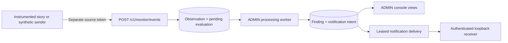

# Tines monitoring

ExecBound can receive selected story events while vendor connectors and credentials stay in Tines. The implemented path is **explicit instrumentation → observation → finding → notification**, with console monitoring views, source lifecycle/health and read-only collection. The supported delivery command targets a local receiver; the jobs service runs `monitor-process` on a schedule without delivering findings ([Processes and their inputs](DEPLOYMENT.md#processes-and-their-inputs)). A 13 October external HTTPS trial qualified the existing outbox worker against a dedicated Tines test tenant using local test wiring; it did not add a production destination configuration or hosted delivery drain. The reproducible demonstration is synthetic. A separate live Tines account trial on September 14, 2026 also passed using a dedicated story, synthetic action metadata and a temporary HTTPS intake.

## What runs



These records cannot authorize protected execution, create approvals, settle provider effects or consume/refund execution limits. A source-reported success is not independently verified impact. An unknown action remains `INSUFFICIENT_EVIDENCE`.

| Component | Implementation |
| --- | --- |
| Envelope and source identity | [models.py](../src/execbound/monitoring/models.py), [store.py](../src/execbound/monitoring/store.py) |
| Tenant schema and grants | [0008_monitoring](../migrations/versions/0008_monitoring.py), [runtime catalog](../src/execbound/db.py) |
| Strict HTTP intake | [http.py](../src/execbound/monitoring/http.py) |
| Intake-only temporary tunnel origin | [ingress.py](../src/execbound/monitoring/ingress.py) |
| ADMIN views and acknowledgement | [console API](../src/execbound/surfaces/console_api/monitoring.py), [console page](../console/src/routes/monitor.tsx) |
| Local notification transport/recovery | [worker.py](../src/execbound/monitoring/worker.py), [delivery.py](../src/execbound/monitoring/delivery.py), [receiver.py](../src/execbound/monitoring/receiver.py) |
| Operator commands and Tines check | [commands.py](../src/execbound/monitoring/commands.py), [tines.py](../src/execbound/monitoring/tines.py) |
| Reproducible browser walkthrough | [monitoring_demo.py](../scripts/monitoring_demo.py) |

## Credentials and the env file

Put the Tines settings in a private env file such as `.env.tines` at the checkout root (`.gitignore` covers `.env.*`). Never paste its contents into issues or logs.

```dotenv
TINES_BASE_URL=https://your-tenant.tines.com
TINES_API_KEY=
EXECBOUND_MONITOR_URL=http://127.0.0.1:8120
EXECBOUND_MONITOR_SOURCE_ID=
EXECBOUND_MONITOR_TOKEN=
```

The first two fields configure only the explicit management API check. The three `EXECBOUND_MONITOR_*` fields are operator notes for story setup; the service does not silently load them. The Tines key and ExecBound source token serve different directions and must remain separate. The source token authenticates one reporting story, not an administrator or execution agent.

The check command reads the named file with interpolation disabled, accepts a Tines HTTPS tenant origin only, and makes one stories-list request. It disables redirects and ambient proxy configuration and prints only a fixed access result. It does not fetch or persist response content, enumerate all connectors or start collection. Use it only after selecting an account/scope you are permitted to test:

```sh
uv run python -m execbound.monitoring.commands check-tines --env-file .env.tines
```

Use a service/team key with the least story access needed. Authentication uses the documented `X-User-Token` header; see [Tines API authentication](https://www.tines.com/stories/docs/api/authentication/). A successful check establishes stories-list access only, not audit or AI-event coverage.

## Run the synthetic browser demonstration

First follow the repository's Python/PostgreSQL setup. Migrate the **local development** database to head; the app never migrates automatically.

```sh
uv run alembic upgrade head
uv run python -m execbound.monitoring.commands init-demo --output local-data/monitoring-private-1.json
uv run python scripts/monitoring_demo.py --private local-data/monitoring-private-1.json --output local-data/monitoring-evidence-1
```

Use a fresh private config and evidence directory on each full run. The fixture creates a new synthetic tenant, an eight-hour ADMIN credential, one eight-hour story token and local signing material. It requires matching loopback `execbound` owner/runtime database URLs. It never prints tokens. The harness expects new state, owns local ports **8120–8121** — `init-demo` takes `--gateway-port` and `--receiver-port`, so a second run on the same machine can take a different pair, and a run that cannot take a port says which one — starts/stops its own processes, logs in with Chromium, sends a heartbeat and reported `identity.disable`, evaluates and delivers one finding, acknowledges it, and checks four views at desktop and 390px width.

Only screenshots taken after login and a small synthetic result summary enter the evidence directory. Private config and receiver receipts stay under `local-data`. CI runs this walkthrough on every change.

For manual use, open separate terminals from this checkout:

```sh
uv run python -m execbound.monitoring.commands serve --config local-data/monitoring-private-1.json
uv run python -m execbound.monitoring.commands receiver --config local-data/monitoring-private-1.json --output local-data/manual-receipts
```

Open `http://127.0.0.1:8120/login`, sign in using `admin_token` from the private file, and follow **Monitoring**. In a third terminal:

```sh
uv run python -m execbound.monitoring.commands emit-demo --config local-data/monitoring-private-1.json
uv run python -m execbound.monitoring.commands process --config local-data/monitoring-private-1.json --deliver-local --limit 50
```

`serve` configures no execution connectors. `process` without `--deliver-local` evaluates only; findings and pending notifications remain visible. Neither worker nor receiver runs automatically. The test suite rebuilds its schema, so give each checkout its own database, never one holding data you need.

Provisioning never overwrites an existing output. It also writes private, fsynced phase files in a sibling `.<output-name>.recovery-*` directory: ADMIN credentials before database work, source attempt metadata, and complete issued credentials in `config-ready.json` before final publication. If initialization fails, preserve these files. When `config-ready.json` is complete and valid, copy it privately to a **new** path; do not replay provisioning. Otherwise reconcile the saved tenant/story/time/source selectors using the retained ADMIN credential, and revoke an incomplete source before fresh issuance. A lost source secret cannot be recovered from its database digest. Known source input/authority/capacity rejection removes only this invocation's still-empty output and records `not-provisioned.json`; uncertain or post-commit failures retain artifacts. These recovery files contain secrets and must stay outside version control.

## Register and instrument a real story

A current ADMIN can provision one source with a file containing its existing ExecBound ADMIN credential:

```sh
uv run python -m execbound.monitoring.commands create-source --credential-file local-data/admin-token.txt --label "Security lab" --story-id 12345 --hours 8 --output local-data/story-source.json
```

The output is exclusively created, owner-only (mode 0600) where the platform carries POSIX modes, and contains the source token. Expiry is 1–24 hours in this CLI. Rotate and revoke reporting tokens with the commands below; do not edit receipt history to reset it. The source records the administrator who created it, beside who rotated and revoked it, and lands in the workspace's first Space, which must be one that administrator administers and that is not archived: the command has no option to choose another Space, so where the first is archived, unarchive it with `execbound space-unarchive`, and where the administrator is seated only elsewhere, seat them there with `execbound space-assign` or, where the deployment connects Tines from the console, add the source there in the Space it belongs to. Either refusal is recorded in `not-provisioned.json` (`SPACE_ARCHIVED` or `INVALID_ADMIN`). A story that already has an unrevoked source in that Space that can still take its events, expired or not, is refused `SOURCE_EXISTS` (recorded in `not-provisioned.json`): rotate that source instead. A source that has kept its 10,000 events, which rotation does not reset, refuses none, and still takes its story's heartbeats, so create the story's source again while it stands, give the story the new token, and only then revoke the full one with `revoke-source`: revoking is final, and a workspace already holding 100 sources, revoked ones included, refuses the new one `SOURCE_CAPACITY` with nothing changed.

### Add a reporting source from the console

Where the deployment gives the collector's public key (the same condition as [Connect Tines from the console](#connect-tines-from-the-console)), an administrator adds a reporting source from Monitoring, Connections, with **Add a reporting source**, or from Inventory with **Report this story** beside a discovered story that has an open coverage gap and no unrevoked source (a story whose source was revoked included), which fills in the story's ID. A story with an unrevoked source names that source instead, and says whether it can report now: Inventory reassesses a story's gap only when it is read again, so a source added a moment ago appears beside a gap that stays open until the next inventory pass, and reads as able to report. A revoked connection is never collected again, so its stories keep the gaps they had, and a source beside one says that the connection was revoked and that no pass reassesses the story. A source whose token has expired says so and that its token is rotated, or the source revoked, from Connections (or with `rotate-source` where the console mints nothing), or, to an administrator who only reviews its Space, that its Space's administrators do so. A source in a Space the reader does not see is named by its identifier alone: nothing about its token is shown there, whether it has expired included, and its story offers nothing. The form takes a name, the Tines story ID, how long the token lives (1, 7 or 30 days, 30 by default) and how often the story sends its heartbeat (every 5, 15 or 60 minutes, 5 by default; never every minute, which the health pass would call silent before most stories are built, though a source added every minute before keeps that interval). It says what the token can do: it authorizes intake only, for that one story, and cannot run actions, approve requests or read anything from ExecBound. A story has one unrevoked source in a Space that can still take its events, expired or not: adding another is refused `SOURCE_EXISTS`, and the existing source is rotated instead. A source that has kept its 10,000 events, which rotation does not reset, refuses none and still takes its story's heartbeats, so its card says to add the story again first and to revoke it once the story reports through the new token, never before: revoking is final and stops its heartbeats, and a full workspace refuses the new source with nothing changed, leaving the full one as it was. So when the answer to **Create source** does not arrive, the form says the source may have been created rather than that nothing changed, and trying again cannot add another.

The token is shown once, in a dialog that closes on its own button only, beside the intake address, how to hold the token in a Tines Text credential restricted to the intake host and referenced as `Bearer <<CREDENTIAL.your_credential_name>>`, and a heartbeat body with the story ID filled in; the token is in no line of that recipe. The answer that carries it is `Cache-Control: no-store`, no other answer carries it, and the database keeps its SHA-256 only. Once the dialog closes, the source's card waits for the first heartbeat: it reads the source every ten seconds while the page is visible, for at most ten minutes, and says when the story is reporting. The health pass calls a source that has never reported stale twice its heartbeat interval after the mint, so, at every interval the console offers, no sooner than ten minutes after it, and opens a finding that it never reported, which stays open until someone acknowledges it; the card's ten minutes start only when the token dialog closes, so should it see that verdict while it still reads, it says no heartbeat came and what to check, and goes on reading for the rest of its ten minutes, so a first heartbeat after it still shows the story reporting. The card waits ten minutes whatever the interval, so a story with a 15- or 60-minute heartbeat can send its first one after the card has stopped: unless the health pass has already called the source silent, the card's last line then says the first can take that long, to reload later, and that the source is marked stale 30 minutes or 2 hours after it was added, the point at which to check the story, rather than telling you to check it now. The source's **Last heartbeat** shows the heartbeat once the page's own read, every 30 seconds while it is visible, or a reload has it, and the waiting card, on Connections or Inventory, then says the story is reporting, after its ten minutes too. The card says to reload only after one more read once the ten minutes are up, made on the reader's return if the page was hidden then; from then on it reads the source again each time the reader comes back to the page, and if the last read fails it says it has stopped checking on its own and to reload. Each source's card offers **Rotate token**, with a grace of none, 10, 30 or 60 minutes for the previous token, which shows the new token the same way and warns when an earlier rotation's grace is still running (a source keeps one previous token, so rotating again ends that grace at once), and **Revoke**, which refuses every token the source ever had at once. Minting, rotating and revoking ask for a recent second factor and refuse a personal access token. Without the collector's public key the console mints and rotates nothing (`CONNECT_UNAVAILABLE`), and still reads and revokes a source made earlier.

A token minted or rotated anywhere, from the console or the command line, lives at most thirty days. Source lifecycle stays on the source's own row and off the execution audit chain, from the console as from the command line.

Rotate a token before it expires, or reissue an expired one, as a current ADMIN:

```sh
uv run python -m execbound.monitoring.commands rotate-source --credential-file local-data/admin-token.txt --source <source id> --hours 8 --grace-minutes 10 --output local-data/story-source-rotated.json
```

The new token is written once to the exclusively created output file. The previous token keeps reporting for the grace window (0 to 60 minutes, never past its own expiry, and not at all once it has expired), so update the Tines credential within that window; the Connections page shows the deadline. A source keeps only one previous token: a rotation inside an earlier rotation's grace makes the token it replaces the previous one and stops the earlier token at once, so rotate again only once the story holds the latest token, or choose the grace knowing that. Revoke a source that must stop reporting at once, whatever token it holds:

```sh
uv run python -m execbound.monitoring.commands revoke-source --credential-file local-data/admin-token.txt --source <source id>
```

Revocation is final: a revoked source cannot be rotated, and reporting needs a newly registered source. Both commands recheck the administrator's current credential inside the monitoring registry lock, record the acting administrator on the source, never touch execution state, provider connections or the execution audit chain, and are refused for other tenants' sources and for non-ADMIN credentials.

The importable example story [`integrations/tines/execbound-monitor.json`](../integrations/tines/execbound-monitor.json) carries the reporting actions to copy: a result body, a scheduled heartbeat, one report action and two exits, described in [its README](../integrations/tines/README.md#the-monitor-story-report-what-your-own-stories-do). Register the source with the Tines story id that will report, since the example takes `story_id` from `META.story.id`. By hand, the same thing is an HTTP Request action that sends only the agreed metadata to `/v1/monitor/events`, with `Authorization: Bearer <source-token>` and `Content-Type: application/json`. Store that reporting token as a Tines credential. Existing vendor keys remain in their existing connector actions. The gateway must be reachable from the sender over a deliberately configured HTTPS origin; a cloud Tines story cannot reach your workstation's loopback URL. The temporary trial procedure below supplies an intake-only origin. For a permanent intake, serve your deployment's gateway over HTTPS ([TLS termination and origin](DEPLOYMENT.md#tls-termination-and-origin)) and point the story at that origin.

Example body (substitute a current timestamp and stable source event identifier):

```json
{
  "version": 1,
  "event_id": "story-run-42-action-7-result-1",
  "story_id": "12345",
  "occurred_at": "2026-09-14T18:00:00Z",
  "kind": "tool_result",
  "action": "identity.disable",
  "target_ref": "lab-user-17",
  "outcome": "success"
}
```

Map an action name only when the story actually performs that operation. Preserve an unknown label if the operation cannot be established. `outcome` is `success`, `error` or `unknown`; report error branches as well as successes. Do not send raw action payloads, email addresses, arguments, prompts, authorization headers or URLs. Identifier fields allow only letters, digits, dot, underscore, colon and hyphen (96 characters, action 64). Target reference is optional.

For ongoing instrumentation, add an independent scheduled heartbeat that exercises the reporting path even when there are no business events. It has `kind: "heartbeat"`, its own unique `event_id`, matching `story_id`, current `occurred_at`, and no action/target/outcome fields. The default interval is 300 seconds; the Connections page shows **Stale** after two missed intervals. This is reporting freshness, not evidence that every connector call is observed. Route reporting failures to a separate Tines error path; otherwise a broken reporting action can silently remove coverage. The example story schedules its heartbeat every five minutes on the same report action as its results, which keeps the two one Tines flow, and routes every refused or unanswered report to its `Reporting failed` exit. The September 14 trial below used a manual heartbeat; the example story's scheduled heartbeat has since been run live, stopped until the source read **Stale**, and resumed.

## Temporary HTTPS trial and the Tines settings it needed

For an explicitly selected test account, run the local services from a private monitoring config as described above. In another terminal start the separate intake origin:

```sh
uv run python -m execbound.monitoring.ingress --port 8122
cloudflared tunnel --no-autoupdate --url http://127.0.0.1:8122 --protocol http2
```

Install `cloudflared` from its official release and verify the published checksum first. A [Cloudflare Quick Tunnel](https://developers.cloudflare.com/cloudflare-one/networks/connectors/cloudflare-tunnel/do-more-with-tunnels/trycloudflare/) gives this explicitly started process a temporary random HTTPS hostname. It is a testing facility without an uptime guarantee. Point the tunnel only at **8122**. That origin accepts exactly `POST /v1/monitor/events`; other paths/methods, encoded aliases and websocket connections are rejected. It binds loopback, requires the local `execbound` database with `execbound_app`, and configures no execution or administrator runtime. The ADMIN service on 8120 and alert receiver on 8121 stay local.

The live trial established these Tines settings:

1. Use a separate, expiring Text credential containing the story's ExecBound source token. Restrict its allowed destination to the exact HTTPS intake URL. Tines requires [credential domain restrictions](https://www.tines.com/docs/credentials/credential-configuration/domain-restriction/) for this outbound use. Reference it as `Bearer <<CREDENTIAL.your_reporting_credential>>`; never use the management API key as the reporting token.
2. Keep `story_id` a JSON **string**, including when the Tines ID contains only digits. In the HTTP Request action, remove `content_type`, explicitly set the `Content-Type: application/json` header, and supply `payload` as **JSON text**: the example story uses `=TO_JSON(...)` over a formula object. Tines' `content_type: "json"` smart validation sends a digit-only string as a number, which the strict intake correctly rejects with `INVALID_EVENT`. A later trial reproduced this with a formula object as well as with a text template, so the explicit header and `TO_JSON` are the fix, not the formula. A dictionary payload with the explicit header is also rejected by Tines. See [HTTP Request options](https://www.tines.com/stories/docs/actions/types/http-request/).
3. For the test webhook with `include_headers: false`, input fields appear directly under the webhook slug: `<<your_webhook.event_id>>` and `<<your_webhook.occurred_at>>`, without `.body`. This keeps webhook authorization headers out of emitted events. Use validated UUID/timestamp inputs for this synthetic text-template example; serialize and escape arbitrary values before adapting it to other data.
4. Give the action result and heartbeat different event IDs; retain the same IDs and timestamps on a retry. Disable redirects on reporting actions. Trigger the dedicated webhook using its separate bearer secret, not the Tines management key.
5. Run the explicit `process --deliver-local` command. Receipt alone does not run evaluation or delivery. Check the HTTP action's emitted response events, stored observations and local receiver receipt. A same-payload repeat should return 200 with `duplicate: true` and create no additional alert.
6. Disable the test story and stop the tunnel, intake, receiver and ADMIN processes after the trial. Keep the private source/config/recovery files. Before another trial, check expiry, provision a fresh source if required, update the reporting credential and both actions to the new HTTPS URL, and update its domain restriction before enabling the story. Never assume the previous tunnel hostname is reusable.

Observed result: two Tines HTTP responses with 202, followed by two duplicate responses with 200 referencing the same observation IDs. PostgreSQL retained two observations (`MATCH` for the simulated action and `NO_MATCH` for its heartbeat), one finding and one `DELIVERED` notification after one attempt. An identical repeat produced no new evaluation or delivery work. Chromium verified all four ADMIN views at desktop and 390px widths, including acknowledgement. No vendor operation was performed. The story was disabled and all four trial processes stopped after verification; no continuous collection is running.

Keep a trial's state and configuration files, and the receiver's receipts, outside version control: they hold the webhook secret and ADMIN, source and signing credentials.

## Intake, evaluation and delivery contract

| Boundary | Behavior |
| --- | --- |
| HTTP | `POST /v1/monitor/events`; bounded 16 KiB JSON, five-second body deadline, eight intake slots; no compressed bodies, duplicate keys, caller tenant fields or query identity |
| Authentication | `mo1` source token; exact tenant/source/story, active state, expiry and revocation checked under source row lock; `eb1` agent/ADMIN tokens cannot ingest |
| Receipt | A new tool result returns 202 with observation ID; identical normalized retry returns 200; conflicting reuse returns 409 and retains an integrity finding without replacing the original. A heartbeat updates only the source's last-heartbeat receipt time and returns 202 with `observation_id: null` and `duplicate: false`, including on retry; it creates no observation or evaluation work |
| Bounds | 100 registered sources/tenant; 10,000 retained observations/source over its lifetime, unchanged by token rotation; 120 authenticated attempts/source/minute, heartbeats included. Heartbeats do not consume observation capacity and work even when it is full. Heartbeat rows retained by older releases stay and still count; no automatic retention purge. Capacity/rate refusals are visible on the source |
| Evaluation | Receipt and pending work commit atomically. Completion, finding and notification intent commit atomically. Worker batches use row locks and stable unique bindings |
| Rules | `sensitive-action.v2` matches `endpoint.isolate`, `identity.disable`, `identity.enable`, `identity.revoke_sessions`, including reported error/unknown outcomes. Other actions are insufficient evidence. `source-event-integrity.v1` records conflicting reuse |
| Human access | An ADMIN session for `/monitor?view=...`; that session, or an administrator's own personal access token, for its console API. Legacy `/monitor/{view}` links redirect. A session's acknowledgement additionally needs same-origin POST and CSRF; a token's does not, as for every console API route. Both need the same-tenant finding lookup, held to the spaces the caller sees: a finding in another space answers as one that does not exist. Each acknowledgement is audited as `monitor.finding_acknowledged`, naming the credential that acted, and may carry an optional note of up to 500 characters, screened like every other piece of people's text and refused when it is shaped like a secret. An acknowledgement is final: the database refuses any change to it once made. Acknowledging many findings in one request is held to a browser session and an inline confirmation; a token acknowledges one finding per request. Snapshots show latest 200 rows per table; the Findings view reads its own list by state, whose counts include findings beyond the 200 shown |
| Delivery | Explicit loopback-only destination, no redirects/proxies, five-second send timeout, 30-second lease, stable delivery ID, at most five attempts, bounded exponential retry delay |
| Receiver proof | HMAC-SHA256 authenticates canonical delivery UUID + newline + exact payload bytes. The local receiver persists once before acknowledgement and rejects changed-ID replays or conflicting duplicates |

Delivery is at least once with receiver deduplication. A process crash after receiver acceptance leaves a recoverable lease; retry retains the ID and payload. A fifth expired lease becomes `FAILED / DELIVERY_UNCERTAIN` with no sixth send. `RECEIVER_UNAVAILABLE` also does not prove no receipt: responses can be lost. Inspect the receiver by delivery ID before treating a terminal failure as undelivered. Finding acknowledgement is separate from delivery status.

The local demonstration's notification contains only version, kind, delivery/finding/source/observation identifiers and rule version. It omits target references, raw results and credentials. The local receiver is a development fixture, not a production webhook service or delivery guarantee across disk failure.

## Detection profiles and rules

Rules are versioned and detective; they never call `admit`, consume an approval or reserve impact. Without a profile the built-in sensitive action set (`endpoint.isolate`, `identity.disable`, `identity.enable`, `identity.revoke_sessions`) drives `sensitive-action.v2`, and the Findings page states that `restricted-target.v1` and `observed-rate.v1` are inactive. A current ADMIN configures a tenant with an immutable profile version:

```sh
uv run python -m execbound.monitoring.commands set-profile --credential-file local-data/admin-token.txt --input profile.json
uv run python -m execbound.monitoring.commands show-profile --credential-file local-data/admin-token.txt
```

```json
{
  "sensitive_actions": ["identity.disable", "unknown"],
  "restricted_targets": ["dc-01", "tier0-*"],
  "burst_threshold": 20,
  "burst_window_seconds": 300
}
```

`sensitive_actions` replaces the built-in set, and under a profile an unlisted action evaluates as `NO_MATCH`; without a profile it stays `INSUFFICIENT_EVIDENCE`, because the built-in set is not a tenant statement of what is benign (listing `unknown` records a separate finding for tool results whose action the story could not establish; their evaluation stays `INSUFFICIENT_EVIDENCE`). `restricted_targets` are exact target references or prefixes ending in `*`; a match records `restricted-target.v1`. The burst rule counts tool results received from one source in the trailing window (by receipt time, because reported time can be skewed) and records one `observed-rate.v1` finding per window episode once the threshold is reached. Each `set-profile` inserts the next version and retires the current one; every finding a profile produced carries its version, so a later change never rewrites why an earlier finding exists. Invalid files are refused with field locations and no values.

## Source health and clock skew

`process` also evaluates receipt-time health for every active, unexpired source: a source whose latest heartbeat or event (or, before any signal, its registration) is older than twice its heartbeat interval becomes `STALE`, and each new gap records one durable `source-health.v1` finding ("Source never reported after registration" or "Source stopped reporting") that the outbox delivers like any other finding. A heartbeat or event returns the source to `REPORTING` without a finding; the next gap is a new episode with its own finding. Revoked and expired sources are not evaluated. The Connections page shows the health state and when it changed.

A collection connection's freshness is decided at read time, by one rule the setup check and the Connections page share: a connection is overdue a day after its last collection run of any outcome, or its registration if it never ran (a connection the collector opens itself, such as a sealed one, at twice its own interval if that is sooner), or two days after its last inventory sync, whichever comes first, and reads **Collecting** in green only while its last run completed within that time, it has synced, and no capability it needs is forbidden. Inventory is re-read on the first run after a day has passed, which is why the sync window is two days rather than one. A stale source and an overdue connection are both quiet: they are listed first on Connections and counted beside Monitoring in the sidebar and on Home. Findings are not sent outside the console in this release: they appear under Findings, in the count beside Monitoring and on Home, and the loopback receiver above is a development fixture. Email, Slack and Teams carry approval notifications only.

Event time is never rewritten. An observation whose reported `occurred_at` is more than five minutes after receipt, or more than a day before it, is evaluated as usual and additionally records a `clock-skew.v1` finding bound to that observation, so an implausible external clock is visible without silently correcting it. Late and out-of-order events within those bounds are accepted in receipt order with their reported time intact.

## Read-only discovery and collection

Collection adds platform reads beside the event push. A current ADMIN registers one collection connection with a read-only API key that stays in a private env file; the row keeps the key's SHA-256 fingerprint, so a key file that is not the registered one is refused before any request is made:

```sh
uv run python -m execbound.monitoring.commands create-connection \
  --credential-file local-data/admin-token.txt --label "Tines tenant" --key-file .env.tines [--team-id 7]
uv run python -m execbound.monitoring.commands collect-tines \
  --credential-file local-data/admin-token.txt --connection <id> --key-file .env.tines \
  [--inventory] [--audit-pages 20]
uv run python -m execbound.monitoring.commands revoke-connection \
  --credential-file local-data/admin-token.txt --connection <id>
```

One run probes each capability (`stories`, `actions`, `credentials`, `audit`, `ai_audit`) with one bounded request and records the classification; syncs allowlisted story, action and credential metadata when `--inventory` is given or a day has passed; pulls audit records from the durable cursor with a five-minute overlap; and reconciles coverage. Every request is a `GET` to the registered origin with redirects, ambient proxies and in-run retries disabled, the body capped at 4 MiB and the timeout at 10 seconds. The command prints counts and codes only.

Each page of audit records, its pending evaluations and the cursor advance commit in one transaction, so a failure re-reads the page instead of skipping one, and the overlap plus `(tenant, connection, event_id)` uniqueness makes the re-read free of duplicates. A `429` ends the run as `RATE_LIMITED` with the `Retry-After` value retained, a `401` or `403` as `AUTH_LOST`, and a cursor older than the vendor's 30-day retention floor as `RETENTION_GAP`; none of them is retried inside the run. The first collected record pins the platform tenant the connection speaks for, and a later record claiming a different one is quarantined with a health finding rather than stored.

Collection retains metadata only. Action `options`, credential values, audit `inputs` and `outputs`, model prompts and completions, user email addresses and names, request addresses and user agents are dropped in the parser and never reach the database, a log or a page. An `AiModelRun` keeps the model identifier and the token counts; an `AiToolRun` keeps the tool name and its status.

Coverage reconciles a discovered story against a registered reporting source **by the platform story identifier**, so register a source with the story's Tines id for its coverage to reconcile; the Connections page reports how many sources match no discovered story. A story keeps an earlier source on record beside the one that replaced it, revoked or left to expire, and coverage reads one source per story on every pass: a live one first, then the one heard from last, then the newest, so a replacement closes the gap whatever earlier source remains. Three rules evaluate collected evidence: `monitored-path-change.v1` (a change on a registered story, or any credential change), `instrumentation-gap.v1` (one finding per episode for a story with outbound actions and no source) and `collection-health.v1` (lost permission, three consecutive rate limits, a retention gap, five consecutive backlogged runs, a capability that stopped being available, and a quarantined foreign tenant). A collected `ai_tool_run` matches the sensitive-action rule only through the detection profile's `ai_tool_actions` map; an unmapped tool name stays insufficient evidence.

A capability the tenant's plan excludes answers `422`, which classifies `unsupported` like a missing endpoint; the vendor's message body is never read, because "not available on this tenant" is the whole fact. A tenant without the audit feature still collects inventory and coverage, and the Connections page shows the audit and AI capabilities as unsupported rather than as an unknown.

A live probe on September 16, 2026 confirmed the inventory half against a real tenant: the action list path (`/api/v1/actions?story_id=`, not a story sub-resource), the `agents` list key, the allowlisted fields on story, action and credential records, and the pagination `meta` shape. The audit half stays **fixture-verified**: no Tines plan with audit logs has been available to test against, so the audit time filter, the `TINES_OPERATIONS` names, the AI operation names and the rate limits are still unconfirmed, and the pages say so.

## Connect Tines from the console

Where the deployment gives the collector's public key, an administrator connects Tines from Monitoring, Connections, without a host or a command: a connection name, the tenant's address, an optional team and a read-only API key, pasted once. The web service seals the key to the collector's public key before anything is written, in an envelope that binds it to the workspace, the connection and the kind, and keeps the ciphertext beside the key's SHA-256; it can write a key and never read one back. Only the collector's private key opens it. The connection is `sealed`, belongs to the Space the administrator is looking at, and is asked for its first collection. The form names that Space as the server will place the connection, and in a Space the administrator only reviews, or an archived one, or where no Space is chosen, it says so on its first step and goes no further, so it asks for neither the key nor any factor; should the Space turn out to be one of those only once the key is being asked, because the session has moved, it says so there and sends nothing. A connection's own actions on its card (Collect now, Schedule, Replace key and Revoke) are still offered in a Space its administrator only reviews; the server refuses them there (`FORBIDDEN`, after the factor for Replace key and Revoke), and the card or its dialog says the Space is one they review.

The collector's key pair is the deployment operator's, written once:

```sh
uv run python -m execbound.monitoring.commands collector-keygen --output <directory>
```

`collector-public.json` goes into the runtime configuration as `scout.collector` (`{"key_id", "public_key"}`); `collector-private.json` stays with the collector alone, given to `collect-due --collector-key`. Without the block, Connect Tines is not offered and the console says who connects a provider. `collect-due` reads a due sealed connection's ciphertext once it holds the connection's lease, so a key replaced while the pass was under way is the one it uses, and opens it with that key; a connection whose key it cannot open (no collector key, a key it was not sealed to, a damaged ciphertext) is recorded `ERROR` with `COLLECTOR_KEY_UNAVAILABLE`, one whose envelope names another connection or workspace `SEALED_KEY_MISMATCH`, and one whose key is not the registered one `KEY_MISMATCH`, each before any request is made.

To move to a new collector key, work in this order, so that no connection is ever sealed to a key the collector does not hold:

1. Write a new pair with `collector-keygen`.
2. Give the collector both private keys. `collect-due` takes `--collector-key` more than once and opens a connection sealed to any key it is given; a path that names no file is no key. The jobs service names `collector-previous.json` beside `collector-private.json` whenever its collector directory holds it, so the key being retired goes there and the new private key takes its place.
3. Put the new public half in `scout.collector`, in every configuration copy that serves the web service, and restart the web service. Every key pasted from then on is sealed to the new key.
4. Re-seal what was sealed to the old key:

   ```sh
   uv run python -m execbound.monitoring.commands collector-reseal \
     --old-key <old collector-private.json> --new-key <new collector-public.json> --all-tenants
   ```

   Every sealed connection, a revoked one included, is opened with the old key and sealed again to the new one with its fingerprint unchanged, but only while it still holds the ciphertext the re-seal read: a key an administrator replaced in the meantime is kept, counted `failed`, and moved by the next run. Run it again until it reports no `resealed` and no `failed` connection. A connection sealed to neither key is left alone and counted `other_key`. A deactivated workspace is not visited and is counted `inactive`: its connections stay sealed to the old key until a run after it is reactivated.
5. Only then take the old private key away from the collector. Keep it, offline, only while a deactivated workspace still holds a connection sealed to it.

Re-sealing protects what is sealed from then on. If the old private key was exposed, every key sealed to it may already have been opened by whoever also read the database or a backup of it: revoke those keys in Tines and replace them from the console.

Each connection's card names its credential ("Key sealed for the collector" or "Operator key file") and offers Collect now, Schedule, Revoke and, for a sealed connection, Replace key. Collect now asks the next scheduled pass to collect; it is not a collection. Connecting, replacing a key and revoking ask for a recent second factor and refuse a personal access token. Each change, from the console or from `create-connection` and `revoke-connection`, appends an informational event to the audit chain naming the connection and the credential that acted, never the key ([audit events](AUDIT_EVENTS.md)). A sealed connection is overdue on its own schedule: twice its audit interval, so 30 minutes by default, or a day, whichever is shorter.

## Scheduled collection and evaluation

`collect-due` collects every connection that is due, and `process --all-tenants` evaluates every workspace, with no workspace credential: each workspace is visited as its own scheduled actor, admitted only while the workspace is active and only under that workspace's own database fence. Neither appends to the audit chain, and neither delivers a finding.

```sh
uv run python -m execbound.monitoring.commands collect-due --all-tenants --key-files /srv/state/key-files
uv run python -m execbound.monitoring.commands process --all-tenants --limit 50
```

A connection is due a whole interval after its last run of any outcome, or since its registration if it never ran, or as soon as an administrator asks for a collection. A run the platform rate-limited is not followed before the `Retry-After` the platform gave, even when an administrator asks. For a Tines connection the interval is the audit interval, 15 minutes unless set between 5 and 60, and the inventory is re-read daily; for an Entra connection it is the collection interval, 6 hours unless set between 1 and 24. Between an Entra connection's full collections, each pass also gives it a delta pass, after the due collections and within the same per-workspace cap and budget: it reads only the directory's changes since the last pass, inside the same lease, and never records an outcome, moves the connection's next due time or answers a collection request ([Scout](SCOUT.md#between-full-collections-delta-the-baseline-and-the-new-actor-rules)). Every Entra run, full or delta, then reads the directory's audit log from the connection's cursor, which never changes the run's outcome ([Scout](SCOUT.md#what-the-directorys-own-audit-log-shows)). The Connections view shows each connection's schedule and when it is next due, by the same rule `collect-due` reads. A connection registered with an operator key file (`create-connection --key-file`) is collected only where the collecting host holds `<key files>/<connection id>.env`, the same file `collect-tines` or `collect-entra` reads. Without that file the connection is counted `no_key_file` and nothing is recorded on it, because the file may live on an operator's own host. A file that is not a key file, or holds a key that is not the registered one, is recorded on the connection as `ERROR` with `KEY_FILE_INVALID` or `KEY_MISMATCH` and is never sent.

Every collection run, scheduled or an operator's, first takes the connection's lease, for at most fifteen minutes by the database's own clock, and proves it on every write to the connection. Two runs never collect one connection at once: `collect-tines` and `collect-entra` exit with "Collection already running for that connection." while a scheduled run holds it. A run whose connection is revoked mid-run, or that outlived its lease and lost it to the next run, writes nothing more and stops; a lease that expired unfinished is recorded on the connection as `INTERRUPTED` (`RUN_INTERRUPTED`) by the next claim, unless it was an Entra delta pass's, which records no outcome when it finishes and none when it stops. One pass starts at most four connections per workspace (`--per-tenant`) and nothing after 240 seconds (`--budget-seconds`); a connection it did not reach is due first on the next pass. Its output, like its log line `monitor.collect_due`, is counts per workspace and never a key; the output also counts each workspace's delta passes, `delta` for those that completed and `delta_failed` for the rest, and its runs whose read of a directory's audit log was refused, `audit_failed`, or stopped by its pages before catching up, `audit_backlog`, and the log line carries the four totals, because neither a delta pass nor an audit read records anything on its connection's outcome. One workspace's refusal is its own line in the report, never the exit code.

`process --all-tenants` evaluates each active workspace's pending observations, its sources' health, its derived reach and, after that reach, each directory actor's first consequential action taken outside ExecBound (`first-consequential-action.v1`, [Scout](SCOUT.md#between-full-collections-delta-the-baseline-and-the-new-actor-rules)), as `process --config` does for one administrator, and delivers nothing: a receiver is configuration that only `--config` names, so a finding it raises stays queued for delivery. Each workspace's line in its report counts `evaluated` observations, `health_changes`, derived `reach` and the `actions` findings raised. A pass evaluates up to `--limit` pending observations, oldest received first, and beside them up to 400 of a directory's audit-log observations, which raise nothing of their own, so a back-filled audit log never holds back an action a story reports ([Scout](SCOUT.md#what-the-directorys-own-audit-log-shows)). `--all-tenants` refuses `--config` and `--deliver-local` beside it. The jobs service runs `collect-due --all-tenants` every five minutes wherever its state directory holds a `key-files` directory or its collector directory holds the collector's private key, or the key a rotation is retiring, which it then names with `--collector-key`, or the platform app's credential, which it names with `--platform-app` ([Processes and their inputs](DEPLOYMENT.md#processes-and-their-inputs)).

## Remaining work

The 13 October 2026 external delivery trial
proved signed HTTPS receipt, retries, crash recovery and bounded deduplication in
the Tines lab from a local worker. Production delivery remains work: the shared destination
model, per-destination outbox, external egress controls and scheduled drain must
be built and then qualified on the hosted service. The trial's temporary receiver
has been removed.

Source lifecycle, health, detection profiles, delivery workers and collection are implemented. The intake trial above, the September 16 inventory probe and a later instrumented-story trial establish bounded live evidence, not continuous operation or all customer workflows. The supported delivery command uses the authenticated loopback receiver: the scheduled `monitor-process` job and `process --all-tenants` evaluate without delivering, and no shipped monitoring configuration enables email, Slack, Teams or HTTPS webhook delivery. Scheduled collection reaches a connection whose operator key file is on the collecting host, a Tines connection pasted in the console where the collector holds its private key, and a Microsoft Entra directory whose administrator consented to the deployment's platform app. Sources issued from the console live up to 30 days, so ongoing instrumentation still needs a rotation at least monthly; from the command line, at most 24 hours. Audit and AI-audit collection remains fixture-tested because no plan with audit logs has been available; broader live instrumentation, hosted delivery failure exercises and Foundry/OTel remain work. [Processes and their inputs](DEPLOYMENT.md#processes-and-their-inputs) describes the scheduling. Monitoring metadata does not reveal secret credential values, prove historical completeness, validate external approvals or prevent external execution.
